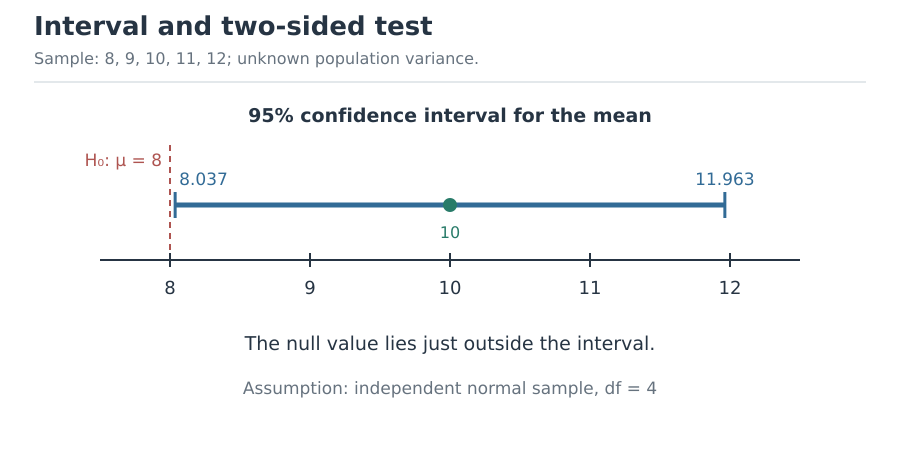

# M16-L2 – Statistical inference: diagnostic test and revision {#L2}

**Course area:** M16 – Bridge to the Master’s programme

**Level:** Transition · Supplementary/bridging requirements

**Prerequisites:** M6, M4.

**Learning objective:** Distinguish estimation, intervals and tests; identify the consequences of sampling assumptions.

## Diagnostic test: a series of measurements and a decision {#S1}

A sensor is read five times under controlled conditions: 8, 9, 10, 11, 12 units. For tasks A and B, assume independent normally distributed measurements with unknown variance.

A. Determine the mean, corrected sample variance and standard error.

B. Construct a two-sided 95% confidence interval and test $H_0:\mu=8$ against $H_1:\mu\ne8$ at level 0.05. Use the reference value $t_{4;0.975}=2.77645$.

C. A second working group examines ten independent null hypotheses, each at level 0.05, and reports only significant results. Calculate the risk of at least one false alarm if all null hypotheses are true. How can this risk be bounded without assuming independence?

## Worked solution: uncertainty is part of the estimate {#S2}

*Figure: Intervall und zweiseitiger Test.*

The deviations are −2, −1, 0, 1, 2. Hence $\bar x=10$, $s^2=10/4=2.5$ and $SE=s/\sqrt{5}=\sqrt{0.5}\approx0.7071$. Dividing by four instead of five accounts for estimating the mean. The standard deviation of individual values is not the same as the variability of the estimator.

$$I=\bar x\pm t_{4;0.975}\,SE\approx[8.037;11.963].$$

$$t=\frac{10-8}{\sqrt{0.5}}\approx2.828.$$

The absolute value exceeds the critical value 2.77645; $H_0$ is narrowly rejected. The interval just excludes 8. In a frequentist interval, probability refers to the long-run coverage of the procedure, not to a random parameter in this particular interval once calculated. The result may change if the model assumptions are violated.

In C, the complementary probability is $1-0.95^{10}\approx0.4013$. Bonferroni bounds the family-wise error rate using individual thresholds of $0.05/10=0.005$, even for dependent tests. This can be conservative. A test selected after inspecting the data is not equivalent to a single test specified in advance.

## Transfer: statistical and practical significance {#S3}

If only a change of three units were technically relevant, narrowly rejecting 8 would not demonstrate a sufficiently large change. This requires a predefined practical threshold and a suitable study design. Likewise, failure to reject does not imply equality. An equivalence test requires its own null hypothesis and justified tolerance limits. For paired observations, the dependence structure must be considered, for example by analysing the differences.

## Assessment and revision {#S4}

Award two points for each of the three tasks: correct method and result with interpretation. If the choice of distribution or degrees of freedom remains unclear, revise M6 (estimation, confidence intervals, tests); for multiple testing, revise the corresponding section in M6. Check question: if $n$ doubles while $s$ remains constant, the estimated standard error decreases by a factor of $1/\sqrt2$, not by half. An interval does not automatically become exactly half as wide.

## Sources and further reading {#S5}

- [NIST: Confidence interval approach, 7.2.2.1](https://www.itl.nist.gov/div898/handbook/prc/section2/prc221.htm) · t interval
