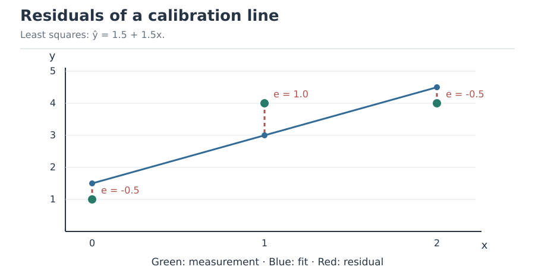

# M16-L3 – Linear models: diagnostic test and revision {#L3}

**Course area:** M16 – Bridge to the Master’s programme

**Level:** Transition · Supplementary/bridging requirements

**Prerequisites:** M8, M2.

**Learning objective:** Diagnose least squares, residuals and identifiability using a small model.

## Diagnostic test: a calibration line {#S1}

A test rig provides the synthetic pairs $(0,1),(1,4),(2,4)$. The first quantity $x$ is the setting, and the second $y$ is the measurement. A. Determine the line $\hat y=a+bx$ by least squares and calculate all residuals. B. Determine the residual sum of squares and $R^2$. C. An additional feature $z=2x$ is to be included. Can the extended model with an intercept be estimated uniquely? What conclusion about causality does the line permit?

## Solution: projection rather than joining points {#S2}

*Figure: Residuen einer Kalibriergeraden.*

We have $\bar x=1$, $\bar y=3$, a centred sum of cross-products of 3 and a centred sum of squares for $x$ of 2. Therefore,

$$b=\frac{\sum_i(x_i-\bar x)(y_i-\bar y)}{\sum_i(x_i-\bar x)^2}=1.5,\qquad a=\bar y-b\bar x=1.5.$$

The predictions are 1.5; 3; 4.5. With the convention $e_i=y_i-\hat y_i$, the residuals are −0.5; 1; −0.5. Their sum is zero; also, $\sum_i x_i e_i=0$. These are the normal equations for an unweighted least-squares solution with an intercept. The graphic shows the vertical distances to the line (not the geometrically shortest distances).

The residual sum of squares is $\mathrm{SSE}=1.5$, and the total sum of squares about the mean is $\mathrm{SST}=6$. Thus $R^2=1-1.5/6=0.75$. This describes the fit to precisely these three data points. There is only one residual degree of freedom; reliable statements about future predictive performance are unavailable.

With the additional feature $z=2x$, columns $x$ and $z$ are linearly dependent. The slopes $b_x$ and $b_z$ appear only as the sum $b_x+2b_z$; every pair with this sum equal to 1.5 produces the same fitted values. Resolving this requires changing the model or introducing a suitable additional assumption. Ridge can select a unique solution if both slopes receive a positive penalty, but it provides no additional empirical information about their separate effects.

## Transfer: checking the model {#S3}

Least squares does not require a normal distribution in order to minimise the sum of squares. Assumptions about the error structure become important for inferential statements. Residual plots can reveal nonlinearity and varying dispersion, but do not guarantee model validity. A slope is initially a conditional association; a causal effect requires, among other things, a suitable design or justified identification assumptions. A high goodness-of-fit value does not rule out confounding.

## Assessment and revision {#S4}

Two points per task: calculation or rank argument, and result with correct interpretation. If you make mistakes in A or B, revise [M8-L1](M8-L1.md) and residual analysis in M8. For C, revise linear dependence and rank (M2). Transfer question: if $x$ is expressed in a new unit as $u=10x$, the slope in $u$ becomes 0.15 for the same model class; the intercept and fitted values remain unchanged.

## Sources and further reading {#S5}

- [scikit-learn: Linear Models](https://scikit-learn.org/stable/modules/linear_model.html) · least squares and ridge
