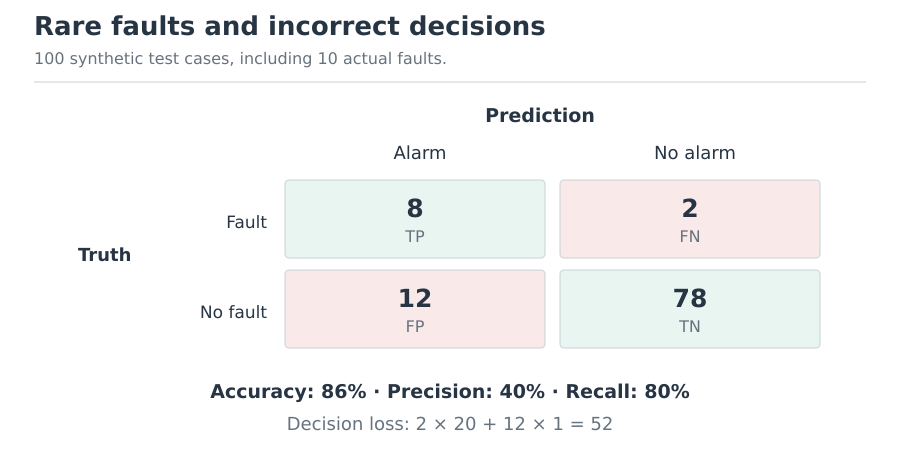

# M16-L4 – Statistical learning: diagnostic test and revision {#L4}

**Course area:** M16 – Bridge to the Master’s programme

**Level:** Transition · Supplementary/bridging requirements

**Prerequisites:** M10, M11, M14.

**Learning objective:** Recognise evaluation errors and assess a classifier by the relevant costs rather than accuracy alone.

## Diagnostic test: detecting rare faults {#S1}

A classifier for a fictitious facility is evaluated on 100 independent test cases. Ten are actual faults; the model detects eight of them, but also raises alarms in twelve fault-free cases. A. Determine the confusion matrix, accuracy, precision and recall. B. A model that never raises an alarm achieves 90% accuracy. Which alternative is preferable if a missed fault costs 20 and a false alarm costs 1, while correct decisions have no cost? C. A developer normalises all 500 observations before splitting the data, selects the best model using the test set and then reports its test score again. What errors have occurred and how would you design the procedure?

## Solution: matrix and decision loss {#S2}

*Figure: Seltene Störungen und Fehlentscheidungen.*

The four entries are $TP=8$, $FN=2$, $FP=12$, $TN=78$. In the matrix shown in the graphic, rows denote ground truth and columns denote decisions. The metrics are

$$\mathrm{Accuracy}=\frac{8+78}{100}=0.86,\qquad \mathrm{Precision}=\frac8{20}=0.4,\qquad \mathrm{Recall}=\frac8{10}=0.8.$$

The harmonic mean of precision and recall is $F_1=2\cdot0.4\cdot0.8/(0.4+0.8)=8/15\approx0.5333$. For a model with no predicted positives, precision is mathematically undefined; software must specify a convention. Accuracy alone favours the trivial solution here.

Under the assumed costs, the alarm model has a total loss of $2\cdot20+12\cdot1=52$ and the model without alarms has a loss of $10\cdot20=200$. Under these cost assumptions, choose the alarm model; other costs or distributions could change the decision. Given a correctly calibrated fault probability $p$, raising an alarm is optimal when $1-p<20p$, that is, $p>1/21$ (a tie at the threshold). The threshold is not a parameter to optimise using the 100 test cases.

## Solution: reliable validation {#S3}

Normalising before splitting uses information from the later test values; the subsequent model selection based on the test set compromises the final evaluation again. Split the data first. Within the development set, fit scaling, feature selection and training separately for each fold, using only the corresponding training portion. Choose the model configuration according to a predefined target metric, refit the selected pipeline on the development set and evaluate it exactly once on the untouched test set. For temporal or group dependence, choose appropriate splitting rules. Nested cross-validation is an alternative when the selection procedure itself is to be evaluated.

## Assessment and revision {#S4}

Two points per task for the correct approach and a justified answer. Revise M10 if you make mistakes in metrics and validation, M11 for model comparison and M14 for training neural models. Additional task: with the same sensitivity of 0.8 and false positive rate of 12/90, but a fault prevalence of only 1%, precision is $0.008/(0.008+0.132)\approx0.0571$. The prevalence of the target class is therefore essential when interpreting results in deployment.

## Sources and further reading {#S5}

- [scikit-learn: Common pitfalls and recommended practices](https://scikit-learn.org/stable/common_pitfalls) · data leakage
- [scikit-learn: Cross-validation](https://scikit-learn.org/stable/modules/cross_validation) · validation and temporal splits
