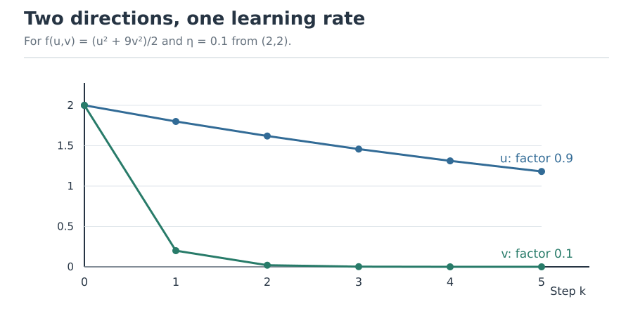

# M16-L5 – Intensive revision of numerical methods, optimisation and linear algebra {#L5}

**Course area:** M16 – Bridge to the Master’s programme

**Level:** Transition · Supplementary/bridging requirements

**Prerequisites:** M2, M9, M14.

**Learning objective:** Assess conditioning, gradients and step size, and distinguish numerical stability from computational speed.

## Diagnostic test: direction and scaling {#S1}

A. For $A=\operatorname{diag}(1,0.01)$ and $b=(1,0.01)^T$, determine the solution to $Ax=b$, the 2-norm condition number and the solution after changing the second component of $b$ to 0.02. B. For $f(u,v)=\tfrac12(u^2+9v^2)$, calculate the gradient and two steps of gradient descent from $(2,2)$ with learning rate 0.1. Which fixed positive learning rates converge from every starting point? C. Why should one not routinely form an explicit inverse when solving linear systems and least-squares problems?

## Solutions: conditioning and methods {#S2}




*Figure: Zwei Richtungen, eine Lernrate.*

The initial solution is $(1,1)^T$; after perturbation it becomes $(1,2)^T$. The singular values of the diagonal matrix are 1 and 0.01, so $\kappa_2(A)=100$. A small absolute perturbation of $b$ can cause a large change in the solution along the poorly conditioned direction. This is a property of the problem, not solely of the solver used.

The gradient is $\nabla f=(u,9v)^T$. The update can be written component by component:

$$u_{k+1}=(1-\eta)u_k,\qquad v_{k+1}=(1-9\eta)v_k.$$

For $\eta=0.1$, the points are $(1.8;0.2)$ and $(1.62;0.02)$; the objective values decrease from 20 to 1.8 and 1.314. Both factors must have absolute values less than one. The common range is $0<\eta<2/9$. At $\eta=2/9$, the magnitude of the second component remains unchanged; with a larger step size it can grow. The graphic illustrates the striking difference between the two directions.

For numerical solution, a suitable factorisation is useful, for example; it avoids explicitly computing the entire inverse. In least-squares problems, QR or SVD can offer advantages over forming $A^TA$: with full column rank, $\kappa_2(A^TA)=\kappa_2(A)^2$. This can exacerbate the amplification of rounding errors. Conditioning and algorithmic stability are distinct considerations.

## Computational check {#S3}

```python
import numpy as np
A = np.diag([1., .01])
assert np.allclose(np.linalg.solve(A, [1., .01]), [1., 1.])
assert np.allclose(np.linalg.solve(A, [1., .02]), [1., 2.])
assert np.isclose(np.linalg.cond(A), 100.)
x = np.array([2., 2.])
for _ in range(2):
    x -= .1 * np.array([1., 9.]) * x
assert np.allclose(x, [1.62, .02])
print(x)
```

When testing your own gradient, the central difference $(f(x+he_i)-f(x-he_i))/(2h)$ can serve as a reference. However, excessively small $h$ amplifies cancellation and rounding errors; excessively large $h$ distorts the local derivative. Check several step sizes rather than just one.

## Assessment and revision {#S4}

Two points per task. For A or C, revise matrix factorisation and conditioning in M2/M9; for B, gradient methods in M9 and M14. Transfer: if the second curvature increases from 9 to 100, the common convergence range shrinks to $0<\eta<0.02$. This explains the importance of scaling and preconditioning without claiming a universally optimal learning rate.

## Sources and further reading {#S5}

- [NumPy: Linear algebra](https://numpy.org/doc/stable/reference/routines.linalg.html?highlight=numpy) · numerical solution methods
