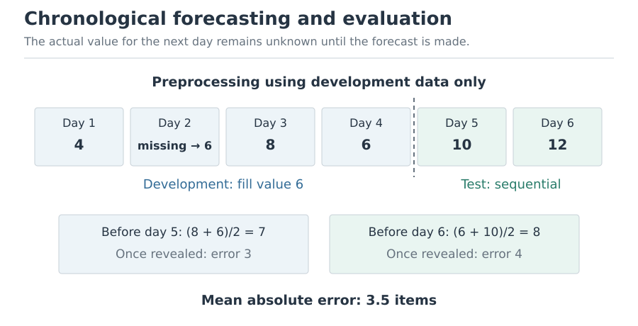

# M16-L6 – Programming and research diagnostics with further study paths {#L6}

**Course area:** M16 – Bridge to the Master’s programme

**Level:** Transition · Supplementary/bridging requirements

**Prerequisites:** M3, M7, M15.

**Learning objective:** Assess data validation, reproducible code and research design as interrelated prerequisites.

## Diagnostic test: a small time series {#S1}

The table contains daily counts from a synthetic device test. The order is chronological; days 1–4 are for development and days 5–6 for testing. A missing development value is to be replaced by the mean of the observed development values. The evaluation predicts the next day using the mean of the last two preprocessed values.

| Day | Count |
|---:|---:|
| 1 | 4 |
| 2 | missing |
| 3 | 8 |
| 4 | 6 |
| 5 | 10 |
| 6 | 12 |

A. Determine the replacement value and predictions for days 5 and 6 (the actual value on day 5 is revealed only after its prediction). Calculate MAE. B. Write a function with input validation and at least two tests. C. Design a fair comparison for a research question and list the information another person needs to reproduce it.

## Solution: chronological data boundaries {#S2}




*Figure: Chronologische Prognose und Auswertung.*

The development mean is $(4+8+6)/3=6$. The method predicts day 5 as $(8+6)/2=7$ and day 6 as $(6+10)/2=8$. The absolute errors are 3 and 4; the MAE is 3.5 items. Day 5 is used only as known history for day 6, not for the estimate of day 5. If both days were forecast at the same time, this protocol would be invalid. A replacement value calculated from the entire series would be 8 and would incorporate future information. Within the development phase, the same temporal separation rule applies whenever historical validation is simulated.

## Reference implementation {#S3}

```python
from statistics import mean
from math import isfinite

def forecast(train, future):
    for series in (train, future):
        if any(x is not None and (not isfinite(x) or x < 0)
               for x in series):
            raise ValueError("invalid count")
    known = [x for x in train if x is not None]
    if len(train) < 2 or not known or not future:
        raise ValueError("insufficient data")
    if any(x is None for x in future):
        raise ValueError("test targets missing")
    fill = mean(known)
    hist = [fill if x is None else x for x in train]
    predictions = []
    for observed in future:
        predictions.append(mean(hist[-2:]))
        hist.append(observed)
    return predictions, mean(abs(y-p) for y,p in zip(future,predictions))

assert forecast([4,None,8,6],[10,12]) == ([7,8],3.5)
assert forecast([2,2],[2]) == ([2],0)
try:
    forecast([None,None],[2])
except ValueError:
    pass
else:
    raise AssertionError("missing guard")
```

The function accepts finite non-negative numbers; for actual count data, integer values and unique timestamps may also need to be checked. The examples test one particular path and one boundary case; they do not replace comprehensive testing.

## Research diagnostics and further study path {#S4}

For example, compare the two-day moving-average forecast with the last observed value, using the same time boundaries and metric. The baseline predicts 6 and 10, with an MAE of 3; it wins in this tiny test. This does not demonstrate its general superiority. Document data provenance, hash, splits, method, code version, environment, run command, metric and complete results. Specify expected results as tests without deriving them from test data for model selection.

Two points per task. For data validation and testing, revise M3/M7; for research design, M15. Transfer: if two consecutive measurements are collected per device, the device identifier must not be spread across training and testing when evaluating on previously unseen devices. The split strategy always follows the actual deployment question.

## Sources and further reading {#S5}

- [scikit-learn: Common pitfalls and recommended practices](https://scikit-learn.org/stable/common_pitfalls) · data leakage
- [scikit-learn: Cross-validation](https://scikit-learn.org/stable/modules/cross_validation) · validation and temporal splits
