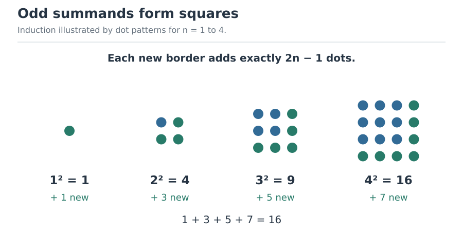

# M16-L7 – Proofs, complexity and theoretical algorithms: entry diagnostics {#L7}

**Course area:** M16 – Bridge to the Master’s programme

**Level:** Transition · Supplementary/diagnostic

**Prerequisites:** M2, M3, M13.

**Learning objective:** Understand proofs, asymptotic bounds and theoretical algorithms as prerequisites for advanced computer science.

## Diagnostic test: from example to proof {#S1}

A. Prove that $\sum_{k=1}^n(2k-1)=n^2$ for all natural numbers $n\ge1$. B. A procedure compares every unordered pair among $n$ objects exactly once. State the number of comparisons and its tight asymptotic bound. Another procedure halves a set of size $n=2^m$ still to be investigated at each iteration until its size is one. How many halvings are required? C. Explain whether polynomial time for verifying a proposed SAT certificate already provides a polynomial-time algorithm for finding a certificate.

## Solution: induction and computational cost {#S2}

*Figure: Ungerade Summanden bilden Quadrate.*

For $n=1$, the statement holds because $2\cdot1-1=1=1^2$. Assume it holds for an arbitrary $n\ge1$. Adding the next summand gives

$$\sum_{k=1}^{n+1}(2k-1)=n^2+2(n+1)-1=(n+1)^2.$$

The statement is thus proved by induction. Checking the first ten numbers alone would not constitute proof for all natural numbers. The graphic visualises the identity by incrementally extending square dot patterns; algebraic induction validates it independently of the drawing.

In B, there are $n(n-1)/2$ pairs. For $n\ge2$, we have $n^2/4\le n(n-1)/2\le n^2/2$. Hence the number of comparisons is $\Theta(n^2)$. The halving procedure requires $m=\log_2 n$ steps. The runtime is $\Theta(\log n)$ only if each iteration requires constant work; merely halving the problem size is insufficient. If a list is copied each time, the copying cost must be included.

## Solution: certificates and search problems {#S3}

A propositional formula in conjunctive normal form can be checked for a given assignment by ensuring that every clause contains at least one true literal. With an appropriate input model, this takes polynomial time in the input length. The class NP comprises decision problems with polynomial-time verifiable certificates of polynomially bounded length for yes-instances. SAT belongs to NP and is NP-complete. The class P comprises decision problems solvable deterministically in polynomial time. Whether P and NP coincide is an open question. Efficient verification alone does not yield any known polynomial-time SAT search algorithm. For SAT, the decision and search versions can be related in polynomial time by fixing variables one by one, assuming a polynomial-time decision algorithm is available.

## Assessment and final diagnostics {#S4}

Two points per task: sound justification and correct result. For A, revise proof techniques and discrete mathematics; for B, algorithm analysis (M3 and the computer science course); for C, logic and SAT (M13). Transfer: the statement ‘Every quadratic algorithm takes at least one second’ does not follow from the asymptotic bound; hardware, constants and input size remain relevant.

After M16, summarise all seven self-tests as a profile of 0–6 points each. 5–6 with traceable assumptions: proceed directly; 3–4: targeted revision; 0–2: work on the foundations first. These thresholds are teaching suggestions, not an empirically validated test or a formal admission rule. A good overall result is no substitute for targeted revision of a weak dimension. L1–L3 are particularly important for advanced statistics; optimisation and deep learning require L5, and theoretical AI additionally requires L7. L4 and L6 are relevant to all advanced modelling topics.

## Sources and further reading {#S5}

- [MIT OCW: Mathematics for Computer Science, Readings](https://ocw.mit.edu/courses/6-1200j-mathematics-for-computer-science-spring-2024/pages/readings/) · proofs, induction, asymptotic analysis; chapter listing opened
- [MIT OCW: Theory of Computation, Lecture Notes](https://ocw.mit.edu/courses/18-404j-theory-of-computation-fall-2020/pages/lecture-notes/) · P, NP, SAT, NP-completeness; search snippet only, notes not checked
