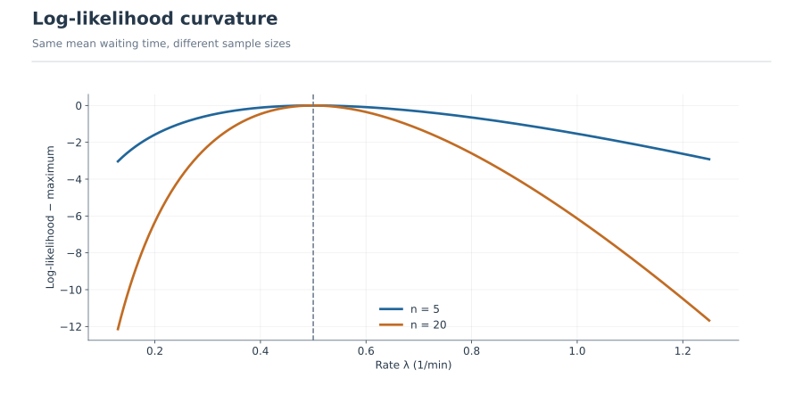

# M17-L1 – Estimation Theory, Sufficiency and Fisher Information {#L1}

**Course area:** M17 – Mathematical Statistics and Statistical Learning

**Level:** Master · Core/advanced

**Prerequisites:** [M16-L1](M16-L1.md), [M16-L2](M16-L2.md), M6.

**Learning objective:** Identify sufficient statistics and derive Fisher information and the Cramér–Rao bound.

## What data does estimation require? {#S1}

A measuring device records independent waiting times $X_i$ in minutes. The exponential density with unknown rate $\lambda>0$ is $f(x;\lambda)=\lambda e^{-\lambda x}$ for $x\geq0$. The rate has units of 1/min. A sample contains not only information about the rate but also the ordering of measurements and random differences. Which of these are necessary for estimating the rate?

For the joint density at fixed $n$, we have:

$$L(\lambda;x)=\lambda^n\exp\left(-\lambda\sum_{i=1}^n x_i\right)\prod_{i=1}^n\mathbf{1}_{x_i\geq0}.$$

The factorisation criterion states for dominated models that if the density can be expressed as a parameter-dependent function of $T(x)$ times a parameter-free function of the data, then $T$ is sufficient. Here the sum $T=\sum_i X_i$ suffices. The conditional distribution of the sample given $T$ no longer depends on $\lambda$. This is a statement within the model, not a general recommendation to delete measurement series: with dependence or time-varying rates, the ordering may be important.

## Information as curvature {#S2}

*Figure: Krümmung der Log-Likelihood.*

The log-likelihood $\ell=n\log\lambda-\lambda T$ has score $U=n/\lambda-T$ and second derivative $-n/\lambda^2$. Under regularity conditions $E[U]=0$; the expected information is

$$I_n(\lambda)=E[U^2]=-E[\ell''(\lambda)]=\frac{n}{\lambda^2}.$$

The equality follows by differentiating the normalisation of the density under the integral. Independent observations contribute additive information. The observed information $-\ell''$ equals the expected information here, but not in general. The more sharply curved the log-likelihood is near its maximum, the more sensitive it is to departures from the parameter value; the graphic illustrates this for two samples with the same mean waiting time.

## Efficiency and bias {#S3}

With $n=5$ and measurements $1,2,1,3,3$, $T=10$ min. The score vanishes at $\widehat\lambda=n/T=0.5$ 1/min. The second derivative is negative, so this is a maximum. However, the estimator is upwardly biased for $n>1$: from $T\sim\operatorname{Gamma}(n,\text{Rate }\lambda)$ it follows that $E[1/T]=\lambda/(n-1)$. Hence $(n-1)/T$ is unbiased and equals 0.4 1/min here.

For regular models and unbiased estimators $\widetilde\lambda$, we have $\operatorname{Var}(\widetilde\lambda)\geq 1/I_n(\lambda)$. At the true rate $\lambda=0.5$ and $n=5$, this bound is 0.05 (1/min)$^2$. For $n>2$ the corrected estimator has variance $\lambda^2/(n-2)$, here approximately 0.0833. The lower bound need not be attained. Rao–Blackwellisation replaces an estimator with its conditional expectation given a sufficient statistic; under squared loss this cannot increase the risk. Completeness is an additional property and does not follow from sufficiency.

## Exercise with solution {#S4}

Ten waiting times sum to 25 min. Determine the ML estimator, the unbiased estimator and the information at $\lambda=0.4$. What information would be lost if the plant had shift-dependent rates?

Solution: $10/25=0.4$ and $9/25=0.36$ 1/min; $I_{10}=10/0.16=62.5$ min$^2$. The Cramér–Rao bound is 0.016 (1/min)$^2$. For two shift-specific rates, at least the corresponding totals and counts are required, not merely the overall total. When the distribution is unknown, these efficiency statements cannot be transferred without checking the model.

## Sources and further reading {#S5}

- [UC Berkeley, Will Fithian: Sufficiency](https://www.stat.berkeley.edu/~wfithian/courses/stat210a/sufficiency.html) · Definition, factorisation
- [University of Minnesota, Charles Geyer: Likelihood Inference](https://www.stat.umn.edu/geyer/5421/notes/likelihood.html) · Fisher information and likelihood ratio
