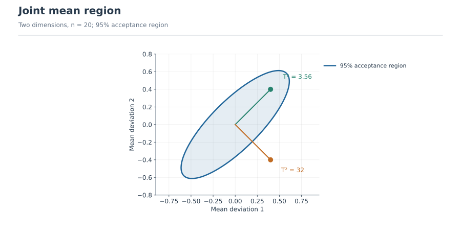

# M17-L10 – Multivariate Statistics and Joint Modelling {#L10}

**Course area:** M17 – Mathematical Statistics and Statistical Learning

**Level:** Master · Elective specialisation

**Prerequisites:** M2, M8, [M17-L3](M17-L3.md).

**Learning objective:** Use covariance in joint models and calculate a Hotelling T² test for a mean vector.

## Joint rather than separate outcomes {#S1}

At a plant, two dimensionless, already scaled measurement deviations are recorded for each component. Both may be affected by the same mechanical cause. Separate tests ignore the joint dispersion structure and, when making multiple decisions, the accumulation of errors. Multivariate statistics models the random vector $X\in\mathbb R^p$ using the mean vector $\mu=E[X]$ and covariance matrix $\Sigma=E[(X-\mu)(X-\mu)^\top]$.

With a positive definite covariance matrix, the multivariate normal density is

$$f(x)=(2\pi)^{-p/2}|\Sigma|^{-1/2}\exp[-\tfrac12(x-\mu)^\top\Sigma^{-1}(x-\mu)].$$

The quadratic form is the squared Mahalanobis distance. A joint deviation in a direction of high variance counts less than an equally large deviation in a stable direction. The covariance matrix therefore determines not only marginal dispersion but also directions in feature space. PCA uses its eigenvectors for dimensionality reduction but does not itself test a mean.

## Hotelling T² and joint uncertainty {#S2}




*Figure: Gemeinsame Mittelwertregion.*

For an iid sample from a $p$-dimensional normal distribution with unknown positive definite covariance and $n>p$, let $S$ be the sample covariance with denominator $n-1$. For $H_0:\mu=\mu_0$,

$$T^2=n(\bar x-\mu_0)^\top S^{-1}(\bar x-\mu_0),\qquad \frac{n-p}{p(n-1)}T^2\sim F_{p,n-p}\quad\text{under }H_0.$$

With two features and $n=20$, suppose $\bar x=(0.4,0.4)^\top$, $\mu_0=(0,0)^\top$ and $S=\begin{pmatrix}1&0.8\\0.8&1\end{pmatrix}$. The eigenvalue in direction $(1,1)$ is 1.8, in the contrasting direction 0.2. For the observed deviation, $T^2=20\cdot0.32/1.8\approx3.556$. The F statistic is approximately 1.684 and the p-value approximately 0.214. For an alternative observed deviation $(0.4,-0.4)$, we would have $T^2=32$ with the same covariance. Both vectors have equal length, but the second direction is more remarkable. The graphic shows the joint 95% acceptance region for the observed mean at fixed $S$ and a specified null value.

```python
import numpy as np
from scipy.stats import f
n,p=20,2
S=np.array([[1.,.8],[.8,1.]])
for v in [np.array([.4,.4]),np.array([.4,-.4])]:
    T2=n*v@np.linalg.solve(S,v)
    F=(n-p)*T2/(p*(n-1))
    print(T2,F,f.sf(F,p,n-p))
assert np.isclose(n*np.array([.4,.4])@np.linalg.solve(S,[.4,.4]),32/9)
```

## Joint modelling and limitations {#S3}

A multivariate regression model $Y=XB+E$ with several target columns can model correlated residuals through a shared covariance. If each column uses the same regressors and error vectors are uncorrelated across observations with constant positive definite covariance, the ordinary least-squares coefficients for each column coincide with the GLS result from joint modelling; the joint inference may nevertheless differ. With many outcomes relative to $n$, $S$ becomes singular or numerically unstable. Covariance shrinkage or dimensionality reduction may be useful, but a modified statistic requires its own calibration. A multivariate normal distribution cannot be inferred merely from apparently normal marginal distributions.

## Exercise with solution {#S4}

Set $S=I_2$ in the example above. What statistic do both deviation vectors give? Solution: $T^2=20(0.16+0.16)=6.4$. They are equally unusual under isotropic covariance; the F statistic is $18\cdot6.4/38\approx3.032$. For $p=1$, Hotelling’s $T^2$ reduces to the square of the usual one-sample t statistic. Joint rejection of a null hypothesis does not automatically identify the individual feature responsible; subsequent tests must be controlled accordingly.

## Sources and further reading {#S5}

- [NIST/SEMATECH e-Handbook: Hotelling’s T squared](https://www.itl.nist.gov/div898/handbook/pmc/section5/pmc543.htm) · Joint mean test
