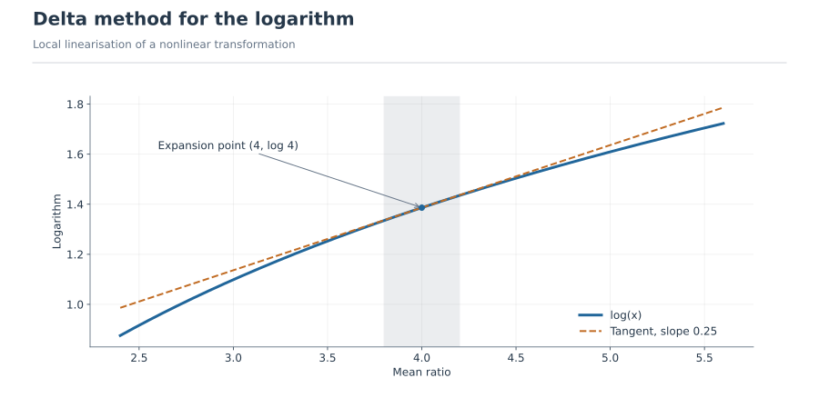

# M17-L2 – Consistency, Asymptotic Normality and the Delta Method {#L2}

**Course area:** M17 – Mathematical Statistics and Statistical Learning

**Level:** Master · Core/advanced

**Prerequisites:** [M17-L1](M17-L1.md), [M16-L1](M16-L1.md), [M4-L7](M4-L7.md).

**Learning objective:** Distinguish consistency from limiting distributions and apply the delta method to a transformed estimate.

## A limit is not the same as an expectation {#S1}

An estimator $T_n$ is consistent for $\theta$ if, for every $\varepsilon>0$, the probability $P_\theta(|T_n-\theta|>\varepsilon)$ tends to zero. Unbiasedness, by contrast, concerns a specific $n$. For example, the estimator $\bar X_n+1/n$ is consistent for the expectation $\mu$ provided the independent, identically distributed observations have a finite first moment, even though it is systematically shifted by $1/n$. By contrast, the estimator $X_1$ is unbiased but not consistent for a non-degenerate distribution.

With finite positive variance $\sigma^2$, the central limit theorem additionally gives

$$\sqrt{n}(\bar X_n-\mu)\xrightarrow{d}N(0,\sigma^2).$$

The distribution of the scaled error therefore has a non-trivial limit. The original estimate, by contrast, concentrates at $\mu$. Convergence in probability and convergence in distribution are distinct statements.

## The delta method from a Taylor expansion {#S2}

Let $\sqrt n(T_n-\theta)\xrightarrow{d}N(0,v)$ and let $g$ be continuously differentiable near $\theta$. The Taylor expansion gives $g(T_n)-g(\theta)=g'(\theta)(T_n-\theta)+o_P(|T_n-\theta|)$. Consequently,

$$\sqrt n[g(T_n)-g(\theta)]\xrightarrow{d}N(0,[g'(\theta)]^2v).$$

The little $o_P$ denotes a remainder that is negligible in probability. With several parameters the derivative is replaced by the Jacobian $J_g$ and the limiting covariance is $J_g\Sigma J_g^\top$. A zero derivative leads to a degenerate approximation; a higher-order expansion may be necessary.

## Case study: costs per geometric size factor {#S3}




*Figure: Delta-Methode am Logarithmus.*

100 independent positive measurements have sample mean 4 and standard deviation 2. For $g(\mu)=\log\mu$ (measurements expressed as dimensionless ratios), $g'(\mu)=1/\mu$. The approximate standard error of $\log\bar X$ is $2/(4\sqrt{100})=0.05$. An asymptotic 95% interval on the log scale is $\log4\pm1.96\cdot0.05$. Transforming back gives approximately $[3.627,4.412]$ for the arithmetic expectation. It is not an interval for the expectation of the log-transformed measurements. The graphic illustrates the local tangent rather than a globally linear transformation.

```python
import numpy as np
n, mean, sd = 100, 4.0, 2.0
se = sd / (mean * np.sqrt(n))
ci = np.exp(np.log(mean) + np.array([-1, 1]) * 1.96 * se)
assert np.allclose(ci, [3.62659, 4.41185], atol=0.0001)
print(se, ci)
```

## Exercise and limitations {#S4}

Transform $T_n$ using $g(t)=1/t$ when the true value is 5 and the asymptotic variance is $v=9$. Calculate the approximate standard error at $n=100$. Solution: $g'(5)=-1/25$; limiting variance $9/625=0.0144$ and standard error $0.012$. Near zero the transformation is ill-conditioned. Small samples, heavy tails, dependence and boundary parameters require separate arguments. A limiting distribution alone does not guarantee a particular coverage rate at fixed $n$.

## Sources and further reading {#S5}

- [University of Washington: STAT 581, Introduction of large sample theory](https://faculty.washington.edu/yenchic/26A_stat581/Lec2_large.html) · Delta method and limiting distributions
