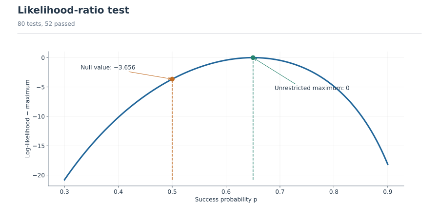

# M17-L3 – Likelihood Ratios and Asymptotic Tests {#L3}

**Course area:** M17 – Mathematical Statistics and Statistical Learning

**Level:** Master · Core/advanced

**Prerequisites:** [M17-L1](M17-L1.md), [M17-L2](M17-L2.md), M6.

**Learning objective:** Compare nested models using likelihood-ratio, Wald and score tests.

## Two models, one dataset {#S1}

A batch of 80 independently tested components contains 52 successful tests. The null hypothesis $H_0:p=0.5$ corresponds to a specified reference. The alternative allows every $p\in(0,1)$. Both models use the same sample, Bernoulli distribution and data encoding. The alternative contains the null model: it can fit at least as well.

With $k=52$ and $n=80$, $\ell(p)=k\log p+(n-k)\log(1-p)$. The alternative reaches its maximum at $\widehat p=0.65$, while the constrained maximum is at $p_0=0.5$. Define

$$\Lambda=\frac{L(p_0)}{L(\widehat p)},\qquad D=-2\log\Lambda=2[\ell(\widehat p)-\ell(p_0)].$$

## Wilks’ theorem and comparison tests {#S2}




*Figure: Likelihood-Ratio-Test.*

Under the null hypothesis, for regular, identifiable nested models with the true parameter in the interior and suitable differentiability, $D$ converges to $\chi^2_q$. Here $q$ is the difference in the dimensions of the free parameters. In the example $q=1$. The log-likelihood difference is about 3.656; $D\approx7.312$. The upper-tail probability of the chi-squared distribution is approximately 0.00685. The graphic shows the two evaluated points on the same log-likelihood.

The Wald test measures the departure from the null value in units of the standard error evaluated at the unrestricted maximum: $W=n(\widehat p-p_0)^2/[\widehat p(1-\widehat p)]$. The score test uses the slope and information under $H_0$: $Q=n(\widehat p-p_0)^2/[p_0(1-p_0)]$. Under the stated conditions the three statistics are asymptotically equivalent under $H_0$, but are not exactly identical.

```python
from math import log
from scipy.stats import chi2
n, k, p0 = 80, 52, 0.5
p = k / n
ell = lambda z: k*log(z) + (n-k)*log(1-z)
d = 2*(ell(p)-ell(p0))
w = n*(p-p0)**2/(p*(1-p))
q = n*(p-p0)**2/(p0*(1-p0))
print(d, w, q, chi2.sf(d, 1))
assert 7.30 < d < 7.32 and abs(q-7.2)<1e-10
```

## Limits of application {#S3}

A test of a variance component equal to zero lies on the boundary of the permissible parameter space. In a mixture model, components may be unidentifiable under the null hypothesis. In either situation the usual chi-squared calibration must not be applied blindly. Depending on the model, special limiting distributions or parametric simulations under the null hypothesis are required. For small Bernoulli samples an exact binomial test is an alternative. The test decision is not a probability that $H_0$ is true and says little about the practical importance of a departure. Therefore supplement it with the estimate and an interval.

## Exercise with solution {#S4}

A model with four regression coefficients has a maximised log-likelihood of -110. A nested model that sets two coefficients to zero reaches -114. All other parameters are parametrised identically. Determine $D$, the degrees of freedom and the asymptotic decision at 5%. Solution: $D=2\cdot4=8$, $q=2$, $p=\exp(-8/2)\approx0.0183$. The restriction is rejected under the regularity assumptions; this does not establish a causal effect.

## Sources and further reading {#S5}

- [University of Minnesota, Charles Geyer: Likelihood Inference](https://www.stat.umn.edu/geyer/5421/notes/likelihood.html) · Fisher information and likelihood ratio
