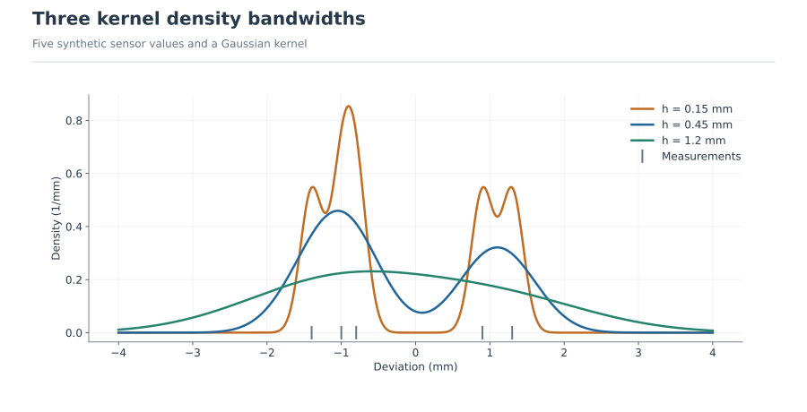

# M17-L4 – Non-parametric Density Estimation and Smoothing {#L4}

**Course area:** M17 – Mathematical Statistics and Statistical Learning

**Level:** Master · Core/advanced

**Prerequisites:** M4, M5, [M17-L2](M17-L2.md).

**Learning objective:** Calculate a kernel density estimate, justify the bandwidth and explain the bias–variance trade-off.

## Density instead of fixed bins {#S1}

A sensor supplies calibrated deviations in millimetres. A histogram depends on bin boundaries; kernel density estimation instead places a small density around each observation. For independent observations drawn from an unknown density $f$ and a non-negative normalised kernel $K$,

$$\widehat f_h(x)=\frac{1}{nh}\sum_{i=1}^n K\left(\frac{x-X_i}{h}\right),\qquad h>0.$$

The bandwidth $h$ has units of mm, and the density has units of 1/mm. After substitution each summand integrates to $1/n$, so the total area is one. A Gaussian kernel $K(u)=\exp(-u^2/2)/\sqrt{2\pi}$ has infinite support. A compact kernel, by contrast, contributes only within a limited neighbourhood. A density height may exceed one; only integrated areas are probabilities.

## Three bandwidths, the same observations {#S2}




*Figure: Drei Bandbreiten einer Kerndichte.*

For the measurements $-1.4,-1,-0.8,0.9,1.3$, the graphic shows densities with $h=0.15$, $0.45$ and $1.2$ mm. Small bandwidths isolate individual measurements; large ones may merge two genuinely separate populations into a single peak. At $h=0.45$ the two groups may remain visible. This is an exploratory observation, not a significance test for multimodality.

```python
import numpy as np
x = np.array([-1.4, -1., -.8, .9, 1.3])
grid = np.linspace(-10, 10, 20001)
def kde(q, h):
    u = (np.asarray(q)[..., None]-x)/h
    return np.exp(-u*u/2).mean(axis=-1)/(h*np.sqrt(2*np.pi))
for h in [.15, .45, 1.2]:
    density = kde(grid, h)
    assert abs(np.trapezoid(density, grid)-1)<1e-6
    print(h, kde(0., h))
```

## Smoothing and model selection {#S3}

For a twice continuously differentiable density, interior points, a symmetric kernel with finite second moment, and $h\to0$ and $nh\to\infty$, the leading bias is of order $h^2$ and the variance of order $1/(nh)$. Under suitable integrability conditions the integrated mean squared error is approximately $C_1h^4+C_2/(nh)$ with positive constants. Differentiation with respect to $h$ gives $4C_1h^3-C_2/(nh^2)=0$, hence the optimal order $n^{-1/5}$. In the smooth $d$-dimensional case with isotropic bandwidth, the variance order increases to $1/(nh^d)$; the corresponding bandwidth order is $n^{-1/(d+4)}$. This illustrates the curse of dimensionality.

In practice, one can choose $h$ using leave-one-out log-likelihood rather than density at the same training points. With bounded support, such as exclusively positive times, a Gaussian kernel may assign mass outside the permissible region. Boundary corrections or suitable transformations should then be considered. Local kernel regression uses similar weights to estimate a conditional mean, but is not density estimation.

## Exercise with solution {#S4}

How does the asymptotically optimal one-dimensional bandwidth change when the sample size increases by a factor of 32 and the distribution remains unchanged? Solution: $32^{-1/5}=1/2$. With fixed $h$ the leading variance falls to one thirty-second, but the smoothing bias remains. Also explain why a bandwidth of 0.45 mm must be converted to 0.00045 m when the data are expressed in metres.

## Sources and further reading {#S5}

- [University of Michigan, Clayton Scott: Kernel Density Estimation (EECS 598)](https://web.eecs.umich.edu/~cscott/past_courses/eecs598w14/notes/19_kde.pdf) · Definition, kernel, bandwidth; PDF and first page opened visually
