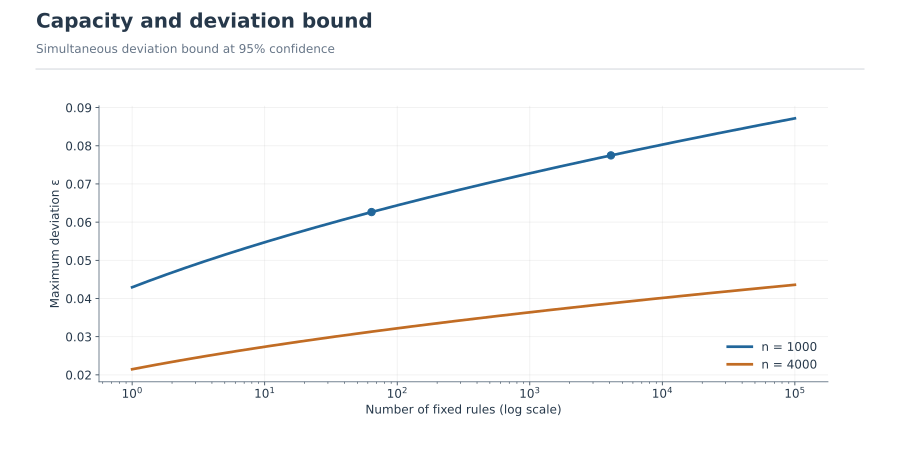

# M17-L5 – Statistical Learning Theory and Capacity Control {#L5}

**Course area:** M17 – Mathematical Statistics and Statistical Learning

**Level:** Master · Core/advanced

**Prerequisites:** M10, [M17-L2](M17-L2.md).

**Learning objective:** Justify empirical risk minimisation and control a finite hypothesis class using a probability bound.

## Risk and selection {#S1}

A quality-control system can choose among several fixed decision rules. Each rule $h$ maps features to a class. For a random observation $Z=(X,Y)$ and loss $\ell(h,Z)\in[0,1]$, the population risk is $R(h)=E[\ell(h,Z)]$. The expectation refers to new data from the target distribution. On $n$ independent training observations, we estimate this risk by $R_n(h)=n^{-1}\sum_i\ell(h,Z_i)$. Empirical risk minimisation (ERM) selects a minimiser $\widehat h$ in the predetermined class $\mathcal H$.

Even if the empirical estimate is unbiased for each fixed rule, the rule selected afterwards as best may appear unduly favourable. Therefore a concentration statement for an individual rule is insufficient.

## Deriving the simultaneous bound {#S2}

For every fixed rule, Hoeffding’s inequality gives $P(|R_n(h)-R(h)|>\varepsilon)\leq2e^{-2n\varepsilon^2}$. For a finite class of $m$ rules the union bound limits the probability of at least one violation to $2me^{-2n\varepsilon^2}$. Set this bound equal to $\delta$ and solve for $\varepsilon$:

$$\varepsilon(n,m,\delta)=\sqrt{\frac{\log(2m/\delta)}{2n}}.$$

With probability at least $1-\delta$ over the training sample, the error bound holds simultaneously for every rule, including the one selected from the data. On this event, for the true risk minimiser $h^*$ within the class it follows that

$$R(\widehat h)\leq R_n(\widehat h)+\varepsilon\leq R_n(h^*)+\varepsilon\leq R(h^*)+2\varepsilon.$$

This is an excess-risk bound; it does not include the gap between the class and the globally optimal Bayes classifier.

## Applying the bound to model capacity {#S3}




*Figure: Kapazität und Fehlergrenze.*

With $n=1000$, $m=64$, $\delta=0.05$, we obtain $\varepsilon\approx0.06265$. At a training error of 0.08, the upper risk bound is therefore approximately 0.143, provided the rules were fixed before the sample. For $m=4096$ the deviation bound rises to around 0.0775. The graphic shows this logarithmic dependence. Bounds may be conservative; validation and theoretical control answer different questions. For continuous model families $m$ is not finite; the following lesson replaces simple counting with a combinatorial measure of capacity. For unbounded squared losses, Hoeffding’s inequality in this form is not applicable.

## Exercise with solution {#S4}

What is the minimum $n$ required so that, for 100 fixed rules and $\delta=0.05$, the deviation bound is at most 0.05?

```python
from math import log, ceil, sqrt
n = ceil(log(2*100/.05)/(2*.05**2))
assert n == 1659
assert sqrt(log(4000)/(2*n)) <= .05
print(n)
```

Solution: 1659 observations; the corresponding ERM excess-risk bound is 0.10 rather than 0.05. If arbitrary new rules were first invented using a dataset, the number of rules remaining at the end cannot simply be inserted into the formula.

## Sources and further reading {#S5}

- [UBC: Statistical Learning Theory, ERM with finite hypothesis classes](https://www.cs.ubc.ca/~dsuth/532D/26w1/notes/html/chap_finite-classes.html) · Finite classes, Hoeffding and union bound
- [MIT 6.790: Learnability and VC Dimension](https://gradml.mit.edu/supervised/learnability_and_vc/) · Shattering, growth function
