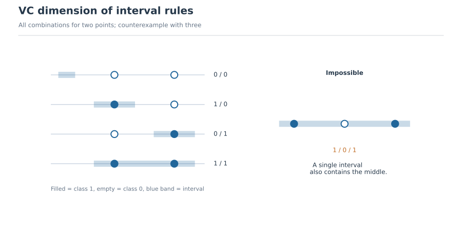

# M17-L6 – VC Dimension and Generalisation Bounds {#L6}

**Course area:** M17 – Mathematical Statistics and Statistical Learning

**Level:** Master · Core/advanced

**Prerequisites:** [M17-L5](M17-L5.md), M2.

**Learning objective:** Determine shattering, VC dimension and statistical capacity using an infinite class of interval rules.

## Effective number of classifications {#S1}

An infinite set of models can generate only finitely many distinct binary assignments on finitely many observations. The growth function $\Pi_{\mathcal H}(m)$ is the maximum number of such assignments over all sets of $m$ distinct points. If all $2^m$ assignments are realised, the point set is said to be shattered. The VC dimension is the largest number of points for which such a set exists; if this number is unbounded, the VC dimension is infinite.

## Proof using interval rules {#S2}




*Figure: VC-Dimension von Intervallregeln.*

On the real line consider $h_{a,b}(x)=\mathbf{1}_{a\leq x\leq b}$ with $a\leq b$. Two distinct points can take all four labellings: both positive using an interval containing both, both negative using a distant interval, or just one positive using a small interval around that point. The graphic shows these four cases. For three ordered points, the assignment positive–negative–positive is impossible, because any connected interval containing both outer points also contains the middle point. Hence the VC dimension is exactly 2. For $m$ ordered points, every non-empty positive set consists of a contiguous block. There are $m(m+1)/2$ such blocks and the empty set. Thus $\Pi(m)=1+m(m+1)/2$.

## Generalisation bounds {#S3}

For finite VC dimension $d$ and $m\ge d$, the Sauer–Shelah lemma gives the upper bound $\Pi_{\mathcal H}(m)\leq\sum_{j=0}^{d}\binom mj$. For $d\ge1$ this sum is at most $(em/d)^d$. Hence the number of distinct labellings grows polynomially rather than exponentially. A classical VC generalisation statement for binary 0–1 loss with iid data, under the usual measurability assumptions, is that the uniform discrepancy between empirical and true risk is controlled with probability at least $1-\delta$ by a quantity of order

$$O\left(\sqrt{\frac{d\log(en/d)+\log(1/\delta)}{n}}\right)$$

for $n\ge d\ge1$. The $O$ notation hides universal constants; this expression is not a numerically calibrated confidence bound. The proof uses a second independent sample for symmetrisation, counts the possible labellings on the combined sample and controls their deviations. Simply substituting $\Pi(n)$ for $|\mathcal H|$ in the finite-class bound would not be justified without this argument.

## Exercise with solution {#S4}

Determine the number of possible interval labellings for five ordered points. Check by enumeration:

```python
n = 5
labels = {tuple(0 for _ in range(n))}
for a in range(n):
    for b in range(a, n):
        labels.add(tuple(int(a<=j<=b) for j in range(n)))
assert len(labels)==16
print(len(labels), 2**n)
```

Solution: 16 out of 32 possibilities. For the class of one-sided thresholds $h_a(x)=\mathbf{1}_{x\ge a}$, the VC dimension is only 1: two ordered points cannot be positive on the left and negative on the right. VC dimension does not simply count parameters; it depends on which decisions a class can actually represent. On its own it measures neither ease of optimisation nor robustness to distribution shifts.

## Sources and further reading {#S5}

- [MIT 6.790: Learnability and VC Dimension](https://gradml.mit.edu/supervised/learnability_and_vc/) · Shattering, growth function
