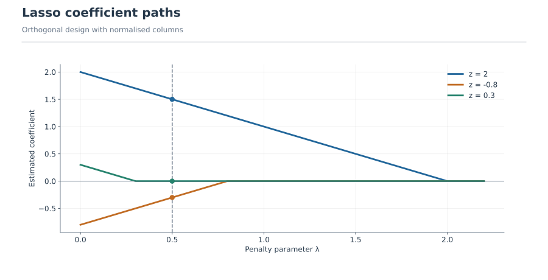

# M17-L7 – High-dimensional Regression and Feature Selection {#L7}

**Course area:** M17 – Mathematical Statistics and Statistical Learning

**Level:** Master · Core/advanced

**Prerequisites:** [M8-L5](M8-L5.md), M9, [M17-L5](M17-L5.md).

**Learning objective:** Regularise high-dimensional regression, derive soft-thresholding and explain the limitations of feature selection.

## More features than observations {#S1}

At a test bench, 400 sensor features are calculated from 50 components. In linear regression $y=X\beta+\epsilon$ the matrix $X\in\mathbb R^{50\times400}$ has rank at most 50. Even without measurement noise, different coefficient vectors can yield identical predictions on the sample, since the null space has at least 350 dimensions. Least squares alone does not uniquely identify the coefficients. A pseudoinverse selects a particular solution, but this does not imply the physical relevance of all features.

Ridge adds a quadratic penalty and Lasso an absolute-value penalty. For centred targets and centred, appropriately scaled columns, a common Lasso objective is

$$\widehat\beta=\arg\min_{\beta}\left[\frac{1}{2n}\|y-X\beta\|_2^2+\lambda\|\beta\|_1\right],\quad\lambda\geq0.$$

An intercept is left unpenalised in typical implementations. Scaling is necessary because the penalty acts on coefficient magnitudes. This convention for $\lambda$ must be considered when comparing software.

## Soft-thresholding {#S2}




*Figure: Lasso-Koeffizientenpfade.*

For an orthogonal, normalised design $X^\top X/n=I$ (thus not in the case $p>n$), the problem separates into individual coordinates. Let $z_j=X_j^\top y/n$. Up to constants, each coordinate minimises $\tfrac12(b-z_j)^2+\lambda|b|$. For $b>0$ differentiation gives $b-z_j+\lambda=0$; for $b<0$, $b-z_j-\lambda=0$. At $b=0$ the subdifferential of the absolute value includes $[-1,1]$. Hence

$$\widehat\beta_j=\operatorname{sign}(z_j)\max(|z_j|-\lambda,0).$$

For $z=(2,-0.8,0.3)$ and $\lambda=0.5$ the result is $(1.5,-0.3,0)$. The graphic shows how the three paths reach zero as the penalty increases. With the convention $\lambda\|\beta\|_2^2/2$, Ridge would shrink all values by the factor $1/(1+\lambda)$ and would not normally set them exactly to zero.

```python
import numpy as np
z = np.array([2., -.8, .3])
lam = .5
b = np.sign(z)*np.maximum(np.abs(z)-lam, 0)
assert np.allclose(b,[1.5,-.3,0])
# KKT: z-b ist im Subgradienten des Strafterms
assert np.all(np.abs(z[b==0])<=lam)
assert np.allclose((z-b)[b!=0],lam*np.sign(b[b!=0]))
```

## Selection under correlation {#S3}

With general designs, coordinate descent can apply soft-thresholding to partial residuals; for non-normalised columns one must additionally divide by $X_j^\top X_j/n$. If two columns are identical, the Lasso penalty can be the same for different same-sign allocations of the same total effect. A selected feature is therefore not evidence of causal relevance. Elastic Net combines L1 and L2 penalties to mitigate problematic correlations. Claims about reliable recovery of a sparse true solution require additional assumptions, such as sufficient signal strength and suitable design conditions.

Choose $\lambda$ using inner cross-validation, including scaling and feature selection within each fold; assess predictive performance on a separate test set or in outer cross-validation. Post-selection inference requires special methods. An ordinary confidence interval after data-driven selection may be too narrow.

## Exercise with solution {#S4}

For $z=(2,-0.8,0.3)$ determine the solution at $\lambda=0.9$ and the smallest value for which all coefficients are zero. Solution: $(1.1,0,0)$; $\lambda_{\max}=2$. For a general design with centred variables the KKT conditions at the zero vector give $\lambda_{\max}=\|X^\top y/n\|_\infty$. This guarantees the existence of a zero solution, not the truth of a null model.

## Sources and further reading {#S5}

- [UC Berkeley, Ryan Tibshirani: High-Dimensional Regression: Lasso](https://www.stat.berkeley.edu/~ryantibs/statlearn-s24/lectures/lasso.pdf) · High-dimensional regression, regularisation; PDF and first page opened visually
