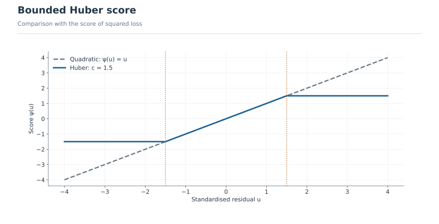

# M17-L8 – Robust Estimation and Distribution Shift {#L8}

**Course area:** M17 – Mathematical Statistics and Statistical Learning

**Level:** Master · Core/advanced

**Prerequisites:** M5, M8, [M17-L5](M17-L5.md).

**Learning objective:** Explain robust M-estimation and weight target risks under covariate shift.

## Two distinct robustness problems {#S1}

A thermometer gives the values $9,10,10,11,50$. The last value might be a fault, but could also indicate a genuine operating state. The mean is 18 and the median is 10. The median absolute deviation from the median (MAD) is 1. For normally distributed data, $1.4826\,\mathrm{MAD}$ serves as an asymptotically calibrated estimate of the standard deviation. A robust method does not mean that rare events are unimportant; it primarily reduces the influence of individual extreme values when estimating a typical location.

## Huber loss and bounded slope {#S2}




*Figure: Begrenzter Einfluss des Huber-Scores.*

For standardised residuals $u=(x-\theta)/s$ with fixed scale $s>0$, the Huber loss is

$$\rho_c(u)=\begin{cases}u^2/2,&|u|\leq c,\\c|u|-c^2/2,&|u|>c.\end{cases}$$

Its derivative is $\psi_c(u)=\min(c,\max(-c,u))$. The M-estimate minimises $\sum_i\rho_c((x_i-\theta)/s)$; at an interior optimum the sum of the scores is zero. The graphic compares the unbounded quadratic-loss slope with the clipped Huber slope. For $s=1,c=1.5$ the solution for the five measurements is 10.375: the first four residuals have absolute values below 1.5, and the last exceeds the threshold. Thus the score sum is $40-4\theta+1.5=0$. In regression, high-leverage covariates can still dominate; robust residual treatment alone does not solve this problem.

## Covariate shift as a distribution problem {#S3}

A second plant produces different proportions of the two operating modes $A,B$, with unchanged conditional error rates. In training the proportions are $(0.8,0.2)$; in deployment $(0.4,0.6)$; assume model error rates of $(0.05,0.25)$. The source risk is $0.09$ and the target risk is $0.17$. Under $p_T(y\mid x)=p_S(y\mid x)$, and if the target covariate distribution is dominated by the source distribution, rewriting the expectation gives

$$R_T(h)=E_S[w(X)\ell(h(X),Y)],\qquad w(x)=\frac{p_T(x)}{p_S(x)}.$$

The weights are 0.5 and 3. A new operating state that never occurs in training cannot be corrected in this way. Highly variable estimated weights increase uncertainty; clipping may trade variance for bias. If the conditional distribution changes, this is no longer the pure covariate shift described here.

```python
import numpy as np
from scipy.optimize import brentq
x = np.array([9.,10,10,11,50])
theta = brentq(lambda t: np.clip(x-t,-1.5,1.5).sum(), 9, 50)
s,t = np.array([.8,.2]),np.array([.4,.6])
e = np.array([.05,.25])
assert np.isclose(theta,10.375)
assert np.isclose(s @ ((t/s)*e),.17)
print(theta,s@e,t@e)
```

## Exercise with solution {#S4}

The target plant produces both types equally often. Calculate the target risk and weights. Solution: $(0.05+0.25)/2=0.15$; weights 0.625 and 2.5. Before applying the method, use labelled target data to check whether the conditional errors really are stable. For the location estimate, also investigate whether the value 50 is a valid measurement from another population; a robust estimate should not replace investigation of the underlying cause.

## Sources and further reading {#S5}

- [STAT 9610: Robust estimation and inference](https://katsevich-teaching.github.io/stat-9610-notes/robust-estimation.html) · MAD, Huber estimation
- [Li, Lam, Prusty (2020): Robust Importance Weighting for Covariate Shift](https://proceedings.mlr.press/v108/li20b.html) · Covariate Shift; Abstract and bibliographic details opened
