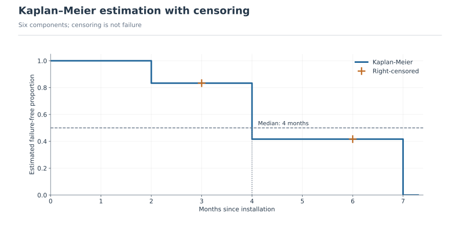

# M17-L9 – Time-to-event Analysis, Censoring and Survival Functions {#L9}

**Course area:** M17 – Mathematical Statistics and Statistical Learning

**Level:** Master · Elective specialisation

**Prerequisites:** M4, M6, [M17-L1](M17-L1.md).

**Learning objective:** Analyse right-censored event times and distinguish Kaplan–Meier and hazard concepts.

## Observation time and event time {#S1}

Six identical components are tracked from installation. On failure the time is recorded; some components leave the study beforehand for organisational reasons. The true event time $T$ is then only bounded below. With censoring time $C$, we observe $U=\min(T,C)$ and $\Delta=\mathbf{1}_{T\leq C}$. A right-censored component has neither failed at time $C$ nor been shown to remain failure-free indefinitely. The Kaplan–Meier estimator requires suitable independent or non-informative censoring and a defined population at risk. If particularly failure-prone devices are systematically removed from observation, the estimate may be biased.

## Product-limit estimation {#S2}




*Figure: Kaplan-Meier-Schätzung mit Zensierung.*

The data in months are entirely synthetic:

| Component | U | Event indicator |
|---|---:|---:|
| A | 2 | 1 |
| B | 3 | 0 |
| C | 4 | 1 |
| D | 4 | 1 |
| E | 6 | 0 |
| F | 7 | 1 |

We estimate the survival function $S(t)=P(T>t)$ by $\widehat S(t)=\prod_{t_j\leq t}(1-d_j/r_j)$, where $d_j$ is the number of events at time $t_j$ and $r_j$ is the risk set size immediately beforehand. Censored observations subsequently leave the risk set but do not directly reduce the estimated survival probability. When event and censoring times coincide, we use the convention of counting events first.

| Month | At risk before | Failures | Censored | Estimate afterwards |
|---:|---:|---:|---:|---:|
| 2 | 6 | 1 | 0 | 5/6 |
| 3 | 5 | 0 | 1 | 5/6 |
| 4 | 4 | 2 | 0 | 5/12 |
| 6 | 2 | 0 | 1 | 5/12 |
| 7 | 1 | 1 | 0 | 0 |

The graphic shows the right-continuous step function and censoring marks. The estimated median is the first time with $\widehat S(t)\leq0.5$, here month 4. The late fall to zero is based on only one remaining component and does not support a certain conclusion about the entire population.

```python
import numpy as np
u=np.array([2,3,4,4,6,7]); d=np.array([1,0,1,1,0,1])
s=1.; result=[]
for time in np.unique(u):
    risk=(u>=time).sum()
    events=((u==time)&(d==1)).sum()
    s*=1-events/risk
    result.append(s)
assert np.allclose(result,[5/6,5/6,5/12,5/12,0])
print(result)
```

## Hazard and modelling {#S3}

For continuous event times, the hazard rate is $\lambda(t)=f(t)/S(t)$ provided $S(t)>0$. It is an instantaneous conditional rate, not a probability; its units are 1/month. The cumulative hazard $H(t)=\int_0^t\lambda(u)du$ gives $S(t)=e^{-H(t)}$. The Cox model assumes $\lambda(t\mid x)=\lambda_0(t)e^{x^\top\beta}$. Two feature vectors then have a constant hazard ratio over time if the proportional hazards assumption holds. Alternative models are needed if the ratio changes with time. A log-rank test compares event counts between groups under suitable assumptions; it does not measure the size of an average gain in months.

## Exercise with solution {#S4}

If B had failed in the third month instead of being censored, what would the survival estimates be after months 3 and 4? Solution: $5/6\cdot4/5=2/3$; after two further failures among four components at risk, $2/3\cdot2/4=1/3$. Distinguishing failure from censoring is therefore crucial. Confidence intervals (for example Greenwood-based transformations) require special treatment when $\widehat S=0$ or 1; small risk sets should be displayed explicitly.

## Sources and further reading {#S5}

- [UCLA OARC: Introduction to Survival Analysis in R](https://stats.oarc.ucla.edu/wp-content/uploads/2025/02/survival_r_full.html) · Censoring, Kaplan–Meier
