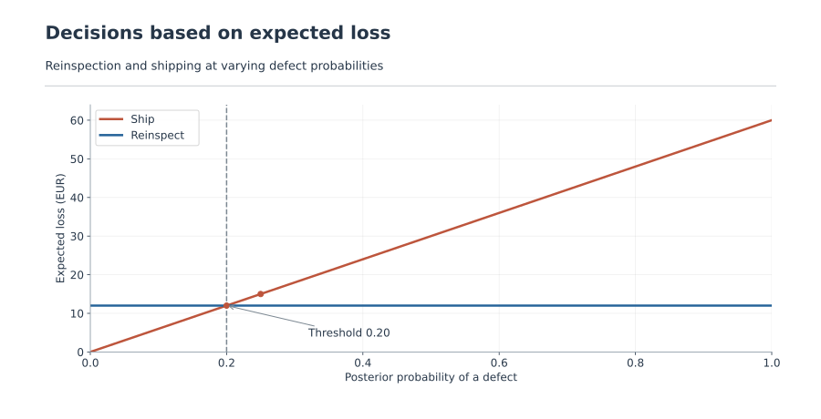

# M18-L1 – Bayesian Decision Theory and Loss {#L1}

**Course area:** M18 – Probabilistic Models and Bayesian Inference

**Level:** Master · Core/advanced

**Prerequisites:** M4, [M16-L2](M16-L2.md), [M17-L1](M17-L1.md).

**Learning objective:** Calculate posterior risks and distinguish decisions from estimates.

## Probabilities are not decisions {#S1}

After a measurement $x$, an automated inspection system estimates that a component is defective with probability $p=0.25$. The workshop can ship it or reinspect it. Which action makes sense depends not only on the probability but also on the consequences. We describe these consequences by a loss function $L(\theta,a)$, where $\theta$ denotes the unknown state and $a$ an admissible action. In the Bayesian model, uncertainty after observation is described by $p(\theta\mid x)$. For continuous states, an integral replaces the sum.

$$\rho(a\mid x)=E[L(\theta,a)\mid x],\qquad a^*(x)\in\arg\min_a\rho(a\mid x).$$

The Bayes risk of a decision rule across all possible observations, by contrast, is $E_X[\rho(a(X)\mid X)]$. It serves to compare entire rules within the assumed joint model.

## Decision with asymmetric costs {#S2}




*Figure: Entscheiden nach erwartetem Verlust.*

The following amounts in euros are freely chosen teaching values. Reinspection always costs 12; shipping costs 0 for an intact component and 60 for a defective one. This gives $\rho(\text{Reinspect})=12$ and $\rho(\text{Ship})=60p$. The two risk lines intersect at $p=0.2$. At $p=0.25$ shipping costs 15 euros in expectation; reinspection has the lower risk. At equality both actions are optimal. A probability of 25% is therefore not the same as a recommendation to ship as a matter of principle.

## Point estimation under different losses {#S3}

For real-valued parameters under squared loss, the decomposition

$$E[(\theta-a)^2\mid x]=\operatorname{Var}(\theta\mid x)+(E[\theta\mid x]-a)^2$$

yields the posterior mean as the optimal estimate, provided the second moment is finite. Under absolute loss, a posterior median minimises the risk. Under discrete 0–1 loss, an action with the greatest posterior mass is optimal; the mode of a continuous density does not follow directly from the same argument because individual points then have probability zero. The mode can also depend on the parametrisation.

```python
import numpy as np
states=np.array([0,1,4]); prob=np.array([.4,.4,.2])
assert np.isclose(states@prob,1.2)
for a in [0,1,1.2,4]:
    print(a,prob@((states-a)**2),prob@abs(states-a))
assert min([60*.25,12]) == 12
```

## Exercise with solution {#S4}

Reinspection now costs 18 euros and a missed defect costs 90 euros. At what probability should reinspection take place? Which point estimate does absolute loss give in the discrete code example?

Solution: threshold $18/90=0.2$; reinspect at higher values. The median is 1, because the cumulative mass reaches 0.8 there, whereas at 0 it is only 0.4. Changes in costs, model calibration and uncertainty about the costs themselves can alter the decision. A loss matrix is therefore an explicit domain assumption, not a priority that can automatically be inferred from the data.

## Sources and further reading {#S5}

- [University of Washington, STAT 581: Elementary Decision Theory](https://faculty.washington.edu/yenchic/26A_stat581/Lec1_decision.html) · Posterior risk, beta-binomial
