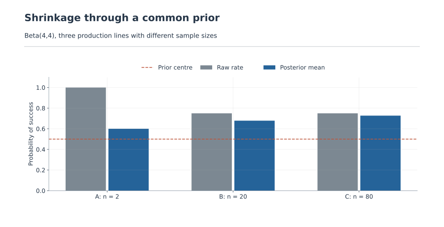

# M18-L2 – Conjugate Models and Hierarchical Bayesian Models {#L2}

**Course area:** M18 – Probabilistic Models and Bayesian Inference

**Level:** Master · Core/advanced

**Prerequisites:** [M4-L5](M4-L5.md), [M4-L6](M4-L6.md), [M17-L1](M17-L1.md), [M18-L1](M18-L1.md).

**Learning objective:** Derive conjugate updates and model group information using partial pooling.

## Conjugacy as a computational aid {#S1}

In a workshop, independent yes/no inspections are recorded for each production line. The success probability $\theta$ is assigned the prior distribution $\operatorname{Beta}(a,b)$ with density proportional to $\theta^{a-1}(1-\theta)^{b-1}$ for $0<\theta<1$. For $k$ successes from $n$ inspections, the likelihood has parameter-dependent part $\theta^k(1-\theta)^{n-k}$. Multiplying the two functions adds the exponents; the subsequently normalised density is

$$\theta\mid k,n\sim\operatorname{Beta}(a+k,b+n-k).$$

The distribution family is preserved, so the prior is called conjugate. This simplifies calculations but does not prove that the prior is substantively appropriate. The posterior mean is $(a+k)/(a+b+n)$; the probability of success at the next conditionally independent inspection is exactly this mean.

## Groups with different sample sizes {#S2}




*Figure: Schrumpfung durch gemeinsame Prior.*

With a common Beta(4,4) prior, three lines yield the following synthetic results:

| Line | Successes | Inspections | Raw rate | Posterior mean |
|---|---:|---:|---:|---:|
| A | 2 | 2 | 1 | 0.6 |
| B | 15 | 20 | 0.75 | 19/28 |
| C | 60 | 80 | 0.75 | 64/88 |

The graphic compares both measures; the small group is pulled more strongly towards the prior centre of 0.5. With complete pooling, all lines would share the same parameter. With separate models and no common information base, estimates would not depend on other groups. Fixed common hyperparameters as used here provide regularisation, but no information is yet learned from the other groups of observations.

## Hierarchical extension {#S3}

A genuinely hierarchical model assumes $\theta_j\mid m,\kappa\sim\operatorname{Beta}(m\kappa,(1-m)\kappa)$ and assigns hyperpriors to $m\in(0,1)$ and $\kappa>0$. $m$ describes the common centre and $\kappa$ the concentration. Each group contributes information to the posterior of the hyperparameters. Conditional on $m,\kappa$, the beta update remains analytical; their full uncertainty can be integrated numerically, for example. In empirical Bayes, by contrast, hyperparameters are estimated from the data and then treated as fixed. This can underestimate hyperparameter uncertainty.

```python
import numpy as np
from scipy.stats import beta
k=np.array([2,15,60]); n=np.array([2,20,80])
a,b=4+k,4+n-k
assert np.allclose(a/(a+b),[.6,19/28,64/88])
print(beta.ppf(.025,a,b),beta.ppf(.975,a,b))
```

## Exercise with solution {#S4}

With Beta(4,4), four successes are observed out of five. Calculate the posterior and the prediction of another success. What happens for a group without data?

Solution: Beta(8,5), prediction $8/13$. Without data, the prior remains unchanged when the hyperparameters are fixed. In a hierarchical model, a new group can nevertheless learn from other groups through the posterior distribution of the hyperparameters, provided the exchangeability assumption is defensible in the domain. Different types of machines may require separate group structures.

## Sources and further reading {#S5}

- [University of Washington, STAT 581: Elementary Decision Theory](https://faculty.washington.edu/yenchic/26A_stat581/Lec1_decision.html) · Posterior risk, beta-binomial
- [Stan Case Study: Hierarchical Partial Pooling for Repeated Binary Trials](https://mc-stan.org/learn-stan/case-studies/pool-binary-trials.html) · Hierarchical models, partial pooling
