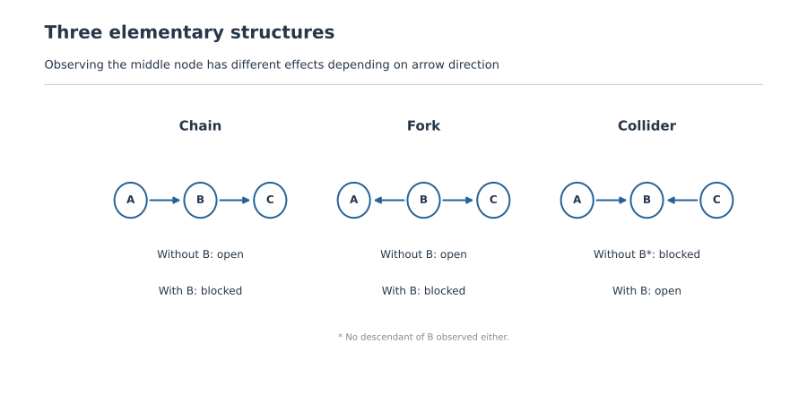

# M18-L3 – Graphical Models and Conditional Independence {#L3}

**Course area:** M18 – Probabilistic Models and Bayesian Inference

**Level:** Master · Core/advanced

**Prerequisites:** M4, M13, [M18-L2](M18-L2.md).

**Learning objective:** Factorise directed graphical models and explain d-separation using a collider.

## Local distributions instead of enormous tables {#S1}

A plant has a cooling state $K$, a temperature state $T$ and a warning signal $W$ (the original model identifiers are retained). One possible directed acyclic graph is $K\to T\to W$. Each node is assigned a conditional distribution given its parents. The joint distribution then factorises as $p(k,t,w)=p(k)p(t\mid k)p(w\mid t)$. For binary variables, five free probabilities suffice here instead of seven in an arbitrary joint table. In general, the factorisation is $p(x_1,\ldots,x_d)=\prod_i p(x_i\mid x_{\mathrm{pa}(i)})$. The graph expresses model assumptions, not automatically a causal mechanism established by observations.

## Three elementary paths {#S2}




*Figure: Drei elementare Strukturen.*

D-separation determines whether the graph structure guarantees conditional independence. On a path with three nodes, observing the middle node blocks a chain $A\to B\to C$ or a fork $A\leftarrow B\to C$. In a collider $A\to B\leftarrow C$ the opposite holds: without an observed collider or observed descendant of it, the path is blocked; observation can open it. On longer paths, all non-colliders must be unobserved and each collider itself or at least one of its descendants must be observed for the path to be active. Only if all paths are blocked does the graph guarantee the corresponding independence. An active path does not necessarily imply actual dependence for every particular parametrisation.

## Selection induces dependence {#S3}

Two independent fault indicators $A,B$ each occur with probability 0.1. A detector $C$ raises an alarm when at least one fault occurs. Thus $P(C=1)=1-0.9^2=0.19$. Given an alarm, $P(A=1\mid C=1)=10/19$ and similarly for B. The joint conditional probability is $1/19$, not $(10/19)^2$. When A is known for certain and an alarm is present, the conditional probability of B returns to 0.1. The two faults thus compete to explain the observation after selection on the alarm.

```python
from fractions import Fraction as F
p=F(1,10); alarm=1-(1-p)**2
m=p/alarm; joint=p*p/alarm
assert (alarm,m,joint)==(F(19,100),F(10,19),F(1,19))
assert joint!=m*m
```

## Exercise with solution {#S4}

A common power supply S influences two sensors A and B, which are conditionally independent. Is marginal independence necessary? What changes when S is observed?

Solution: the fork path is open without S, so marginal independence is not guaranteed. Conditional on S, the only path is blocked, hence $A\perp B\mid S$ in the model. In practice, further unaccounted-for paths can invalidate this conclusion; residuals and domain assumptions should therefore be checked. Instead of directed parent factors, undirected models use non-negative potentials and a common normalising constant to represent such structural assumptions differently.

## Sources and further reading {#S5}

- [UC Berkeley CS188: D-Separation](https://inst.eecs.berkeley.edu/~cs188/textbook/bayes-nets/d-separation.html) · d-Separation
- [Carnegie Mellon 10-708: Probabilistic Graphical Models](https://www.cs.cmu.edu/~epxing/Class/10708-09/lecture.html) · Lecture overview 8–10, sum-product and tree structure
