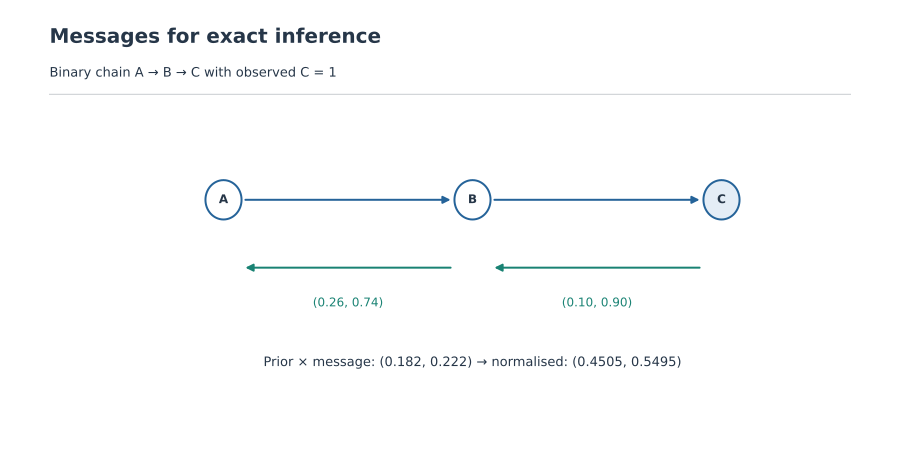

# M18-L4 – Exact Inference and Message Passing {#L4}

**Course area:** M18 – Probabilistic Models and Bayesian Inference

**Level:** Master · Core/advanced

**Prerequisites:** [M18-L3](M18-L3.md), M4.

**Learning objective:** Perform marginalisation using factors and sum-product messages.

## From product to marginal distribution {#S1}

Consider a binary state chain $A\to B\to C$. To estimate $p(A\mid C=1)$, all states of B can be enumerated. Variable elimination has the advantage of storing intermediate results only over variables on which they actually depend. For the query, evidence is first fixed; factors containing the variable to be eliminated are then multiplied and summed over that variable. Finally, the result is normalised. The size of intermediate factors depends on the elimination order; densely connected models may still require exponential storage.

## Messages on a chain {#S2}




*Figure: Nachrichten für exakte Inferenz.*

For the synthetic teaching example, let $p(A=1)=0.3$, $p(B=1\mid A=0)=0.2$, $p(B=1\mid A=1)=0.8$ and $p(C=1\mid B=0)=0.1$ and $p(C=1\mid B=1)=0.9$. The message from C to B contains $m_{C\to B}=(0.1,0.9)$. The next message is obtained by summation:

$$m_{B\to A}(a)=\sum_b p(b\mid a)m_{C\to B}(b).$$

For $a=0$ the result is 0.26, and for $a=1$ it is 0.74. Multiplication by the prior $(0.7,0.3)$ gives $(0.182,0.222)$. The evidence probability is 0.404, and the required posterior is $0.222/0.404\approx0.5495$. The graphic shows both messages and the subsequent normalisation.

## Factor graph and general sum-product {#S3}

A factor graph consists of variable nodes and factor nodes. A message from a variable to one of its factors is the product of the other incoming messages, multiplied by an evidence indicator if applicable. The message from a factor to a variable $x$ is obtained by summing the factor multiplied by the incoming messages from all other neighbouring variables. If all values are non-negative and the evidence has positive mass, the marginal distribution of a variable node can be obtained by normalising the product of its incoming messages. On a tree, two suitable passes give exact marginals. On cyclic graphs, iterative loopy belief propagation can provide an approximation without a general guarantee of convergence or exactness.

```python
import numpy as np
prior=np.array([.7,.3]); T=np.array([[.8,.2],[.2,.8]])
e=np.array([.1,.9]); joint=prior[:,None]*T*e
m=T@e; z=prior@m
assert np.allclose(m,[.26,.74]) and np.isclose(z,.404)
assert np.allclose((prior*m)/z,joint.sum(axis=1)/joint.sum())
```

## Exercise with solution {#S4}

What is $P(A=1\mid C=0)$? Solution: the message from C is now $(0.9,0.1)$, and that from B is $(0.74,0.26)$. Normalisation gives $0.078/(0.518+0.078)=39/298\approx0.1309$. In computationally intensive models, logarithmic representations or regular message normalisation help prevent numerical underflow. However, when normalising to compute the evidence probability, discarded scaling factors must be accounted for.

## Sources and further reading {#S5}

- [UC Berkeley CS188: Exact Inference in Bayes Nets](https://inst.eecs.berkeley.edu/~cs188/textbook/bayes-nets/elimination.html) · Variable elimination
- [Carnegie Mellon 10-708: Probabilistic Graphical Models](https://www.cs.cmu.edu/~epxing/Class/10708-09/lecture.html) · Lecture overview 8–10, sum-product and tree structure
