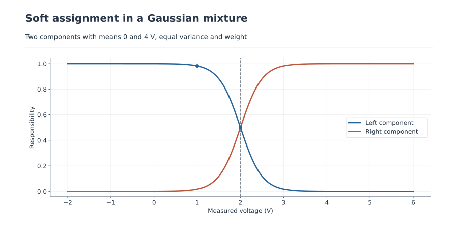

# M18-L5 – Latent Variables, Mixture Models and EM {#L5}

**Course area:** M18 – Probabilistic Models and Bayesian Inference

**Level:** Master · Core/advanced

**Prerequisites:** M12, [M17-L1](M17-L1.md), [M18-L4](M18-L4.md).

**Learning objective:** Estimate a Gaussian mixture model using EM and recognise local optima.

## Unobserved group membership {#S1}

A sensor provides voltage readings from two operating modes whose labels are missing. A mixture models $p(x)=\sum_{j=1}^K\pi_j\mathcal N(x;\mu_j,\sigma_j^2)$, with $\pi_j\geq0$ and $\sum_j\pi_j=1$. Term j describes the probability of the unobserved class and the measurement density within that class. The observed log-likelihood is $\ell=\sum_i\log\sum_j\pi_j\mathcal N(x_i;\mu_j,\sigma_j^2)$. Because of the sum inside the logarithm, it cannot be decomposed into independent weighted mean problems without introducing additional latent information.

## Alternating between E and M steps {#S2}




*Figure: Weiche Zuordnung in einer Gauß-Mischung.*

In the E step, we compute the responsibility under the current parameters:

$$r_{ij}=\frac{\pi_j\mathcal N(x_i;\mu_j,\sigma_j^2)}{\sum_h\pi_h\mathcal N(x_i;\mu_h,\sigma_h^2)}.$$

The M step maximises the expected complete-data log-likelihood. With $N_j=\sum_i r_{ij}$, it gives $\pi_j'=N_j/n$, $\mu_j'=\sum_i r_{ij}x_i/N_j$ and $\sigma_j^{2\prime}=\sum_i r_{ij}(x_i-\mu_j')^2/N_j$, provided the variance is freely estimated and $N_j>0$. We simplify the exercise by fixing the variance at 1 V² so that only weights and means are updated. With equal weights and initial means of 0 V and 4 V, the reading of 2 V has equal responsibility for both components; for the reading of 1 V, the left component has responsibility $1/(1+e^{-4})\approx0.982$. The graphic illustrates these soft assignments.

## Numerical experiment {#S3}

```python
import numpy as np
from scipy.special import logsumexp
x=np.array([-1.,0.,1.,3.,4.,5.]); mu=np.array([0.,4.]); pi=np.array([.5,.5]); ll=[]
for _ in range(25):
    logp=np.log(pi)-.5*(x[:,None]-mu)**2-.5*np.log(2*np.pi)
    norm=logsumexp(logp,axis=1); ll.append(norm.sum())
    r=np.exp(logp-norm[:,None]); N=r.sum(axis=0)
    mu=(r*x[:,None]).sum(axis=0)/N; pi=N/len(x)
assert np.all(np.diff(ll)>=-1e-10) and np.allclose(pi,[.5,.5])
print(mu,ll[0],ll[-1])
```

Exact EM does not decrease the observed likelihood: the E step makes a lower bound exact at the current parameters and the M step improves that bound. This is no guarantee of a global optimum. If variances are freely estimated, a component can collapse around a single measurement and the likelihood can grow without bound. A minimum variance, suitable priors and multiple initialisations can help; component labels remain interchangeable without an additional convention.

## Exercise with solution {#S4}

Three readings $0,2,4$ have responsibilities $0.9,0.5,0.1$ for component 1. Calculate the new mean and weight. Solution: $N_1=1.5$, $\mu_1'=(0+1+0.4)/1.5=14/15$ V and $\pi_1'=0.5$. The memberships are not confirmed operating labels; classification remains uncertain when components overlap strongly.

## Sources and further reading {#S5}

- [Andrew Ng, Stanford CS229: Mixtures of Gaussians and the EM algorithm](https://cs229.stanford.edu/notes_archive/cs229-notes7b.pdf) · E/M steps, mixture models; PDF opened directly, first page visually checked
