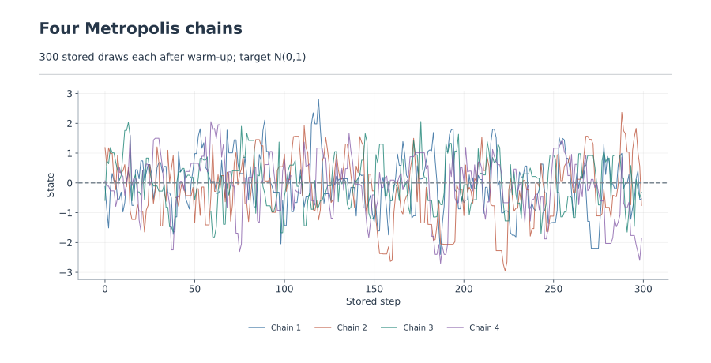

# M18-L6 – Markov Chain Monte Carlo and Diagnostics {#L6}

**Course area:** M18 – Probabilistic Models and Bayesian Inference

**Level:** Master · Core/advanced

**Prerequisites:** M4, [M18-L2](M18-L2.md), [M18-L4](M18-L4.md).

**Learning objective:** Implement Metropolis–Hastings and interpret Monte Carlo diagnostics.

## Sampling from a density known only up to proportionality {#S1}

A posterior $\pi(x)=\widetilde\pi(x)/Z$ has a normalising constant $Z$ that is difficult to compute. Metropolis–Hastings generates a Markov chain whose transitions leave the target distribution invariant. From state x a candidate y is proposed from $q(y\mid x)$. It is accepted with probability

$$\alpha(x,y)=\min\left(1,\frac{\widetilde\pi(y)q(x\mid y)}{\widetilde\pi(x)q(y\mid x)}\right).$$

Otherwise, the chain remains at x. The unknown factor Z cancels. With suitable proposals, the procedure satisfies detailed balance $\pi(x)P(x,dy)=\pi(y)P(y,dx)$ in the measure sense; this implies invariance. Convergence from arbitrary initial states requires additional conditions (see [M18-L9](M18-L9.md)). Rejected proposals must not be removed from the stored trajectory (the unchanged state must be recorded).

## Random-walk Metropolis {#S2}




*Figure: Vier Metropolis-Ketten.*

As a model that can be checked, we choose the standard normal distribution. With a symmetric normally distributed proposal of standard deviation 1, the logarithm of the acceptance ratio simplifies to $-(y^2-x^2)/2$. A proposal from 0 to 2 is thus accepted with probability $e^{-2}\approx0.1353$; the reverse move is accepted with certainty. The graphic shows excerpts from four independently started chains.

```python
import numpy as np
rng=np.random.default_rng(42)
chains=[]; rates=[]
for start in [-4.,-1.,1.,4.]:
    x=start; out=[]; acc=0
    for i in range(12000):
        y=x+rng.normal()
        if np.log(rng.random())<min(0.,-.5*(y*y-x*x)):
            x=y; acc+=1
        if i>=2000: out.append(x)
    chains.append(out); rates.append(acc/12000)
a=np.array(chains); print(a.mean(),a.std(),rates)
assert abs(a.mean())<.12 and abs(a.std()-1)<.12
```

## Diagnostics are not a certificate of convergence {#S3}

The draws are correlated. For a stationary scalar quantity with integrable autocorrelation, approximately $N_{\mathrm{eff}}=N/(1+2\sum_{k\ge1}\rho_k)$ holds, provided the sum is well defined. The Monte Carlo standard error of the mean is approximately $s/\sqrt{N_{\mathrm{eff}}}$. This differs from the posterior standard deviation s. Multiple chains with dispersed starting values facilitate assessment. Rank-normalised split R-hat compares chains, while bulk and tail ESS assess different parts of the distribution. R-hat values near 1 and sufficient ESS are useful but not sufficient evidence. Hamiltonian Monte Carlo uses gradients; there, additional features such as divergences must also be examined. A histogram alone can be misleading when modes are poorly explored.

## Exercise with solution {#S4}

For 10,000 stationary draws, assume the idealised conditions $\rho_k=0.5^k$ and $s=2$. Then $\sum_{k\ge1}\rho_k=1$, $N_{\mathrm{eff}}=10000/3$ and the standard error is approximately 0.0346. Twice as many correlated draws should not be equated with twice as many independent draws. Before applying the algorithm to complex models, test it against known target distributions and different starting points.

## Sources and further reading {#S5}

- [RStan: Convergence and efficiency diagnostics for Markov Chains](https://mc-stan.org/rstan/reference/Rhat.html) · Rank-normalised split R-hat, ESS
- [University of Oxford: Probability and Computing, Markov chains](https://www.cs.ox.ac.uk/people/elias.koutsoupias/pc2017-18/lectures.html) · Stationarity, irreducibility, periodicity
