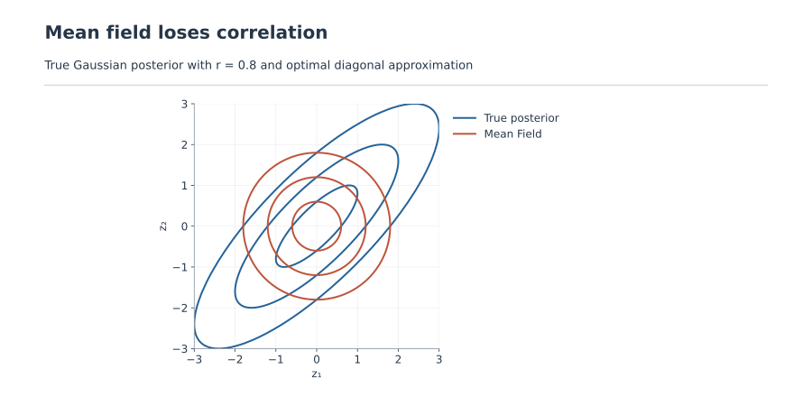

# M18-L7 – Variational Inference and the ELBO {#L7}

**Course area:** M18 – Probabilistic Models and Bayesian Inference

**Level:** Master · Core/advanced

**Prerequisites:** [M18-L5](M18-L5.md), [M18-L6](M18-L6.md), M9.

**Learning objective:** Derive the ELBO from KL divergence and assess a mean-field approximation.

## Inference through optimisation {#S1}

Let $z$ be a latent variable, x be fixed data and $p(x)>0$. Instead of drawing correlated samples from $p(z\mid x)$, variational inference seeks a tractable density $q_\lambda(z)$ in a parametrised family. For suitable densities and finite integrals, the identity holds:

$$\log p(x)=\underbrace{E_q[\log p(x,z)-\log q(z)]}_{\mathcal L(q)}+D_{\mathrm{KL}}(q\Vert p(z\mid x)).$$

It follows from $\log p(z\mid x)=\log p(x,z)-\log p(x)$ and the definition of KL divergence. Since the divergence is non-negative, $\mathcal L$ is a lower bound on the log evidence (Evidence Lower Bound, ELBO). Maximising the ELBO for fixed data and a fixed model minimises the indicated direction of KL divergence. The identity does not mean the ELBO is always easy to compute.

## What does a factorised approximation lose? {#S2}




*Figure: Mean Field verliert Korrelation.*

Consider a two-dimensional normal posterior with mean zero, unit variances and correlation $r=0.8$. Its precision matrix is $\Lambda=(1-r^2)^{-1}\begin{pmatrix}1&-r\\-r&1\end{pmatrix}$. We restrict q to independent normal variables with mean vector m and diagonal covariance D. For dimension d=2 the KL divergence is

$$D_{\mathrm{KL}}(q\Vert p)=\tfrac12[\operatorname{tr}(\Lambda D)+m^\top\Lambda m-d+\log(\det\Sigma/\det D)].$$

Differentiation with respect to the diagonal elements $v_i$ gives $\frac12(\Lambda_{ii}-1/v_i)$; the minimum is at $m=0$, $v_i=1/\Lambda_{ii}=0.36$. The true marginal variances are each 1. The graphic compares density contours on equal scales; the computationally convenient independence produces marginals that are too narrow. The minimum KL value is $-\tfrac12\log(1-r^2)\approx0.5108$.

## Optimisation methods and limitations {#S3}

```python
import numpy as np
from scipy.optimize import minimize
S=np.array([[1.,.8],[.8,1.]]); L=np.linalg.inv(S)
def kl(logv):
    v=np.exp(logv)
    return .5*(np.diag(L)@v-2+np.linalg.slogdet(S)[1]-logv.sum())
r=minimize(kl,np.zeros(2))
assert r.success and np.allclose(np.exp(r.x),.36,atol=1e-5)
print(r.fun)
```

Mean field decomposes q into factors; coordinate-wise updates can be analytical in suitable exponential families. With stochastic gradients, a normal variable can be represented, for example, as $z=\mu+\sigma\epsilon$ with parameter-free normal $\epsilon$. Under suitable conditions, this allows gradients through the sample. For multimodal targets, the direction of KL divergence may favour individual modes. The ELBO curve alone does not measure the quality of every prediction.

## Exercise with solution {#S4}

Set the correlation to 0.6. Solution: $v_i=1-0.36=0.64$, minimum KL value $-\log(0.64)/2\approx0.2231$. When correlation is zero, the true posterior belongs to the mean-field family and KL is zero. In applications, predictive distributions, sensitivity and MCMC results on a smaller reference problem should be compared.

## Sources and further reading {#S5}

- [Blei, Kucukelbir, McAuliffe (2017): Variational Inference: A Review for Statisticians](https://arxiv.org/abs/1601.00670) · ELBO, KL, Mean Field
