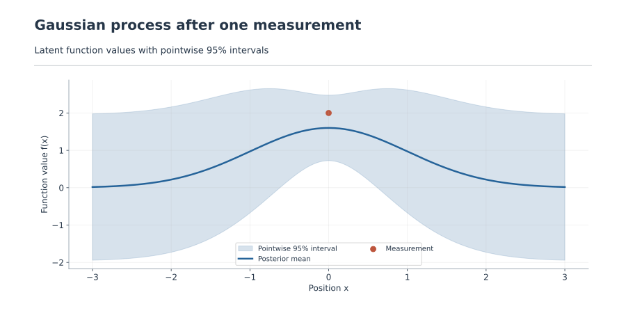

# M18-L8 – Gaussian Processes and Predictive Uncertainty {#L8}

**Course area:** M18 – Probabilistic Models and Bayesian Inference

**Level:** Master · Core/advanced

**Prerequisites:** M2, M8, [M18-L2](M18-L2.md).

**Learning objective:** Calculate Gaussian process regression with a covariance kernel and interpret predictive variance.

## A distribution over function values {#S1}

For a calibration curve $f(x)$, uncertainty at unmeasured positions is important alongside the expected trend. A Gaussian process $f\sim\mathcal{GP}(m,k)$ defines, for every finite set of inputs, a jointly normally distributed vector of function values with mean $m(x)$ and covariance entries $k(x_i,x_j)$. A symmetric positive semidefinite kernel is required. The RBF kernel $k(x,x')=s_f^2\exp[-(x-x')^2/(2\ell^2)]$ uses amplitude $s_f$ and length scale $\ell>0$. Small length scales allow more rapid local changes; the units of $\ell$ must match those of x.

## Conditioning on an observation {#S2}




*Figure: Gauß-Prozess nach einer Messung.*

With independent Gaussian measurement noise of variance $\sigma_n^2$ and a zero prior mean, let $K=k(X,X)$, $K_*=k(X,X_*)$ and $K_{**}=k(X_*,X_*)$. Then, for the latent function at new points,

$$m_*=K_*^\top(K+\sigma_n^2 I)^{-1}y,\qquad V_*=K_{**}-K_*^\top(K+\sigma_n^2 I)^{-1}K_*.$$

The formulas arise from the conditional multivariate normal distribution. For $s_f=1$, $\ell=1$, $\sigma_n^2=0.25$ and a measurement $y=2$ at $x=0$, the mean at the measurement location is 1.6 and the latent variance is 0.2. Far away, the covariance term tends to zero, the mean returns to 0 and the variance to 1. When predicting a new independent measurement, the noise variance is added. The graphic shows the latent pointwise uncertainty and the measurement.

## Stable computation {#S3}

```python
import numpy as np
X=np.array([0.]); y=np.array([2.]); Xs=np.linspace(-3,3,121)
def k(a,b): return np.exp(-.5*(a[:,None]-b[None,:])**2)
L=np.linalg.cholesky(k(X,X)+.25*np.eye(len(X)))
Ks=k(X,Xs); v=np.linalg.solve(L,Ks)
mu=Ks.T@np.linalg.solve(L.T,np.linalg.solve(L,y))
var=1-(v*v).sum(axis=0)
assert np.all(var>=0) and np.allclose([mu[60],var[60]],[1.6,.2])
```

Cholesky decomposition avoids explicit matrix inversion. A dense exact GP typically requires $O(n^3)$ computation time and $O(n^2)$ memory for factorisation. Inducing-point and structured methods reduce costs under additional assumptions. Hyperparameters can be estimated through marginal likelihood; when fixed hyperparameter estimates are plugged in, the intervals do not reflect their uncertainty. Pointwise 95% intervals are not simultaneous 95% bands over an entire curve.

## Exercise with solution {#S4}

What latent variance and measurement prediction variance arise at $x=1$ in the above model? Solution: $k(0,1)=e^{-1/2}$, latent variance $1-e^{-1}/1.25\approx0.7057$, measurement prediction variance approximately 0.9557. A narrower interval is not automatically better; calibration against held-out measurements and checking the assumed noise structure are necessary.

## Sources and further reading {#S5}

- [Tufts University CS145: Gaussian Processes for Regression](https://www.cs.tufts.edu/cs/145/2026s/notes/day02-GaussianProcesses.html) · Kernel, posterior prediction
