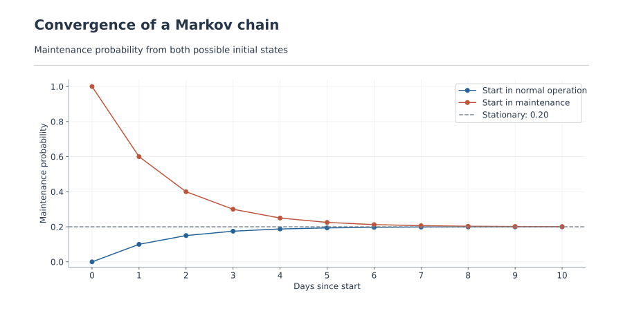

# M18-L9 – Stochastic Processes, Markov Chains and Ergodicity {#L9}

**Course area:** M18 – Probabilistic Models and Bayesian Inference

**Level:** Master · Optional advanced study

**Prerequisites:** M4, [M18-L6](M18-L6.md).

**Learning objective:** Model finite Markov chains and distinguish invariance, ergodicity and convergence.

## States over time {#S1}

A technical system switches daily between normal operation N and maintenance W (the original state identifiers are retained). A stochastic process is a family of random variables $X_t$; for a time-homogeneous discrete Markov chain, $P(X_{t+1}=j\mid X_0,\ldots,X_t=i)=P_{ij}$ holds. The state must contain enough information for this assumption to be plausible. For maintenance duration with memory, the time since the start of maintenance, for example, would be a useful additional state variable. A transition matrix is row-stochastic: all entries are non-negative and every row sums to 1.

## Stationary distribution and convergence {#S2}




*Figure: Konvergenz einer Markovkette.*

The synthetic matrix for N and W is

$$P=\begin{pmatrix}0.9&0.1\\0.4&0.6\end{pmatrix}.$$

For row distributions, $p_{t+1}=p_tP$ and $p_t=p_0P^t$ hold. A stationary distribution $\pi$ satisfies $\pi P=\pi$ and $\pi_N+\pi_W=1$. The equation $0.1\pi_N=0.4\pi_W$ yields $(0.8,0.2)$. Starting from normal operation, the probability of maintenance after one day is 0.1 and after two days $0.9\cdot0.1+0.1\cdot0.6=0.15$. The recurrence $w_{t+1}=0.1+0.5w_t$ has solution $w_t=0.2+(w_0-0.2)0.5^t$. The graphic shows the trajectory from both initial states.

## Long-term statements and a counterexample {#S3}

A finite irreducible chain has a unique stationary distribution. Irreducible means that every state can be reached from every other state in finitely many steps with positive probability. With additional aperiodicity, the distribution converges to this stationary distribution from any initial distribution. The period of a state is the greatest common divisor of its possible positive return times. The matrix with zero on the diagonal and one off the diagonal is irreducible but periodic; its stationary distribution $(1/2,1/2)$ is unique, yet from a fixed state the marginal distribution oscillates. Time averages can nevertheless converge. For finite irreducible chains, an ergodic theorem holds for time averages of integrable state functions; the term ergodic is used more narrowly or broadly depending on the source.

```python
import numpy as np
P=np.array([[.9,.1],[.4,.6]]); pi=np.array([.8,.2])
assert np.allclose(pi@P,pi)
for n in range(11):
    p=np.array([1.,0.])@np.linalg.matrix_power(P,n)
    assert np.isclose(p[1],.2*(1-.5**n))
print(np.linalg.matrix_power(P,20))
```

## Exercise with solution {#S4}

A system starts in W. What is the probability of W on day three? Solution: $w_3=0.2+0.8\cdot0.5^3=0.3$. If maintenance were permanently absorbing, however, the transition from W to N would be zero and the original stationary distribution would no longer be valid. For MCMC ([M18-L6](M18-L6.md)), a constructed transition rule must not only leave the target invariant but also explore the relevant state space sufficiently. Continuous and non-homogeneous processes require further theory.

## Sources and further reading {#S5}

- [University of Oxford: Probability and Computing, Markov chains](https://www.cs.ox.ac.uk/people/elias.koutsoupias/pc2017-18/lectures.html) · Stationarity, irreducibility, periodicity
