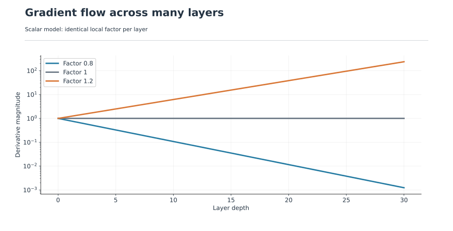

# M19-L1 – Deep Architectures and Gradient Flow {#L1}

**Course area:** M19 – Advanced Deep Learning

**Level:** Master · Core/advanced

**Prerequisites:** M14, M16, M9.

**Learning objective:** Analyse products of gradients and use initialisation, normalisation and residual paths with justification.

## Depth as a computational problem {#S1}

A network with many layers can first derive short patterns from a sensor signal, then periodic structures and ultimately the states of a plant. However, extra layers are useful only if training reaches their parameters. Write $h_l=\phi_l(W_lh_{l-1}+b_l)$ and $J_l=\partial h_l/\partial h_{l-1}$. Using column vectors, the chain rule gives

$$\nabla_{h_0}L=J_1^\top J_2^\top\cdots J_d^\top\nabla_{h_d}L.$$

An upper bound is $\|\nabla_{h_d}L\|\prod_l\|J_l\|_2$. Not every direction vector attains this bound. Repeated attenuation can make the gradient practically vanish; repeated amplification can render updates unusable. Saturating activations often exacerbate the first problem.

## A scalar experiment {#S2}




*Figure: Gradient flow across network depth.*

Consider $h_l=a h_{l-1}$, $h_0=1$ and $L=h_d$. With 30 layers and $a=0.8$, the derivative is $0.8^{30}\approx0.001238$; with $a=1.2$ it is $237.38$. The teaching diagram plots the magnitudes on a logarithmic axis. In a residual block $h_{l+1}=h_l+F_l(h_l)$ the local Jacobian is $I+J_{F_l}$. The direct path improves the prospects for gradient flow but does not guarantee a stable overall gradient.

```python
import numpy as np
d=np.arange(31)
assert np.isclose(.8**30,.0012379400392853823)
assert np.isclose(1.2**30,237.37631379976955)
print(.8**30,1.2**30)
```

## Initialisation and normalisation {#S3}

Under simplifying independence assumptions, a weighted signal with $n$ inputs and centred weights of variance $v$ has a second moment proportional to $nv$. A ReLU halves this moment in expectation for symmetric preactivations. He initialisation therefore often uses $v=2/n$ for ReLU, giving a standard deviation of 0.125 for 128 inputs. Glorot initialisation accounts for input and output dimensions ($2/(n_{in}+n_{out})$). Both are starting conditions, not guarantees during training. Batch normalisation uses batch statistics and requires appropriate inference statistics; layer normalisation operates per example across selected feature axes. With very small batches the choice can be decisive.

In practice, log activation moments, gradient norms per block, update-to-weight ratios and validation loss. Clipping may help with exploding gradients; when gradients systematically vanish it cannot replace an architectural correction.

## Exercise with solution {#S4}

Two scalar residual blocks have local derivatives $1+0.1$ and $1-0.2$. What is the overall derivative? Solution: $1.1\cdot0.8=0.88$. With ten identical factors of 0.88 it would be about 0.279. Even residual paths can attenuate signals over many blocks.

## Sources and further reading {#S5}

- [Dive into Deep Learning, 5.4: Numerical Stability and Initialization](https://d2l.ai/chapter_multilayer-perceptrons/numerical-stability-and-init.html) · initialisation and gradient norms
- [Goodfellow, Bengio, Courville: Deep Learning, Chapter 8](https://www.deeplearningbook.org/contents/optimization.html) · optimisation problems, initialisation, adaptive methods
- [He et al. (2015): Deep Residual Learning for Image Recognition](https://arxiv.org/abs/1512.03385) · residual connections
