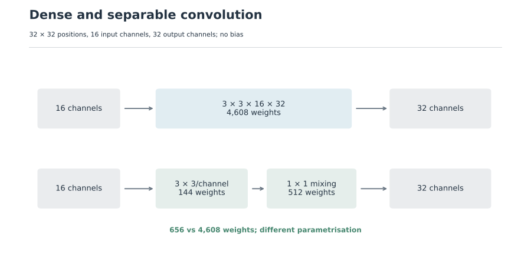

# M19-L2 – CNNs, ResNets and Efficient Convolution {#L2}

**Course area:** M19 – Advanced Deep Learning

**Level:** Master · Core/advanced

**Prerequisites:** M14, [M19-L1](M19-L1.md), M2.

**Learning objective:** Determine output shapes, parameter counts, receptive fields and computational costs of convolutional blocks.

## Local weights instead of dense connections {#S1}

In an image of a circuit board, scratches are to be detected irrespective of their position. A CNN uses shared local filters for this purpose. The operation commonly used in libraries is cross-correlation (without flipping the kernel). For a square kernel of size $k$, padding $p$, stride $s$ and dilation $d$, the output height is

$$H'=\left\lfloor\frac{H+2p-d(k-1)-1}{s}\right\rfloor+1.$$

The width is analogous. With $C_{in}$ input channels and $C_{out}$ output channels, dense convolution contains $k^2 C_{in}C_{out}$ weights plus optionally $C_{out}$ bias values. Translation equivariance holds under idealised conditions for unit strides and away from boundary artefacts; pooling and larger strides alter this property.

## From filter to residual block {#S2}




*Figure: Dense and depthwise-separable convolution.*

A 32×32-pixel image with 16 channels is processed with 32 filters of size 3×3, stride 1 and padding 1. The output is 32×32×32. The 4,608 weights entail 4,718,592 multiply-accumulate operations (MACs, excluding bias) per image. A separable variant with one filter per channel followed by 1×1 mixing has $9\cdot16+16\cdot32=656$ weights and 671,744 MACs. This is not an identical parametrisation, but it can reduce costs if performance is acceptable. The diagram compares the two paths. Actual latency also depends on memory access and kernel implementation.

```python
H,Cin,Cout,k=32,16,32,3
full=k*k*Cin*Cout
sep=k*k*Cin+Cin*Cout
assert (full,sep,H*H*full,H*H*sep)==(4608,656,4718592,671744)
print(full/sep)
```

## Receptive fields, residuals and practical architecture {#S3}

The theoretical receptive field can be tracked with jump $j_0=1$ and field size $r_0=1$: $r_l=r_{l-1}+(k_l-1)d_lj_{l-1}$ and $j_l=j_{l-1}s_l$. Two 3×3 layers with stride 1 reach a 5×5 field; with stride 2 in the first layer they reach a 7×7 field. The effective field may be smaller. Residual blocks add a transformation to the input; if channel counts or spatial dimensions differ, an appropriate 1×1 projection or downsampling can be used. Grouped convolution limits channel interactions; 1×1 convolution mixes channels without a spatial neighbourhood. In segmentation, loss of resolution and small objects should be explicitly evaluated.

## Exercise with solution {#S4}

A 64×64 input with eight channels is processed with 16 filters, $k=5$, $p=2$, $s=2$, $d=1$. Solution: $H'=32$, weights $25\cdot8\cdot16=3200$, MACs $32^2\cdot3200=3{,}276{,}800$. Bias values would be added separately. A second 3×3 layer with stride 1 reaches a 9×9 field.

## Sources and further reading {#S5}

- [Dive into Deep Learning, 7.2: Convolutions for Images](https://d2l.ai/chapter_convolutional-neural-networks/conv-layer.html) · cross-correlation and convolution
- [He et al. (2015): Deep Residual Learning for Image Recognition](https://arxiv.org/abs/1512.03385) · residual connections
