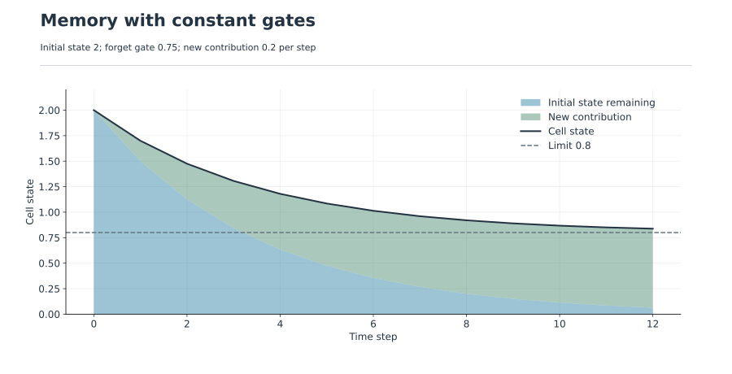

# M19-L3 – Recurrent Networks, LSTM and Sequence Modelling {#L3}

**Course area:** M19 – Advanced Deep Learning

**Level:** Master · Core/advanced

**Prerequisites:** M14, [M19-L1](M19-L1.md), [M18-L9](M18-L9.md).

**Learning objective:** Calculate time-dependent states and LSTM gates and distinguish sequence training from inference.

## State and unfolding through time {#S1}

A measuring device provides a temperature every second. The current measurement alone is insufficient to detect a gradual trend. A recurrent network computes $h_t=\tanh(W_xx_t+W_hh_{t-1}+b)$. The same parameters are reused along the time axis. In backpropagation through time (BPTT), parameter gradients from multiple time steps are summed; long products of state derivatives can become unstable. Truncated BPTT limits the backward path but can make long-range dependencies harder to learn.

## LSTM: controlled memory {#S2}




*Figure: Memory with constant LSTM gates.*

With $u_t=[x_t;h_{t-1}]$, the forget, input and output gates $f_t,i_t,o_t$ are each computed by $\sigma(Wu_t+b)$, and the candidate for writing is $g_t=\tanh(W_gu_t+b_g)$. Elementwise multiplication is denoted by $\odot$:

$$c_t=f_t\odot c_{t-1}+i_t\odot g_t,\qquad h_t=o_t\odot\tanh(c_t).$$

For a scalar memory cell with $c_0=2$, $f=0.75$, $i=0.5$, $g=0.4$ and $o=0.8$, the result is $c_1=1.7$ and $h_1\approx0.748$. If the gates remain unchanged, the cell state approaches 0.8; the teaching diagram shows the initial contribution and the newly written portion. The direct partial derivative path through $c$ contains $f_t$. The full derivative also includes the dependence of the gates on earlier states.

```python
import numpy as np
c=2.; cs=[c]
for t in range(12):
    c=.75*c+.5*.4
    cs.append(c)
assert np.isclose(cs[1],1.7)
assert np.isclose(cs[-1],.8+1.2*.75**12)
print(.8*np.tanh(cs[1]))
```

## Training and use in sequences {#S3}

With variable lengths, padding positions are masked in the loss; states must not inadvertently be passed between independent devices. Temporal separation of training and test data is particularly important for forecasting. A bidirectional network can use context before and after a position in completed recordings, but is inappropriate for real-time prediction without future observations. For autoregressive output, teacher forcing uses known earlier target values during training; at inference only values generated so far are available. This difference can allow errors to accumulate. GRUs are an alternative architecture with fewer explicit gate components.

## Exercise with solution {#S4}

An input pulse leaves $c_0=1$, after which nothing more is written and the gate remains at 0.9. After ten steps, $0.9^{10}\approx0.3487$ remains. The half-life in steps is $\log(0.5)/\log(0.9)\approx6.58$. This is a model with a fixed gate, not a fixed memory length of a trained LSTM.

## Sources and further reading {#S5}

- [Dive into Deep Learning, 10.1: Long Short-Term Memory](https://d2l.ai/chapter_recurrent-modern/lstm.html) · LSTM gates and states
- [Goodfellow, Bengio, Courville: Deep Learning, Chapter 8](https://www.deeplearningbook.org/contents/optimization.html) · optimisation problems, initialisation, adaptive methods
