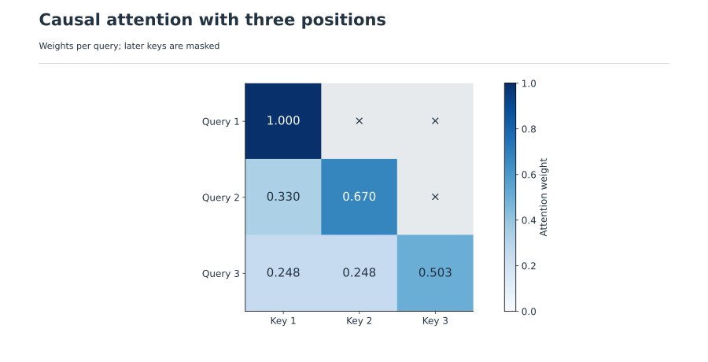

# M19-L4 – Attention and Transformer Architecture {#L4}

**Course area:** M19 – Advanced Deep Learning

**Level:** Master · Core/advanced

**Prerequisites:** M14, M2, [M19-L1](M19-L1.md).

**Learning objective:** Calculate scaled dot-product attention including masking and identify Transformer components.

## Addressing rather than merely propagating state {#S1}

In a sequence of sensor messages, a later error message may refer to a restart far in the past. Attention allows each position to weight information from other positions according to its features. From an input matrix $X\in\mathbb R^{n\times d}$, trainable projections produce the query $Q=XW_Q$, key $K=XW_K$ and value $V=XW_V$. One head computes

$$A=\operatorname{softmax}_{\text{row}}(QK^\top/\sqrt{d_k}+M),\qquad Z=AV.$$

$M$ contains 0 for permitted positions and $-\infty$ for forbidden positions. Scaling by $\sqrt{d_k}$ keeps the variance of dot products manageable under simplifying assumptions. Every row of $A$ that is not fully masked sums to one. A fully masked row requires special handling.

## Worked example with three positions {#S2}




*Figure: Causal attention matrix.*

Set $Q=K=((1,0),(0,1),(1,1))$ and scalar values $(2,4,8)$. For the first position the unmasked scores are $(1,0,1)/\sqrt{2}$; the weights are approximately $(0.401,0.198,0.401)$ and the output is about 4.802. With a causal mask the first position may read only its own information: the result is 2. The third position may use all three values. The diagram shows the causal weight matrix; crossed-out cells contribute nothing.

```python
import numpy as np
Q=np.array([[1.,0.],[0.,1.],[1.,1.]])
V=np.array([2.,4.,8.]); scores=Q@Q.T/np.sqrt(2)
def softmax(s):
    e=np.exp(s-s.max(axis=1,keepdims=True)); return e/e.sum(axis=1,keepdims=True)
A=softmax(scores)
B=softmax(np.where(np.triu(np.ones((3,3),bool),1),-np.inf,scores))
assert np.allclose(B.sum(1),1) and np.allclose((B@V)[0],2)
print(A[0],A@V,B@V)
```

## A complete block {#S3}

Multi-head attention combines several projections and mixes the results again. A position-wise feedforward network transforms the features nonlinearly. Residual connections and normalisation support optimisation. Positional information, such as added encodings or relative/rotary positional mechanisms, distinguishes order. Encoders typically use bidirectional self-attention, while decoders for autoregressive language use a causal mask. In encoder-decoder models, cross-attention connects decoder queries to encoder keys and values. Dense attention requires $O(n^2d_k)$ operations per head to calculate scores; an explicit score matrix uses $O(n^2)$ memory. Memory-optimised algorithms can avoid materialising the matrix. Attention weights alone are not a reliable explanation of a model decision.

## Exercise with solution {#S4}

With 2,048 positions and eight heads, how many score elements are produced per layer in a dense implementation? Solution: $8\cdot2048^2=33{,}554{,}432$. At two bytes per element this is 64 MiB, excluding gradients and other tensors. A causal mask does not automatically avoid quadratic allocation.

## Sources and further reading {#S5}

- [Vaswani et al. (2017): Attention Is All You Need](https://arxiv.org/abs/1706.03762) · Transformer and attention
