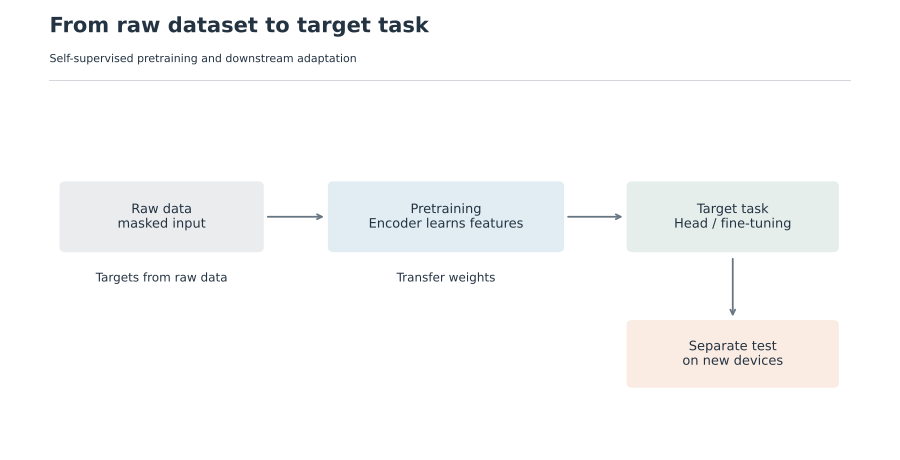

# M19-L5 – Transfer Learning and Self-Supervised Learning {#L5}

**Course area:** M19 – Advanced Deep Learning

**Level:** Master · Core/advanced

**Prerequisites:** M14, M10, [M19-L4](M19-L4.md).

**Learning objective:** Compare pretrained models, self-generated targets and appropriate adaptation strategies.

## Which information can be transferred? {#S1}

A company has many unlabelled photos of components, but only a few with verified defect classes. Instead of training a large model from random weights, it can adopt a pretrained encoder $f_\theta$. With a frozen encoder, only the head $g_\psi$ is adjusted. Fine-tuning also changes encoder parameters. Partial adaptation trains selected blocks; parameter-efficient methods add small trainable components. No strategy guarantees transfer: differences in sensors, materials, perspectives and defect types can invalidate the representation.

## Self-supervision as the creation of learning tasks {#S2}




*Figure: Pretraining and transfer to a target task.*

Unlabelled data provide their own training signals: masked token prediction hides parts and reconstructs them from context; autoregressive tasks predict the next element; image methods can estimate missing regions. For masked positions $\mathcal M$, for example,

$$L=-\frac1{|\mathcal M|}\sum_{t\in\mathcal M}\log p_\theta(x_t\mid\widetilde x).$$

$\widetilde x$ is the modified input, not the unobscured original content. With two correct-target probabilities of 0.8 and 0.25, the mean cross-entropy is $-\log(0.2)/2\approx0.805$. The diagram shows an original three-stage procedure: a learning signal from raw data, encoder pretraining, and separate adaptation and evaluation. Self-supervision avoids manually assigned target classes for this task, not necessarily data preparation or checking rights.

## Costs and comparison {#S3}

An encoder with 8 million parameters produces vectors of length 512; the new head distinguishes five classes. Its number of weights and bias values is $512\cdot5+5=2565$. Only 0.0321% of the total parameters are trainable when the encoder is frozen, but encoder runtime remains part of inference. With a low-rank update $\Delta W=BA$ for a 512×512 matrix of rank at most 8 for the update, there are 8,192 additional weights instead of 262,144 fully trainable weights. The original matrix remains stored.

```python
import numpy as np
head=512*5+5; enc=8_000_000
assert head==2565 and 2*512*8==8192
assert np.isclose(-np.log([.8,.25]).mean(),.8047189562170501)
print(100*head/(enc+head))
```

Compare random initialisation, a frozen encoder and fine-tuning using the same target training and test data; document external pretraining data as far as known. When labels are scarce, validation groups should be separated by device or recording time. For reproducible features, a frozen encoder may also need to be placed in evaluation mode so that dropout/batch normalisation do not cause unwanted changes.

## Exercise with solution {#S4}

With three target classes and a feature width of 128, a head needs $128\cdot3+3=387$ parameters. A rank-4 update to a 128×256 matrix needs $4(128+256)=1536$ parameters, excluding bias. Decide on the basis of target performance, computational budget and shifts in the data distribution, not parameter savings alone.

## Sources and further reading {#S5}

- [PyTorch: Transfer Learning for Computer Vision Tutorial](https://docs.pytorch.org/tutorials/beginner/transfer_learning_tutorial.html) · freezing and fine-tuning
- [Devlin et al. (2018): BERT](https://arxiv.org/abs/1810.04805) · pretraining and transfer
