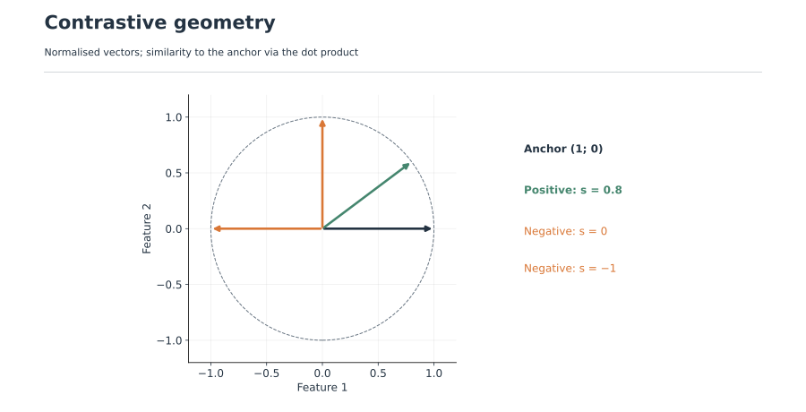

# M19-L6 – Representation Learning and Contrastive Objectives {#L6}

**Course area:** M19 – Advanced Deep Learning

**Level:** Master · Core/advanced

**Prerequisites:** M12, M14, [M19-L5](M19-L5.md).

**Learning objective:** Calculate similarity-based learning objectives and select meaningful positive and negative examples.

## From raw data to a geometry {#S1}

A warehouse management system is to find similar product views without class labels. An encoder maps different crops of the same object to vectors. For normalised vectors $z_i$, cosine similarity is $s_{ij}=z_i^\top z_j$. In contrastive learning, another crop of the same image is selected as a positive pair, for example; other objects form negative pairs. Good augmentation preserves the properties important for the later task. If the colour of a component is changed even though it determines its type class, the learned invariance may be harmful.

## A contrastive loss {#S2}




*Figure: Contrastive vector geometry.*

For an anchor $i$ and its positive partner $j$, let $\mathcal C_i$ be the candidate set excluding the anchor but including $j$. The temperature $\tau>0$ scales the similarities:

$$\ell_{i,j}=-\log\frac{\exp(s_{ij}/\tau)}{\sum_{k\in\mathcal C_i}\exp(s_{ik}/\tau)}.$$

For $z_i=(1,0)$, $z_j=(0.8,0.6)$ and two negatives $(0,1)$ and $(-1,0)$, the similarities are 0.8, 0 and -1. At $\tau=0.5$, the logits are 1.6, 0 and -2, the probability of the positive pair is about 0.814 and the loss about 0.206. The original diagram shows the four vectors on the unit circle. A low temperature sharpens the ranking but can be particularly sensitive to false negatives.

```python
import numpy as np
z=np.array([[1.,0.],[.8,.6],[0.,1.],[-1.,0.]])
assert np.allclose(np.linalg.norm(z,axis=1),1)
s=z[1:]@z[0]/.5
loss=np.logaddexp.reduce(s)-s[0]
print(float(np.exp(-loss)),float(loss))
assert .80<np.exp(-loss)<.83
```

## Learning strategy and evaluation {#S3}

Using two augmentations per input, both views can be used in turn as anchors. Other examples of the same actual type may mistakenly be treated as negative pairs. A projection head after the encoder enables optimisation of the training objective in a separate space; the preceding encoder features may be better suited to later use. Alternatives without explicit negative pairs need other mechanisms against collapse, such as asymmetric target paths or variance constraints. Test representations with a frozen encoder and a linear classifier, nearest-neighbour search and transfer to new devices. Also check that the vectors do not all collapse to the same point; high training similarity alone is insufficient.

## Exercise with solution {#S4}

With three candidates of equal similarity, the positive share is $1/3$ regardless of temperature; the loss is $\log 3\approx1.099$. Can the loss alone show that all target classes are separated? No. It evaluates the chosen pair relationships; their correspondence with later classes must be assessed separately.

## Sources and further reading {#S5}

- [Chen et al. (2020): A Simple Framework for Contrastive Learning of Visual Representations](https://arxiv.org/abs/2002.05709) · contrastive learning and augmentation
