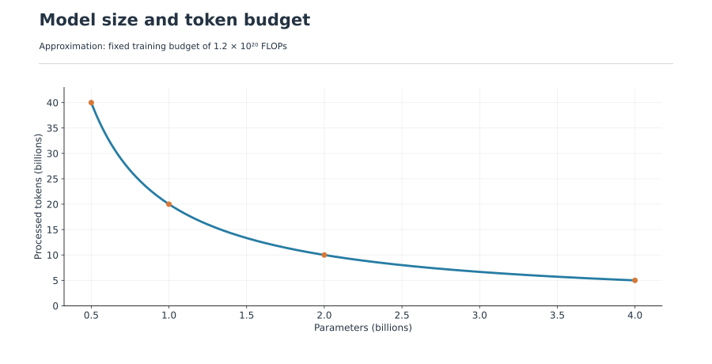

# M19-L7 – Optimisation of Large Models and Scaling {#L7}

**Course area:** M19 – Advanced Deep Learning

**Level:** Master · Core/advanced

**Prerequisites:** M9, M14, [M19-L4](M19-L4.md).

**Learning objective:** Roughly estimate a training budget and distinguish memory requirements, parallelisation and optimisation methods.

## Compute budget and model size {#S1}

A language-based document system is to be pretrained with a fixed budget. More parameters without sufficient training data are not automatically advantageous. For a dense autoregressive Transformer, the rough training estimate $C\approx6ND$ FLOPs is often used, with $N$ trainable parameters and $D$ processed tokens. The factor approximates forward and backward computation for dense matrices; attention with long sequences, embeddings, extra recomputation and hardware utilisation can alter the actual calculation. $D$ counts processed tokens, not necessarily distinct tokens. Empirical scaling laws depend on data, architecture, target quantity and tested ranges.

## A budget calculation {#S2}




*Figure: Scaling under a fixed compute budget.*

With $N=10^9$ and $D=20\cdot10^9$ the approximation gives $1.2\cdot10^{20}$ FLOPs. If a system effectively delivers $60\cdot10^{12}$ FLOP/s, an idealised $2\cdot10^6$ seconds or about 23.15 days are required. Doubling the parameter count at the same budget halves the possible token count. The diagram presents this budget curve. It is not an empirical law of performance and contains no prices.

```python
N,D=10**9,20*10**9
C=6*N*D
seconds=C/(60*10**12)
assert C==120_000_000_000_000_000_000 and seconds==2_000_000
print(seconds/86400)
```

## Memory and distributed updates {#S3}

An illustrative mixed-precision Adam state contains, per parameter, two bytes for the model weight, two bytes for the gradient, four bytes for the master weight and four bytes for each of two moment estimators: 16 bytes in total. For one billion parameters this is 16 GB (decimal), excluding activations, temporary tensors and communication buffers; implementations vary. Gradient accumulation processes multiple microbatches before an update; with equal weighting and without batch-dependent operations, their mean gradient corresponds to that of a larger batch. Activation checkpointing trades memory for recomputation. Data parallelism replicates weights and aggregates gradients; tensor parallelism divides matrix operations, pipeline parallelism divides layers, and sharding distributes states and requires communication. At low precision, loss scaling can reduce gradient underflow; instabilities must be detected. AdamW decouples the weight shrinkage term from the adaptively scaled data-loss gradient. Warm-up, learning-rate schedules and clipping should be investigated in a controlled manner.

## Exercise with solution {#S4}

Four processes each handle eight examples in six accumulation steps. One update sees 192 examples (with complete, equally sized batches). If 10,000 tokens are processed per process and microbatch, there are 240,000 tokens per update. A model twice as large costs approximately twice as much for the same token count, but does not necessarily require twice the wall-clock time.

## Sources and further reading {#S5}

- [Goodfellow, Bengio, Courville: Deep Learning, Chapter 8](https://www.deeplearningbook.org/contents/optimization.html) · optimisation problems, initialisation, adaptive methods
- [Hoffmann et al. (2022): Training Compute-Optimal Large Language Models](https://arxiv.org/abs/2203.15556) · compute budget, data and model size
- [Loshchilov and Hutter (2017): Decoupled Weight Decay Regularization](https://arxiv.org/abs/1711.05101) · decoupled weight decay
