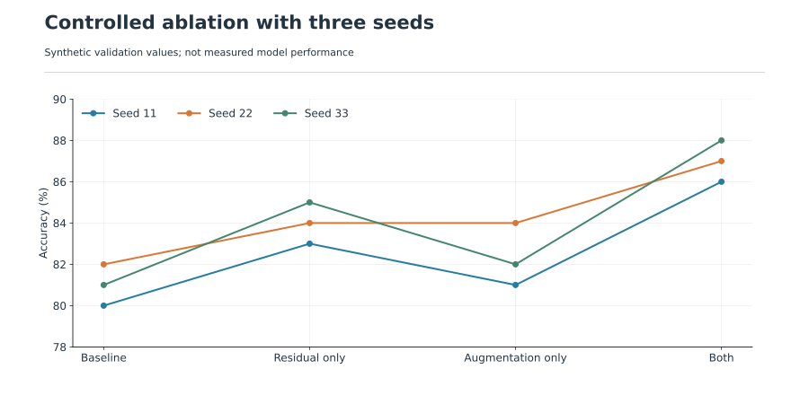

# M19-L8 – Experiments, Ablation and Training Stability {#L8}

**Course area:** M19 – Advanced Deep Learning

**Level:** Master · Core/advanced

**Prerequisites:** M6, M10, M15, [M19-L7](M19-L7.md).

**Learning objective:** Evaluate controlled ablations with multiple repetitions and diagnose instability.

## One change rather than many claims {#S1}

A team develops a model to classify synthetic machine signals. The new version contains residual paths and an augmentation. Greater performance of the combined version does not prove which component was helpful. A factorial design with each of the two components on/off gives four combinations. Use the same data split, training budget, search budget and metric; pair random initialisations where possible. A comparison specified in advance protects against retrospectively selecting the most favourable result. The test set is used at the end of the predetermined decision process, not for repeated optimisation.

## Ablation with synthetic measurements {#S2}




*Figure: Ablation results across three seeds.*

The following table contains explicitly invented validation values (accuracy in per cent), not measured model performance.

| Seed | Baseline | Residual only | Augmentation only | Both |
|---|---:|---:|---:|---:|
| 11 | 80 | 83 | 81 | 86 |
| 22 | 82 | 84 | 84 | 87 |
| 33 | 81 | 85 | 82 | 88 |

The mean residual effect without augmentation is 3 points, and with augmentation $14/3$ points. The interaction effect is $5/3$ points. The two components together yield paired improvements of $(6,5,7)$ points, with mean 6 and sample standard deviation 1. The figure shows the individual paired results; it does not illustrate experimentally observed performance. A t-interval with three independent and approximately normally distributed seed differences is very wide: $6\pm4.303/\sqrt3$, or approximately [3.52; 8.48]. It does not capture uncertainty due to new test populations.

```python
import numpy as np
from scipy.stats import t
x=np.array([[80,83,81,86],[82,84,84,87],[81,85,82,88]])
d=x[:,3]-x[:,0]
interaction=x[:,3]-x[:,2]-x[:,1]+x[:,0]
assert np.isclose(interaction.mean(),5/3) and d.mean()==6
ci=d.mean()+np.array([-1,1])*t.ppf(.975,2)*d.std(ddof=1)/np.sqrt(3)
print(ci)
```

## Diagnosis before conclusions {#S3}

Log loss and validation metrics against the same number of processed examples or tokens; also record wall-clock time, learning rate, gradient norms, outliers, data-loading errors and memory. With NaN/Inf, check data, logarithms and divisions first, then precision and updates. An excessively large learning-rate increase can cause loss spikes; persistently poor validation with low training loss instead suggests generalisation problems. Do not selectively repeat failed runs until they succeed. Document seeds, libraries, model versions, data hashes and selection rules. For many comparisons, use appropriate multiple-testing methods or mark the analysis as exploratory.

## Exercise with solution {#S4}

An additional seed produces -2 points for the combined version relative to the baseline. The new mean difference is $(6+5+7-2)/4=4$. The result is not more reliable merely because there are more runs if selection rules were violated; the correct approach is to report the planned run fully and recalculate the dispersion.

## Sources and further reading {#S5}

- [Goodfellow, Bengio, Courville: Deep Learning, Chapter 8](https://www.deeplearningbook.org/contents/optimization.html) · optimisation problems, initialisation, adaptive methods
- [Chen et al. (2020): A Simple Framework for Contrastive Learning of Visual Representations](https://arxiv.org/abs/2002.05709) · contrastive learning and augmentation
