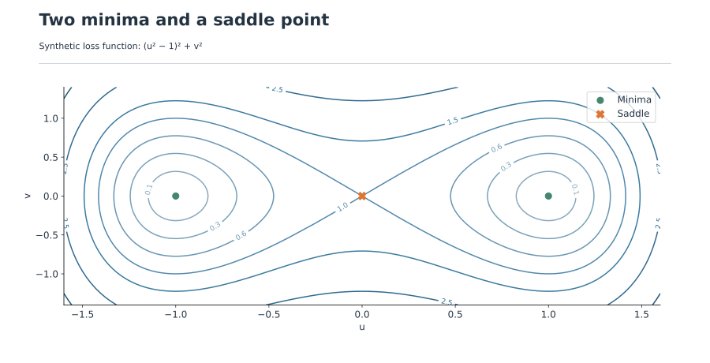

# M19-L9 – Non-Convex Optimisation and Landscapes of Deep Networks {#L9}

**Course area:** M19 – Advanced Deep Learning

**Level:** Master · Elective specialisation

**Prerequisites:** M9, M17, [M19-L1](M19-L1.md), [M19-L8](M19-L8.md).

**Learning objective:** Recognise saddle points, symmetries and local curvature and explain the limitations of two-dimensional loss plots.

## Stationary does not mean optimal {#S1}

In a deep network, training loss as a function of all weights is generally non-convex. A stationary point satisfies $\nabla L=0$ but can be a minimum, maximum or saddle point. For twice differentiable $L$, the Hessian examines local curvature. Mixed positive and negative eigenvalues at a stationary point establish a saddle. Positive definiteness is sufficient for a strict local minimum, but semidefiniteness alone is not. At ReLU kinks, an appropriate local analysis must replace the classical second derivative.

## A teaching model with two valleys {#S2}




*Figure: Two minima and a saddle point.*

We examine the following original two-dimensional function:

$$L(u,v)=(u^2-1)^2+v^2.$$

The gradient is $(4u(u^2-1),2v)$, and the Hessian is diagonal with $(12u^2-4,2)$. The stationary points are $(0,0)$ and $(\pm1,0)$. At the origin the eigenvalues are -4 and 2, hence a saddle; at the other two points they are 8 and 2, hence strict minima of value 0. The diagram shows contour lines and marks all three points. Gradient descent with a learning rate of 0.05 from the starting point $(0.1,1)$ moves towards the right-hand valley; deterministic descent starting exactly on $u=0$, by contrast, does not leave this axis of symmetry.

```python
import numpy as np
def grad(w):
    u,v=w; return np.array([4*u*(u*u-1),2*v])
w=np.array([.1,1.])
for _ in range(150): w-=.05*grad(w)
assert np.allclose(w,[1,0],atol=1e-6)
assert np.allclose(grad([0,0]),0)
print(w)
```

## Significance and limitations for deep networks {#S3}

Swapping neurons in a hidden layer can leave the network function unchanged if the following weights are swapped correspondingly. Scaling symmetries also often produce equivalent parametrisations: for $a>0$, $\operatorname{ReLU}(ax)=a\operatorname{ReLU}(x)$ holds, so preceding and subsequent weights can be scaled in opposite directions. A raw curvature measure therefore depends on parametrisation. A visualisation $L(\theta_0+u d_1+v d_2)$ shows only the chosen plane of the high-dimensional landscape. Directions should be meaningfully normalised and results checked across several slices. Wide valleys are not automatically evidence of good generalisation. Stochastic gradients, momentum and suitable initialisation can alter the trajectory; a general proof of global optimality does not follow. Validation remains necessary.

## Exercise with solution {#S4}

Examine $L(u,v)=u^4+v^2$ at the origin. The Hessian eigenvalues are 0 and 2, yet the point is a strict global minimum because both terms are non-negative and vanish together only there. This explains why vanishing curvature does not automatically imply a flat set of minima or a saddle.

## Sources and further reading {#S5}

- [Goodfellow, Bengio, Courville: Deep Learning, Chapter 8](https://www.deeplearningbook.org/contents/optimization.html) · optimisation problems, initialisation, adaptive methods
- [Li et al. (2018): Visualizing the Loss Landscape of Neural Nets](https://arxiv.org/abs/1712.09913) · visualisation limits and normalisation
