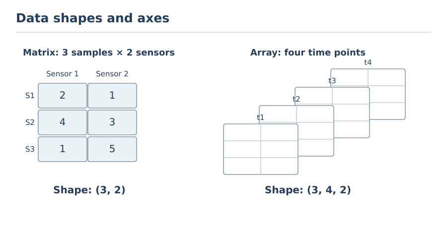

# M2-L1 – Vectors, matrices and data tensors {#L1}

**Course area:** M2 – Mathematics for data-driven methods

**Level:** Bachelor · Core/Fundamentals

**Prerequisites:** M1; school-level algebra.

**Learning objective:** Model data as arrays, interpret their shapes and calculate a linear transformation.

## From a measurement record to a matrix {#S1}

A laboratory measures two dimensionless, already normalised sensor values for each of three samples. A single observation can be written as a column vector, and several observations as a matrix. We define each row as an observation and each column as a sensor. All numbers in this module are original synthetic examples.

$$x=\begin{pmatrix}2\\1\end{pmatrix},\qquad X=\begin{pmatrix}2&1\\4&3\\1&5\end{pmatrix}.$$

The vector has two components and the matrix has shape $3\times 2$. In general, $X\in\mathbb R^{n\times d}$ means that there are $n$ rows and $d$ columns with real-valued entries. An index pair $X_{ij}$ identifies the value in row $i$ and column $j$; in mathematical notation we start at 1. Transposition exchanges the two axes. $X^T$ therefore has shape $2\times3$.

## Axes and tensor shapes {#S2}

*Figure: Data shapes and axes.*

If the same three samples are analysed at four time points, the result is a three-dimensional array $T\in\mathbb R^{3\times4\times2}$. Here the axes represent sample, time point and sensor. $T_{2,3,1}$ refers to sensor 1 on sample 2 at the third time point. A matrix is a special case of a multidimensional array. In data science such an array is often called a tensor. The stricter mathematical notion of a tensor also includes specified transformation properties; these are not assumed here.

Shape is not a complete description: two arrays can have the same size but different meanings for their axes. Swapping the time and sensor axes can produce computationally valid but scientifically incorrect results. NumPy uses zero-based indices: the value mentioned above is found at `T[1, 2, 0]`.

## Linear combinations of features {#S3}

For a simple indicator, the first sensor receives weight 2 and the second weight $-1$. With $w=(2,-1)^T$ we calculate all three indicators at once:

$$Xw=\begin{pmatrix}4-1\\8-3\\2-5\end{pmatrix}=\begin{pmatrix}3\\5\\-3\end{pmatrix}.$$

In a matrix product $(n\times d)(d\times k)$, the inner dimensions must match. The result has $n$ rows and $k$ columns. This is not element-wise multiplication. The weights may later be learnt; here they are specified in advance. For raw values with different units, the weights and scaling must be justified in the application domain.

## Exercise and solution {#S4}

Calculate $Xv$ for $v=(1,2)^T$. What is the shape of $X^TX$? How many entries does the array $T$ above contain?

Solution: $Xv=(4,10,11)^T$. $X^TX$ has shape $2\times2$ because the shared dimension 3 is contracted. $T$ has $3\cdot4\cdot2=24$ entries. The next lesson explains how to compare two feature vectors.

## Sources and further reading {#S5}

- [NumPy 2.3, NumPy: the absolute basics for beginners, Array attributes (documentation; search excerpt).](https://numpy.org/doc/2.3/user/absolute_beginners.html) – **Verification:** pending; access date recorded only in source register (2026-11-20); substantive check not evidenced.
- [MIT Symm4ML, Linear Algebra for Representations, sections 1–5 and 10–11 (online course notes).](https://symm4ml.mit.edu/symm4ml_s26/notes/linear-algebra) – **Verification:** pending; access date recorded only in source register (2026-11-20); substantive check not evidenced.
