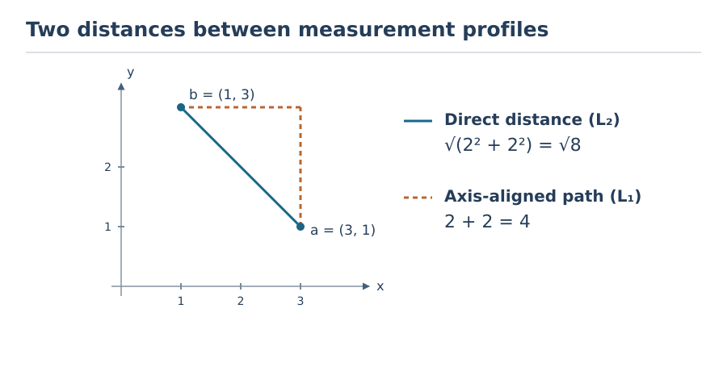

# M2-L2 – Dot products, norms and distances {#L2}

**Course area:** M2 – Mathematics for data-driven methods

**Level:** Bachelor · Core/Fundamentals

**Prerequisites:** [M2-L1](M2-L1.md).

**Learning objective:** Calculate lengths, Euclidean distances and cosine similarity, and assess their dependence on scale.

## Comparing two measurement profiles {#S1}

Let two normalised measurement profiles be $a=(3,1)^T$ and $b=(1,3)^T$. A comparison may ask how much the values differ, or whether both profiles point in a similar direction. These questions are not equivalent: a vector twice as large has the same direction but may be far away.

For real vectors of the same length, the dot product is

$$a^Tb=\sum_{i=1}^{d}a_ib_i=3\cdot1+1\cdot3=6.$$

It produces a single number. Orthogonality means a dot product of zero. However, the sign alone is not sufficient to assess the degree of similarity: the lengths of the vectors also influence the result.

## Norms measure magnitude {#S2}

*Figure: Two distances between measurement profiles.*

The $L_1$ norm adds absolute values, the $L_2$ norm calculates geometric length, and the maximum norm considers the component with the greatest absolute value:

$$\|x\|_1=\sum_i|x_i|,\qquad\|x\|_2=\sqrt{\sum_i x_i^2},\qquad\|x\|_\infty=\max_i|x_i|.$$

For $a$ the results are 4, $\sqrt{10}$ and 3. The distance between two vectors associated with the respective norm is $d_p(a,b)=\|a-b\|_p$. From $a-b=(2,-2)^T$ we obtain $d_1=4$, $d_2=\sqrt{8}$ and $d_\infty=2$. Euclidean distance is the length of the straight line joining the points, whereas $d_1$ gives the sum of the horizontal and vertical changes.

## Direction and scaling {#S3}

The cosine of the angle between two non-zero real vectors is

$$s(a,b)=\frac{a^Tb}{\|a\|_2\|b\|_2}=\frac{6}{10}=0.6.$$

Cosine similarity ranges from $-1$ to 1. It is undefined for a zero vector. For $a$ and $2a$ it is 1, although their Euclidean distance is $\sqrt{10}$. Accordingly, it is useful when the direction of a feature profile matters more than its overall magnitude. Unlike Euclidean distance, $1-s$ is generally not a metric.

Changing the unit of measurement of a single axis changes distances and often angles as well. For heterogeneous features, standardisation using the training mean and training standard deviation can help. It does not replace domain-specific weighting: some features may be more important than others. Features with no variation require special treatment.

## Exercise and solution {#S4}

Given $u=(2,0)^T$, $v=(0,4)^T$ and $w=(4,0)^T$, calculate the cosine similarities $s(u,v)$, $s(u,w)$ and the two Euclidean distances.

Solution: the dot products are 0 and 8, giving similarities of 0 and 1. The distances are $\sqrt{20}$ and 2, respectively. When searching for similar data points, the criterion for defining similarity must therefore be established first. Next, the dot product will also enable geometric projections.

## Sources and further reading {#S5}

- [MIT Symm4ML, Linear Algebra for Representations, sections 1–5 and 10–11 (online course notes).](https://symm4ml.mit.edu/symm4ml_s26/notes/linear-algebra) – **Verification:** pending; access date recorded only in source register (2026-11-20); substantive check not evidenced.
