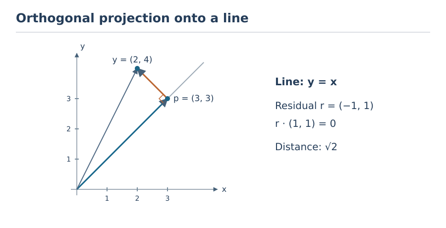

# M2-L3 – Systems of linear equations and projections {#L3}

**Course area:** M2 – Mathematics for data-driven methods

**Level:** Bachelor · Core/Fundamentals

**Prerequisites:** [M2-L1](M2-L1.md) to [M2-L2](M2-L2.md).

**Learning objective:** Distinguish exact and overdetermined linear systems and derive an orthogonal projection.

## Determining unknowns from measurements {#S1}

A simple calibration model describes two unknown parameters $x_1,x_2$ using two equations:

$$Ax=b,\quad A=\begin{pmatrix}1&1\\2&1\end{pmatrix},\quad b=\begin{pmatrix}5\\8\end{pmatrix}.$$

Subtracting the first equation from the second gives $x_1=3$. Substitution yields $x_2=2$. The solution is unique because the columns of $A$ are linearly independent. For square invertible matrices, $x=A^{-1}b$ exists in theory. Numerically, the system is usually solved directly without computing the entire inverse.

When there are more measurement equations than parameters, an exact solution is not guaranteed. Noise may cause the measured values to lie outside the column space of $A$. We then seek a value that keeps the discrepancies small.

## Projection onto a line {#S2}

*Figure: Orthogonal projection onto a line.*

A one-dimensional model is to approximate the measurement vector $y=(2,4)^T$ by a multiple of $u=(1,1)^T$. The closest point on the line $\{tu:t\in\mathbb R\}$ is the orthogonal projection $p$. The residual vector $r=y-p$ is perpendicular to $u$; hence $u^T(y-tu)=0$. Solving gives

$$t=\frac{u^Ty}{u^Tu}=\frac{6}{2}=3,\qquad p=(3,3)^T,\qquad r=(-1,1)^T.$$

Orthogonality can be checked directly: $u^Tr=-1+1=0$. The distance to the line is $\sqrt2$. The solution exists and is unique because $u\ne0$. The diagram shows $y=p+r$ and the right angle between the line and the residual vector.

## Least squares for several parameters {#S3}

For a general real-valued system we consider the minimisation problem

$$\min_x\|Ax-b\|_2^2.$$

At the minimum, the residual $b-Ax$ is orthogonal to each column of $A$. This gives the normal equations

$$A^TAx=A^Tb.$$

If $A$ has full column rank, the solution is unique. Even with rank deficiency, a best approximating vector exists in the column space, but several parameter vectors can produce the same vector. In numerical methods, QR or singular value decomposition is often more suitable than explicitly forming $A^TA$: squaring the singular values worsens the conditioning of an ill-conditioned problem.

## Exercise and solution {#S4}

Project $y=(4,1)^T$ onto the line with direction vector $u=(2,1)^T$. Calculate the residual as well.

Solution: $t=(8+1)/(4+1)=9/5$. Hence $p=(18/5,9/5)^T$ and $r=(2/5,-4/5)^T$. The check $u^Tr=4/5-4/5=0$ confirms the right angle. In later regression lessons this geometric idea becomes a method for parameter estimation.

## Sources and further reading {#S5}

- [MIT Symm4ML, Linear Algebra for Representations, sections 1–5 and 10–11 (online course notes).](https://symm4ml.mit.edu/symm4ml_s26/notes/linear-algebra) – **Verification:** pending; access date recorded only in source register (2026-11-20); substantive check not evidenced.
