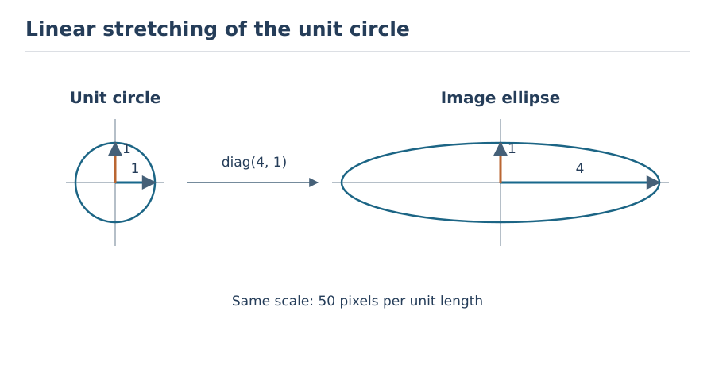

# M2-L4 – Eigenvalues, singular values and matrix factorisations {#L4}

**Course area:** M2 – Mathematics for data-driven methods

**Level:** Bachelor · Core/Fundamentals

**Prerequisites:** [M2-L1](M2-L1.md) to [M2-L3](M2-L3.md).

**Learning objective:** Distinguish eigendirections, singular value decomposition and rank reduction.

## Directions of a linear transformation {#S1}

A square matrix $A$ can rotate, stretch, compress or redirect a vector. An eigenvector $v\ne0$ defines a direction whose line is preserved by the transformation (possibly collapsed to zero):

$$Av=\lambda v.$$

$\lambda$ is called an eigenvalue. A negative eigenvalue reverses the orientation; a zero eigenvalue maps the vector to zero. Consider the real matrix

$$A=\begin{pmatrix}2&1\\1&2\end{pmatrix}.$$

We have $A(1,1)^T=3(1,1)^T$ and $A(1,-1)^T=(1,-1)^T$. The eigenvalues are 3 and 1. In general, eigenvalues are obtained as solutions of $\det(A-\lambda I)=0$ (over the complex numbers if necessary). A real symmetric matrix has an orthonormal eigenbasis and can be written as $A=Q\Lambda Q^T$.

## Singular values for rectangular matrices too {#S2}

*Figure: Linear stretching of the unit circle.*

A rectangular data matrix cannot have an eigenvalue decomposition in the sense described above. Singular value decomposition (SVD), however, exists for every real matrix. For $B\in\mathbb R^{m\times n}$ we have

$$B=U\Sigma V^T.$$

$U$ and $V$ are orthogonal matrices of sizes $m\times m$ and $n\times n$. The rectangular diagonal matrix $\Sigma$ has non-negative singular values $\sigma_1\ge\sigma_2\ge\dots\ge0$. They are the square roots of the corresponding eigenvalues of $B^TB$ (with only $\min(m,n)$ singular values, including zeros where appropriate). The normalised right singular vectors specify input directions, while the left singular vectors specify the corresponding output directions for positive singular values.

For $B=\mathrm{diag}(4,1)$ both changes of basis are the identity and the singular values are 4 and 1. The unit circle becomes an ellipse with semi-axes 4 and 1. The diagram illustrates this transformation.

## Factorisation and data compression {#S3}

Matrices can be factored for different tasks. QR decomposes a matrix into orthonormal directions and an upper triangular factor; LU uses triangular factors (with permutation if necessary). An SVD can be used for rank reduction:

$$B_k=\sum_{i=1}^{k}\sigma_i u_i v_i^T.$$

If we retain only the largest singular value in the example, we obtain $B_1=\mathrm{diag}(4,0)$. The error in the Frobenius norm is 1. In general, this truncation gives a best rank-$k$ approximation in the Frobenius norm. However, small singular values are not automatically unimportant in the application domain. A rare but relevant data structure may have little total energy.

## Exercise and solution {#S4}

For $C=\mathrm{diag}(-5,2)$, determine the eigenvalues and singular values. What is the error in the Frobenius norm of a rank-1 version obtained by truncating the SVD?

Solution: the eigenvalues are $-5$ and 2; $C^TC=\mathrm{diag}(25,4)$, so the singular values are 5 and 2. The error is 2. Eigenvalues may be negative, but singular values cannot. This distinction is needed later for principal component analysis and numerical stability.

## Sources and further reading {#S5}

- [MIT Symm4ML, Linear Algebra for Representations, sections 1–5 and 10–11 (online course notes).](https://symm4ml.mit.edu/symm4ml_s26/notes/linear-algebra) – **Verification:** pending; access date recorded only in source register (2026-11-20); substantive check not evidenced.
- [MIT OpenCourseWare, Linear Algebra 18.06SC, Singular Value Decomposition (session overview).](https://ocw.mit.edu/courses/18-06sc-linear-algebra-fall-2011/pages/positive-definite-matrices-and-applications/singular-value-decomposition/) – **Verification:** pending; access date recorded only in source register (2026-11-20); substantive check not evidenced.
