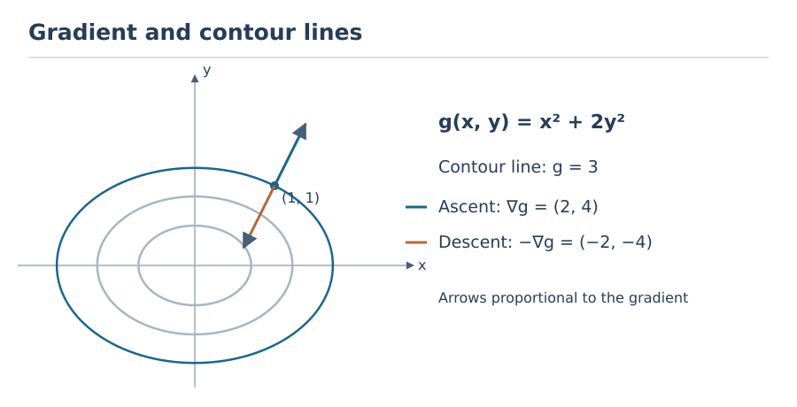

# M2-L5 – Derivatives, gradients and Jacobian matrices {#L5}

**Course area:** M2 – Mathematics for data-driven methods

**Level:** Bachelor · Core/Fundamentals

**Prerequisites:** [M2-L1](M2-L1.md) to [M2-L4](M2-L4.md); elementary differentiation rules.

**Learning objective:** Interpret partial derivatives and the Jacobian matrix, and estimate local changes.

## Changes in a model function {#S1}

A model has several adjustable parameters. How sensitive is its output to changes in these parameters? The derivative of a scalar function of one variable is the limit of the difference quotient, if it exists:

$$f'(x)=\lim_{h\to0}\frac{f(x+h)-f(x)}h.$$

For $f(x)=x^2$ we have $f'(x)=2x$. At $x=3$, for a small positive step $h$, the function value changes by approximately $6h$. This is a local statement, not an exact value for arbitrary step sizes.

## Partial derivatives and the gradient {#S2}

*Figure: Gradient and contour lines.*

For $g(x,y)=x^2+2y^2$ we examine one variable at a time while holding the other fixed. The partial derivatives are $\partial g/\partial x=2x$ and $\partial g/\partial y=4y$. Together they form the column gradient

$$\nabla g(x,y)=\begin{pmatrix}2x\\4y\end{pmatrix}.$$

At $(1,1)$ it is $(2,4)^T$. For a small step $h=(0.1,-0.1)^T$, assuming differentiability, we have approximately $\Delta g\approx\nabla g^Th=-0.2$. The exact new value $g(1.1,0.9)=2.83$ is $0.17$ below the initial value of 3. The approximation neglects curvature. With the Euclidean norm, the gradient, provided it is non-zero, points in the direction of steepest local ascent; the negative gradient points in the opposite direction. The diagram marks ascent and descent perpendicular to the contour line.

## Several outputs: the Jacobian matrix {#S3}

For a vector-valued function $F:\mathbb R^n\to\mathbb R^m$ the derivatives are arranged in a matrix $J$. Its rows represent outputs, and its columns represent inputs. For example,

$$F(x,y)=\begin{pmatrix}xy\\x+2y\end{pmatrix},\qquad J_F(x,y)=\begin{pmatrix}y&x\\1&2\end{pmatrix}.$$

Near $(2,3)$ the step $(0.1,0)^T$ produces the change $(0.3,0.1)^T$. In this special case the linear approximation is exact because only $x$ changes. For composed differentiable functions $G\circ F$ the chain rule is $J_{G\circ F}(x)=J_G(F(x))J_F(x)$. The dimensions determine the order. Many methods for computing derivatives in neural networks are also based on this rule.

## Exercise and solution {#S4}

Calculate the gradient of $q(x,y)=3x^2+xy$ at $(2,1)$ and the approximate change for the step $(0,0.1)$.

Solution: $\nabla q=(6x+y,x)^T=(13,2)^T$. The linear change is $0.2$; here it is exact. For non-differentiable functions, such as $|x|$ at zero, such a classical derivative is not available. The next lesson also examines changes in the gradient.

## Sources and further reading {#S5}

- [MIT OpenCourseWare, 18.S096 Matrix Calculus for Machine Learning and Beyond, Lecture Notes and Readings (HTML overview).](https://ocw.mit.edu/courses/18-s096-matrix-calculus-for-machine-learning-and-beyond-january-iap-2023/pages/lecture-notes-and-readings/) – **Verification:** pending; access date recorded only in source register (2026-11-20); substantive check not evidenced.
