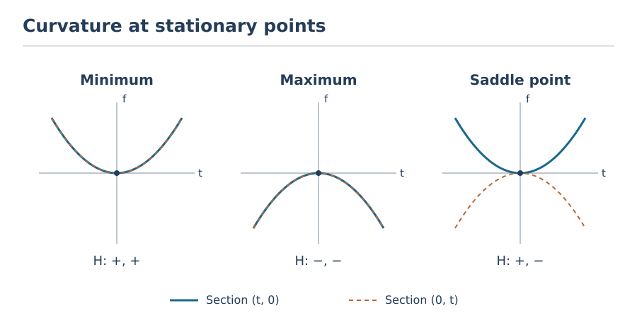

# M2-L6 – Multivariate functions, the Hessian matrix and Taylor approximation {#L6}

**Course area:** M2 – Mathematics for data-driven methods

**Level:** Bachelor · Core/Fundamentals

**Prerequisites:** [M2-L5](M2-L5.md).

**Learning objective:** Describe curvature using the Hessian matrix and apply a local quadratic approximation.

## Why slope alone is not enough {#S1}

For a differentiable function $f:\mathbb R^n\to\mathbb R$, the gradient describes the local slope. At a stationary point, $\nabla f=0$. This does not yet imply a minimum: a maximum or saddle point can have the same property.

The Hessian matrix collects the second partial derivatives:

$$H_{ij}(x)=\frac{\partial^2 f}{\partial x_i\partial x_j}(x).$$

If these derivatives are continuous in a neighbourhood, $H$ is symmetric. Along the line $x+tv$ with fixed direction vector $v$, the second derivative at $t=0$ is $v^TH(x)v$. Its magnitude and sign may vary with direction.

## Three types of curvature {#S2}

*Figure: Curvature at stationary points.*

Consider the functions $f_1=x^2+y^2$, $f_2=-x^2-y^2$ and $f_3=x^2-y^2$. All three have a zero gradient at the origin. The Hessian matrices are diagonal, with diagonal entries $(2,2)$, $(-2,-2)$ and $(2,-2)$, respectively.

| Hessian matrix at the stationary point | Conclusion |
|---|---|
| Positive definite | Strict local minimum |
| Negative definite | Strict local maximum |
| Indefinite | Saddle point |

These criteria apply under sufficient smoothness; if the matrix is merely semidefinite, classification may remain inconclusive. For example, $x^4$ and $-x^4$ both have a second derivative of zero at the origin but different types of extrema. The diagram shows cross-sections of the three two-dimensional functions along the coordinate axes.

## Second-order Taylor approximation {#S3}

For a twice continuously differentiable function, in a neighbourhood of $a$ we have

$$f(a+h)=f(a)+\nabla f(a)^Th+\tfrac12 h^TH(a)h+o(\|h\|_2^2).$$

The remainder notation means that the remainder divided by $\|h\|_2^2$ tends to zero as $h$ tends to zero. For $f(x,y)=x^2+xy+2y^2$ and $a=(1,1)^T$ we have $f(a)=4$, $\nabla f(a)=(3,5)^T$ and $H=\begin{pmatrix}2&1\\1&4\end{pmatrix}$. With $h=(0.2,-0.1)^T$ the linear contribution is $0.1$ and the quadratic contribution is $0.04$. The new function value is $4.14$. For this quadratic function the remainder is exactly zero. For general functions the approximation is reliable only locally; a large step may misrepresent the curvature.

## Exercise and solution {#S4}

Determine the gradient and Hessian matrix of $q(x,y)=x^2+4y^2-2x$. Where is the stationary point, and how can it be classified?

Solution: $\nabla q=(2x-2,8y)^T$; the gradient vanishes at $(1,0)$. $H=\mathrm{diag}(2,8)$ is positive definite. The point is a strict local minimum, and in this case also a global minimum, since $q=(x-1)^2+4y^2-1$. This analysis forms the basis of curvature-based optimisation methods.

## Sources and further reading {#S5}

- [MIT OpenCourseWare, 18.S096 Matrix Calculus for Machine Learning and Beyond, Lecture Notes and Readings (HTML overview).](https://ocw.mit.edu/courses/18-s096-matrix-calculus-for-machine-learning-and-beyond-january-iap-2023/pages/lecture-notes-and-readings/) – **Verification:** pending; access date recorded only in source register (2026-11-20); substantive check not evidenced.
