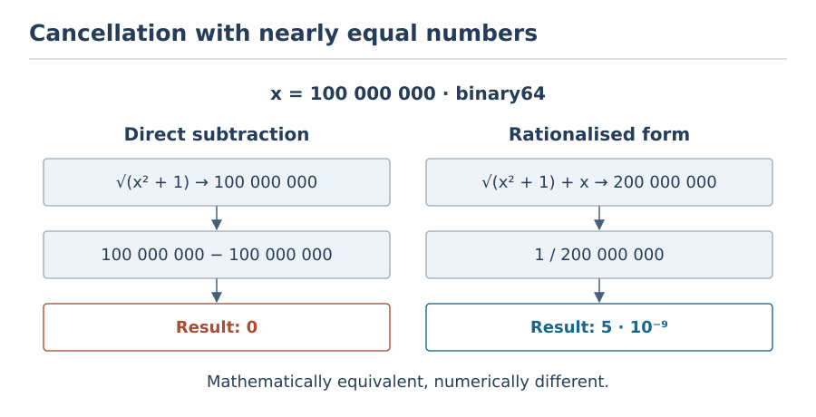

# M2-L7 – Numerical stability and floating-point arithmetic {#L7}

**Course area:** M2 – Mathematics for data-driven methods

**Level:** Bachelor · Core/Fundamentals

**Prerequisites:** [M2-L1](M2-L1.md) to [M2-L6](M2-L6.md).

**Learning objective:** Distinguish rounding, cancellation, conditioning and stability, and formulate a more stable calculation.

## Real numbers and their machine representation {#S1}

A computer stores real numbers only approximately. In the widely used IEEE 754 binary64 format, 53 significant binary digits are available for normalised numbers (including the implicit leading digit). An exponent is stored in addition to the sign. Because the available number space is finite, many decimal fractions cannot be represented exactly.

The gap between 1 and the next larger binary64 number is $2^{-52}$. When rounding to nearest, the relative rounding error bound for normalised results is typically at most $u=2^{-53}$, provided overflow or underflow does not violate the assumptions of the model. The absolute gap between adjacent numbers is not uniform.

## Cancellation and rearranged formulae {#S2}




*Figure: Cancellation with nearly equal numbers.*

In binary64 with rounding to nearest, let us calculate the following expression at $x=10^8$:

$$d=\sqrt{x^2+1}-x.$$

The square is $10^{16}$; there the gap to the next representable number is 2. Adding 1 in the usual rounding mode (ties to even) rounds to $10^{16}$. The two terms of the subsequent subtraction therefore appear identical, and the numerical result is zero. Mathematically, $d$ is positive. Rationalising gives

$$d=\frac{1}{\sqrt{x^2+1}+x}\approx5\cdot10^{-9}.$$

The result can now be well approximated even in binary64. In this case the rearrangement avoids subtracting almost identical numbers. For extremely large magnitudes, possible overflow when forming the square must also be prevented. The diagram compares the two calculation paths.

## Problem conditioning and algorithm stability {#S3}

Conditioning describes how strongly the mathematical solution changes when the inputs are perturbed slightly. For an invertible matrix, with respect to the Euclidean norm, $\kappa_2(A)=\sigma_{\max}/\sigma_{\min}$. If this ratio is large, small errors in the data can be greatly amplified. For example, the matrix $\mathrm{diag}(1,10^{-6})$ has condition number $10^6$.

Stability, by contrast, is a property of a specific computational procedure. A backward stable algorithm delivers approximately an exact solution to a slightly perturbed problem. Even then, poor conditioning can lead to a large forward error. The concepts are therefore not interchangeable.

## Exercise and solution {#S4}

Compare the two calculation paths in Python:

```python
import math
x = 100_000_000.0
root = math.sqrt(x*x + 1.0)
print(root - x)
print(1.0 / (root + x))
```

Solution on a typical binary64 system: `0.0` and `5e-09`. Check approximate values using absolute and relative tolerances chosen for the application rather than blindly testing exact equality. Such tests must take the scale of the problem into account. The module thus ends with an important limitation of numerical models: correct mathematics alone does not guarantee a reliable implementation.

## Sources and further reading {#S5}

- [Python 3.14, Floating-Point Arithmetic: Issues and Limitations, ch. 15 (documentation).](https://docs.python.org/3.14/tutorial/floatingpoint.html) – **Verification:** pending; access date recorded only in source register (2026-11-20); substantive check not evidenced.
- [MIT Symm4ML, Linear Algebra for Representations, sections 1–5 and 10–11 (online course notes).](https://symm4ml.mit.edu/symm4ml_s26/notes/linear-algebra) – **Verification:** pending; access date recorded only in source register (2026-11-20); substantive check not evidenced.
