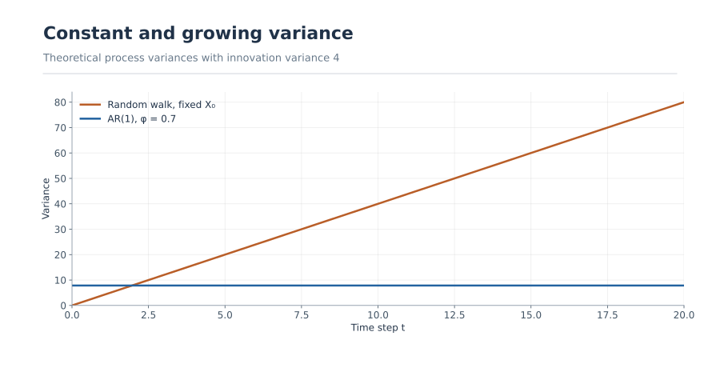

# M20-L1 – Stationarity, Autocorrelation and Time-Series Splits {#L1}

**Course area:** M20 – Time Series, Spatial and Functional Data

**Level:** Master · Elective/methods

**Prerequisites:** M17, M18.

**Learning objective:** Recognise weakly stationary processes, interpret autocorrelation and validate forecasts in chronological order.

## Time is part of the data {#S1}

The hourly power of a cooling plant cannot be treated like a randomly ordered sample. Temperatures, control mechanisms and the environment introduce temporal dependencies. A process $Y_t$ is weakly stationary if its expected value $\mu$ and finite variance are constant and $\operatorname{Cov}(Y_t,Y_{t-k})=\gamma(k)$ depends only on the lag $k$. Strict stationarity requires all finite-dimensional distributions to be invariant under shifts in time. The two concepts are not equivalent. A strictly stationary process with finite second moments is weakly stationary.

A realisation may appear to contain long trends even though its generating process is stationary. Conversely, a short non-stationary series may look unremarkable. Autocorrelation is not a causal explanation; it describes linear temporal dependence.

## Autocorrelation and differences {#S2}




*Figure: Stationary series and random-walk variance.*

For $\gamma(0)>0$, $\rho(k)=\gamma(k)/\gamma(0)$. An empirical ACF may use

$$\widehat\rho(k)=\frac{\sum_{t=k+1}^{n}(y_t-\bar y)(y_{t-k}-\bar y)}{\sum_{t=1}^{n}(y_t-\bar y)^2}.$$

For $Y_t=0.7Y_{t-1}+\varepsilon_t$ with white noise of variance 4 and stationary initialisation, we have $\gamma(0)=4/(1-0.7^2)\approx7.843$ and $\rho(k)=0.7^k$. In contrast, the random walk $X_t=X_{t-1}+\varepsilon_t$ with fixed $X_0$ has growing variance $4t$. Its first differences are the original noise. The diagram illustrates the theoretical variances. An AR(1) series with negative feedback has alternating correlations; a slowly decaying ACF, however, can indicate persistence or non-stationarity.

```python
import numpy as np
k = np.arange(5)
rho = .7**k
v = 4/(1-.7**2)
assert np.isclose(v, 7.8431372549)
assert np.isclose(rho[3], .343)
print(v, rho)
```

## Chronologically valid training and test data {#S3}

For a one-hour forecast at the end of hour 120, only values actually available by that time may be used. Scaling, imputation and feature selection must also be based on the training segment. Rolling forecast origins recreate this scenario: for example, train through hour 120, forecast hours 121–124, then train through hour 124 and forecast hours 125–128. Overlapping target windows or delayed labels may require an additional gap. Conventional random splits are often optimistic here.

Unit-root tests (ADF) and stationarity tests (KPSS) have different null hypotheses. Trends, seasonal changes and structural breaks can affect both. Differencing does not automatically improve forecasting and can generate negative autocorrelation when overdone. Diagnosis, domain plausibility and backtesting belong together.

## Exercise with solution {#S4}

A stationary AR(1) process has $\phi=-0.5$ and innovation variance 3. Calculate its variance and ACF for the first three positive lags. Solution: $3/(1-0.25)=4$; the correlations are $-0.5$, $0.25$ and $-0.125$. When forecasting hours 201–204, randomly mixing the data with measurements taken after hour 200 is inadmissible.

## Sources and further reading {#S5}

- [Hyndman and Athanasopoulos: Forecasting: Principles and Practice, 3rd ed., Chapter 9](https://otexts.com/fpp3/arima.html) · stationarity, differencing, ARIMA and SARIMA
- [Hyndman and Athanasopoulos: Forecasting: Principles and Practice, 3rd ed., Chapter 5](https://otexts.com/fpp3/toolbox.html) · time-series validation and distributional forecasting
