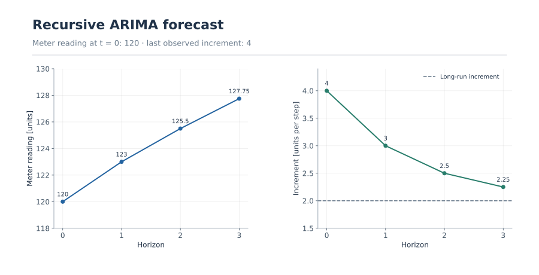

# M20-L2 – ARIMA and Seasonal Models {#L2}

**Course area:** M20 – Time Series, Spatial and Functional Data

**Level:** Master · Elective/methods

**Prerequisites:** M17, M18, [M20-L1](M20-L1.md).

**Learning objective:** Combine AR, MA and differencing terms and transform forecasts back to the original scale.

## From lag to model equation {#S1}

Using the backshift operator $By_t=y_{t-1}$, ARIMA separates three tasks: dynamic feedback, differencing and the processing of earlier innovation shocks. Under a common sign convention, ARIMA$(p,d,q)$ is given by

$$\phi(B)(1-B)^dy_t=c+\theta(B)\varepsilon_t,$$

where $\phi(B)=1-\phi_1B-\cdots-\phi_pB^p$ and $\theta(B)=1+\theta_1B+\cdots+\theta_qB^q$. An MA term is therefore not a moving average of the data. The innovation sequence has zero expectation and constant variance; normally distributed forecast intervals require additional distributional assumptions. The roots of $\phi$ outside the unit circle ensure stationarity of the AR component; the corresponding property of $\theta$ ensures invertibility.

## Recursion on the original scale {#S2}




*Figure: Recursive ARIMA forecast.*

Suppose the latest meter reading is 120 units and its last increment was four units. The model for increments is $z_t=2+0.5(z_{t-1}-2)+\varepsilon_t$ with $z_t=y_t-y_{t-1}$. This is an ARIMA(1,1,0) with drift (mean increment 2). Assuming that future innovations have mean zero, the next expected increments are 3, 2.5 and 2.25. On the original scale these correspond to 123, 125.5 and 127.75. Forecasting only the differences would not suffice for planning. The diagram shows both quantities on a common time axis but with separate unit ranges.

```python
import numpy as np
h = np.arange(1,4)
z = 2 + (4-2)*.5**h
y = 120 + np.cumsum(z)
assert np.allclose(z,[3,2.5,2.25])
assert np.allclose(y,[123,125.5,127.75])
print(z,y)
```

## Seasonal structure and model selection {#S3}

For quarterly calendar data, the seasonal period can be $s=4$. A multiplicative SARIMA model extends the equation to

$$\phi(B)\Phi(B^s)(1-B)^d(1-B^s)^D y_t=c+\theta(B)\Theta(B^s)\varepsilon_t.$$

The seasonal difference is $y_t-y_{t-s}$. Before estimating further terms, check that the seasonal period is meaningful in the domain and stable; movable holidays may require regressors instead of pure periodicity. ACF/PACF provide starting points for model orders, and information criteria such as AICc support selection for comparable likelihoods (particularly with the same differencing). Check residuals for remaining dependence, for example with the Ljung–Box test; a non-significant test does not prove the model. Compare against naïve and seasonal naïve forecasts in backtesting. Future values of exogenous regressors must actually be available or forecast themselves.

## Exercise with solution {#S4}

The latest meter reading is 90 and the last increment is 0. The same model yields increments of 1 and 1.5, hence forecasts of 91 and 92.5. For a seasonal naïve quarterly model whose latest observed quarters are 7, 10, 9, 12, the next four forecasts are 7, 10, 9, 12.

## Sources and further reading {#S5}

- [Hyndman and Athanasopoulos: Forecasting: Principles and Practice, 3rd ed., Chapter 9](https://otexts.com/fpp3/arima.html) · stationarity, differencing, ARIMA and SARIMA
