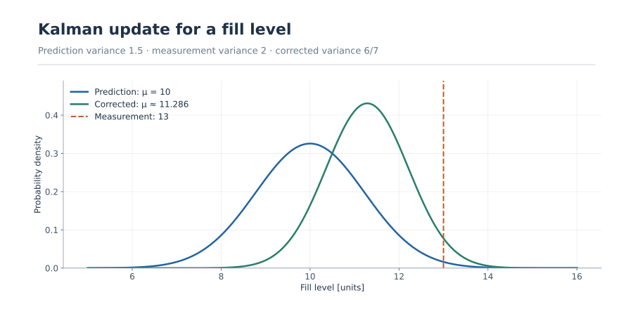

# M20-L3 – State-Space Models and Kalman Filters {#L3}

**Course area:** M20 – Time Series, Spatial and Functional Data

**Level:** Master · Elective/methods

**Prerequisites:** M17, M18.

**Learning objective:** Separate hidden system states from measurement errors and derive a filtering cycle.

## Dynamics and measurement channel {#S1}

A sensor records a slowly changing fill level. The actual fill level is not directly known and individual measurements are noisy. A linear state-space model separates these layers:

$$x_t=F x_{t-1}+w_t,\qquad y_t=H x_t+v_t.$$

Here $F$ is the state dynamics matrix and $H$ the observation matrix. Assume the disturbances $w_t,v_t$ have zero mean, are independent over time and mutually independent; their covariances are $Q$ and $R$. Under these assumptions, Gaussian initial states and disturbances yield exactly Gaussian conditional states. In other linear cases, under suitable second-moment assumptions, the Kalman filter minimises mean squared error within the class of linear estimators.

## Predicting and correcting {#S2}




*Figure: State-density update in the Kalman filter.*

From the last filtered mean $m$ and covariance $P$, first obtain $m^-=Fm$ and $P^-=FPF^\top+Q$. The innovation covariance is $S=HP^-H^\top+R$, and for invertible $S$ we obtain

$$K=P^-H^\top S^{-1},\quad m^+=m^-+K(y-Hm^-).$$

The Joseph form of the updated covariance is numerically useful:

$$P^+=(I-KH)P^-(I-KH)^\top+KRK^\top.$$

In the scalar fill-level model, let $F=H=1$, $m=10$, $P=1$, $Q=0.5$, $R=2$ and $y=13$. Before measurement, $P^-=1.5$, hence $K=1.5/3.5=3/7$. The corrected estimate is $10+9/7\approx11.286$ and its variance is $6/7\approx0.857$. The illustration depicts the two Gaussian state estimates before and after measurement; the measurement itself is at 13.

```python
import numpy as np
m,P,Q,R,y=10.,1.,.5,2.,13.
P0=P+Q
K=P0/(P0+R)
post=m+K*(y-m)
var=(1-K)**2*P0+K*K*R
assert np.allclose([K,post,var],[3/7,79/7,6/7])
print(K,post,var)
```

## Filters, smoothers and limitations {#S3}

Filtering uses only measurements up to $t$; smoothing also uses subsequent measurements and is therefore not a real-time forecast. Forecasting advances only the state step. If a measurement is missing, the correction step is omitted; an observed zero is a different matter. Non-linear dynamics can be handled by methods such as extended and unscented Kalman filters or particle filters; multimodal states often cannot be represented adequately by a single Gaussian state.

When $Q,R$ are unknown, their estimation must be separated from subsequent evaluation. Innovation residuals and their modelled dispersion help detect poorly calibrated filters. In multidimensional systems, observability must also be examined, for example using the rank of the stacked matrices $H,HF,\ldots,HF^{n-1}$. A numerically stable implementation solves linear systems rather than explicitly inverting matrices.

## Exercise with solution {#S4}

If the measurement variance is increased to 6, $K=1.5/7.5=0.2$; the new mean is 10.6 and the variance 1.2. The model places less trust in the measurement. If the measurement is missing entirely, the mean remains 10 and the variance 1.5 at this time step.

## Sources and further reading {#S5}

- [Welch and Bishop: An Introduction to the Kalman Filter, Section 1](https://homepages.inf.ed.ac.uk/rbf/CVonline/LOCAL_COPIES/WELCH/kalman.1.html) · discrete Kalman filter
