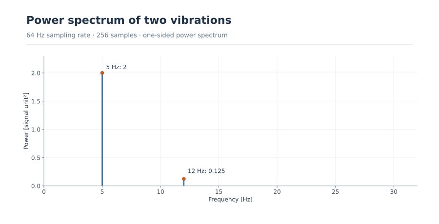

# M20-L4 – Spectral Analysis and Time-Dependent Features {#L4}

**Course area:** M20 – Time Series, Spatial and Functional Data

**Level:** Master · Elective/methods

**Prerequisites:** M17, M18, [M20-L1](M20-L1.md).

**Learning objective:** Determine frequency components from discrete signals and avoid aliasing and data leakage.

## Frequency rather than time {#S1}

A motor generates vibrations. Several superimposed periods may be difficult to distinguish from the time trace alone. From $N$ equally spaced samples $x_n$, the discrete Fourier transform calculates

$$X_k=\sum_{n=0}^{N-1}x_n\exp(-2\pi i kn/N).$$

At sampling rate $f_s$ in hertz, the frequency spacing is $f_s/N$. For real signals, the magnitudes at positive and negative frequencies are mirror images. Without suitable band-limiting, frequencies above $f_s/2$ cannot be uniquely reconstructed (aliasing). The FFT is an efficient algorithm for the same transform; it is not itself a model of the cause of a peak.

## A synthetic vibration signal {#S2}




*Figure: Spectrum of two oscillations.*

We measure four seconds at 64 Hz. The signal $x(t)=2\sin(2\pi\cdot5t)+0.5\sin(2\pi\cdot12t)$ contains 256 samples. Both frequencies fall exactly on grid points. With an unweighted window and a one-sided power spectrum, the powers at the two frequencies are $2^2/2=2$ and $0.5^2/2=0.125$. The unit is the squared signal unit; here the sum equals the variance of 2.125. A power spectral density (PSD), by contrast, is measured in signal units squared per hertz. The diagram shows the two peaks of the self-generated signal.

When the window contains a non-integer number of periods, energy spreads across neighbouring frequencies. Window functions such as Hann can suppress sidelobes but broaden the main lobe. Zero-padding provides a denser frequency grid; it does not improve the resolving power limited by measurement duration and window choice.

```python
import numpy as np
from scipy.signal import periodogram
fs=64; t=np.arange(256)/fs
x=2*np.sin(2*np.pi*5*t)+.5*np.sin(2*np.pi*12*t)
f,p=periodogram(x,fs=fs,scaling='spectrum')
assert np.allclose(p[[20,48]],[2,.125])
assert np.isclose(p.sum(),2.125)
print(f[np.argsort(p)[-2:]],p[[20,48]])
```

## Features for temporally valid models {#S3}

Typical features include band energy, dominant frequency, moving averages, variance and temporal gradients. Welch estimation averages modified periodograms over segments; when rotational speed varies, time-local methods (STFT, wavelets) may be useful. For a warning at time $t$, the window may extend only up to $t$. A centred window would use future measurements. A machine-state classifier should preferably be validated by machine and time block, rather than by randomly mixing heavily overlapping windows. With irregular sampling, the ordinary FFT grid is not directly applicable; for example, a Lomb–Scargle periodogram may be used.

## Exercise with solution {#S4}

At 80 Hz and 400 samples, the grid spacing is 0.2 Hz; the Nyquist frequency is 40 Hz. Without an anti-aliasing filter, an isolated sinusoid at 53 Hz appears at 27 Hz (with the corresponding phase/sign change). Distinguishing these cases requires additional knowledge or faster sampling.

## Sources and further reading {#S5}

- [SciPy: periodogram](https://docs.scipy.org/doc/scipy/reference/generated/scipy.signal.periodogram.html) · spectral density, frequencies and scaling
