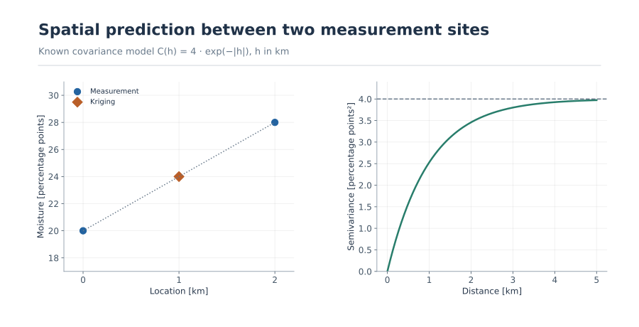

# M20-L5 – Spatial Dependence, Variograms and Kriging {#L5}

**Course area:** M20 – Time Series, Spatial and Functional Data

**Level:** Master · Elective/methods

**Prerequisites:** M17, M18.

**Learning objective:** Interpret a semivariogram and calculate ordinary kriging as a linear prediction problem.

## Distance and direction as model information {#S1}

Soil moisture at two neighbouring measurement sites is often more similar than at distant sites. The observational unit is now a location $s$; distances must be appropriate to the scale and coordinate system. Under intrinsic stationarity, increments have zero expectation and the variance of the difference depends only on the displacement vector $h$. The semivariogram is

$$\gamma(h)=\tfrac12\operatorname{Var}[Z(s+h)-Z(s)].$$

Under second-order stationarity with covariance $C(h)$, we have $\gamma(h)=C(0)-C(h)$. Empirically, squared differences between pairs of observations are grouped into distance classes and divided by twice the number of pairs. Under isotropy, only distance matters. A directional variogram can reveal anisotropy. A nugget describes a jump at small positive distances, for example due to measurement noise or microscale variation. A sill is a long-term plateau; the range characterises the distance at which spatial dependence practically or exactly dies away, depending on the model family.

## Weighted prediction at a new location {#S2}




*Figure: Kriging and variogram.*

Ordinary kriging estimates $\widehat Z(s_0)=\sum_i w_i Z(s_i)$ with a constant unknown mean and $\sum_iw_i=1$. For a valid covariance matrix $C$ and covariance vector $c$ to the target location, we solve

$$\begin{pmatrix} C&\mathbf{1}\\\mathbf{1}^\top&0\end{pmatrix}\begin{pmatrix}w\\\lambda\end{pmatrix}=\begin{pmatrix}c\\1\end{pmatrix}.$$

This equation minimises $C(0)-2w^\top c+w^\top Cw$ subject to the sum constraint. Two measurement sites are located at 0 and 2 km, with moisture values of 20 and 28 percentage points. For a target at 1 km and $C(h)=4\exp(-|h|)$ in squared percentage points (h expressed numerically in km), both covariances with the target are equal. By symmetry, $w=(0.5,0.5)$ and the estimate is 24 percentage points. The prediction variance is $4-8e^{-1}+2+2e^{-2}\approx3.328$ squared percentage points. The illustration shows the target and measurement sites as well as the semivariogram derived from the chosen covariance.

```python
import numpy as np
s=np.array([0.,2.]); z=np.array([20.,28.]); s0=1.
C=4*np.exp(-abs(s[:,None]-s[None,:]))
c=4*np.exp(-abs(s-s0))
A=np.block([[C,np.ones((2,1))],[np.ones((1,2)),np.zeros((1,1))]])
w=np.linalg.solve(A,np.r_[c,1.])[:2]
variance=4-2*w@c+w@C@w
assert np.allclose(w,[.5,.5])
assert np.isclose(w@z,24)
assert np.isclose(variance,6-8/np.e+2/np.e**2)
print(w, w@z,variance)
```

## Spatial validation and model limitations {#S3}

Kriging weights need not be positive. A plausible variogram is not necessarily a valid covariance model; established admissible model families should be used in practice. With a spatial trend, universal kriging with trend regressors may be more appropriate. Gaussian process models from M18 offer a related probabilistic approach. The kriging variance assumes the covariance model is known and may therefore underestimate the additional uncertainty of parameter estimation.

For prediction in unmeasured regions, spatial block cross-validation is usually more informative than randomly splitting nearby measurement points. The variogram and trend are re-estimated for each training block. For measurement networks with unequal spacing, spatial barriers or multiple scales, the distance definition must be justified separately.

## Exercise with solution {#S4}

Replace the moisture values with 18 and 32 percentage points. With unchanged locations and a known covariance model, the weights and variance remain the same; the prediction increases to 25 percentage points. In a real application, refitting the covariance model after changing the values may also alter the weights.

## Sources and further reading {#S5}

- [Penn State: GEOG 586, A Statistical Approach to Interpolation: Kriging](https://courses.ems.psu.edu/geog586/node/683) · semivariogram and spatial interpolation
- [Geostatistics and Analysis of Spatial Data, DTU](https://www2.imm.dtu.dk/pubdb/pubs/5177-full.html) · kriging and covariance models
