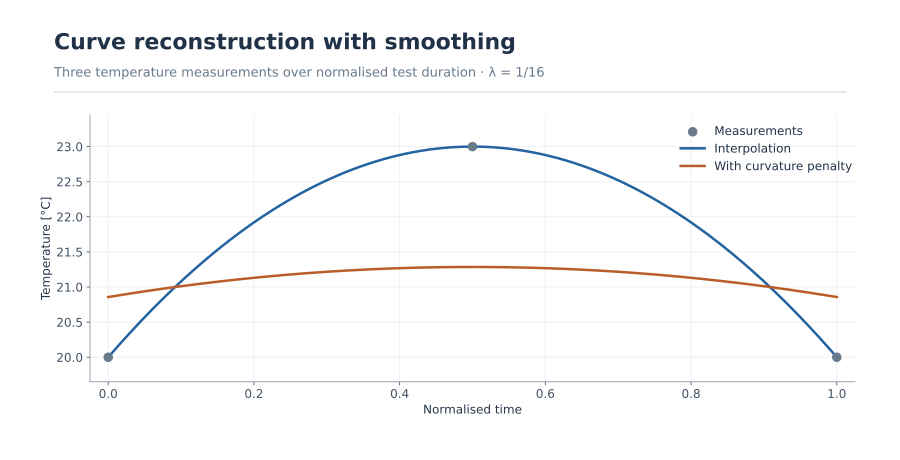

# M20-L6 – Functional Data and Curve Models {#L6}

**Course area:** M20 – Time Series, Spatial and Functional Data

**Level:** Master · Elective/methods

**Prerequisites:** M17, M18.

**Learning objective:** Model curves as observations, smooth them with basis functions and interpret functional principal components.

## The observation is a function {#S1}

Three test rigs each record a temperature trace during a load test. Not every time point corresponds to an independent object. Rather, each complete curve $x_i(t)$ is an observation, and discrete values $y_{ij}=x_i(t_{ij})+\varepsilon_{ij}$ are measurements of the same function. Curves may be recorded on different time grids. Smoothing replaces noise with a structured estimate; interpolation without smoothing would interpret disturbances as signal as well.

A basis expansion uses $x_i(t)\approx\sum_{k=1}^K a_{ik}b_k(t)$, for example B-splines, Fourier functions or polynomials. With design matrix $B_{jk}=b_k(t_j)$ and curvature penalty $R_{kl}=\int b_k''(t)b_l''(t)\,dt$, we solve

$$\widehat a=\arg\min_a\{\|y-Ba\|_2^2+\lambda a^\top Ra\}.$$

If $B^\top B+\lambda R$ is invertible, the solution follows from a linear system. The penalty is semidefinite: linear functions are not penalised by the second derivative.

## A smoothing example on normalised time {#S2}




*Figure: Functional basis and curvature penalty.*

On $[0,1]$, choose $b(t)=(1,t,t^2)$, hence $R=\operatorname{diag}(0,0,4)$. The measurements at $t=0,0.5,1$ are 20, 23 and 20 degrees Celsius. Without a penalty, the model interpolates with $a=(20,12,-12)^\top$. For $\lambda=1/16$, we obtain $a=(146/7,12/7,-12/7)^\top$ (rounded to 20.857; 1.714; −1.714). The diagram shows the attenuated peak: the strongly curved interpolation becomes a flat curve. The large smoothing effect here follows from the presence of only three measurement points and the chosen penalty. It is not a recommendation for choosing $\lambda$ in other problems. Too large a penalty can remove genuine process peaks.

```python
import numpy as np
t=np.array([0.,.5,1.]); y=np.array([20.,23.,20.])
B=np.column_stack([np.ones(3),t,t*t]); R=np.diag([0.,0.,4.])
a0=np.linalg.solve(B,y)
a=np.linalg.solve(B.T@B+R/16,B.T@y)
assert np.allclose(a0,[20,12,-12])
# Erwartungswerte durch direkte Substitution in die Normalgleichung
assert np.allclose((B.T@B+R/16)@a,B.T@y)
assert np.allclose(a,[146/7,12/7,-12/7])
print(a0,a,B@a)
```

## Functional PCA and regression {#S3}

The mean curve is $\mu(t)=n^{-1}\sum_i x_i(t)$; the covariance kernel $G(s,t)$ describes joint changes. Functional PCA seeks orthonormal eigenfunctions $\psi_j$ of the operator $\int G(s,t)\psi_j(t)\,dt=\eta_j\psi_j(s)$ and scores $\xi_{ij}=\int(x_i(t)-\mu(t))\psi_j(t)\,dt$. On a discrete grid, quadrature must be taken into account in the normalisation. With a non-orthogonal basis, the Gram matrix of the basis functions plays a role. This distinguishes curve analysis from unweighted PCA of arbitrarily sampled columns.

In scalar-on-function regression, for example, $E[Y_i\mid x_i]=\alpha+\int\beta(t)x_i(t)\,dt$. Because the inputs are high-dimensional and correlated, $\beta$ also requires structure or regularisation. When predicting from partial curves, smoothing must not use future measurement points. Differences in timing (phase) and magnitude (amplitude) may require separate registration. Validation is performed by complete independent curves or test rigs.

## Exercise with solution {#S4}

What function results when the curvature penalty is increased indefinitely for these data? Solution: The quadratic component tends to zero. Because the measurement points are symmetric, the best linear fit is the constant 21 degrees Celsius. For unequal time intervals, a discrete approximation of the functional inner product should use appropriate quadrature weights.

## Sources and further reading {#S5}

- [Gertheiss et al. (2024): Functional Data Analysis: An Introduction and Recent Developments](https://onlinelibrary.wiley.com/doi/full/10.1002/bimj.202300363) · smoothing, basis functions and FPCA
