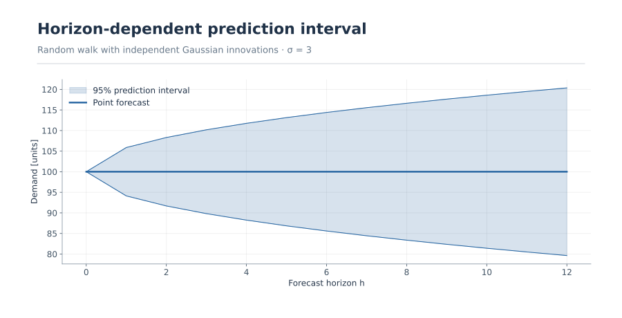

# M20-L7 – Prediction Intervals and Backtesting {#L7}

**Course area:** M20 – Time Series, Spatial and Functional Data

**Level:** Master · Elective/methods

**Prerequisites:** M17, M18, [M20-L1](M20-L1.md).

**Learning objective:** Calculate horizon-dependent uncertainty and evaluate point and interval forecasts on chronologically separated data.

## An interval for future observations {#S1}




*Figure: Random-walk forecast fan.*

A warehouse needs not only an expected value for demand, but also information about how far demand may deviate from it. A prediction interval describes possible future observations; a confidence interval for an estimated mean answers a different question. For a simple random walk $y_t=y_{t-1}+\varepsilon_t$ with independent innovations $N(0,\sigma^2)$ and known $\sigma$, conditional on the past we have

$$Y_{T+h}\mid Y_T=y_T\sim N(y_T,h\sigma^2).$$

For $y_T=100$ and $\sigma=3$, the symmetric 95% intervals are $100\pm1.96\cdot3\sqrt h$ (rounded normal quantile). At $h=1$ this gives [94.12; 105.88], and at $h=4$ [88.24; 111.76]. The diagram shows dispersion growing with the square root of the horizon. Drift, parameter uncertainty or non-normally distributed shocks might require different intervals.

## Looking back under realistic conditions {#S2}

A backtest consists of a specified training window, a forecast origin and the horizon to be examined. At each origin, all processing steps use only admissible historical information. As an illustration, we evaluate four values forecast at the same horizon: observations $(102,95,110,103)$, point forecasts $(100,100,104,105)$, lower bounds $(96,96,99,101)$ and upper bounds $(104,104,109,109)$. The absolute errors are 2, 5, 6 and 2; the MAE is 3.75. Two of the four observations fall within the intervals, giving empirical coverage of 50% and a mean width of 8.5. Four cases are insufficient for a reliable conclusion about calibration.

An interval-based measure penalises both width and non-coverage. For a two-sided interval $[l,u]$ with nominal coverage $1-\alpha$, we use

$$IS_\alpha=(u-l)+\frac{2}{\alpha}(l-y)\mathbf{1}_{y<l}+\frac{2}{\alpha}(y-u)\mathbf{1}_{y>u}.$$

For $\alpha=0.1$, the example yields scores of 8, 28, 30 and 8, with a mean of 18.5.

```python
import numpy as np
y=np.array([102,95,110,103]); pred=np.array([100,100,104,105])
l=np.array([96,96,99,101]); u=np.array([104,104,109,109])
mae=np.mean(abs(y-pred)); cover=np.mean((y>=l)&(y<=u))
score=u-l+20*np.maximum(l-y,0)+20*np.maximum(y-u,0)
assert np.isclose(mae,3.75) and np.isclose(cover,.5)
assert np.isclose(np.mean(u-l),8.5) and np.isclose(score.mean(),18.5)
print(mae,cover,np.mean(u-l),score,score.mean())
```

## Calibration, horizons and model selection {#S3}

Coverage and width must be evaluated together: arbitrarily wide intervals do not solve a planning problem. Summaries by horizon, region or season show whether deviations occur systematically. Pinball loss evaluates individual quantiles, while CRPS evaluates entire predictive distributions. Block bootstrap or simulation from a fitted model can account for dependencies; unexamined i.i.d. resampling of individual time points is problematic under autocorrelation. Conformal methods suitable for time series require explicitly appropriate assumptions or adaptations; ordinary i.i.d. coverage guarantees cannot simply be transferred to drift.

Models are selected using rolling validation windows and finally tested on a time span not used for selection. Forecast errors are dependent when horizons overlap; simple standard errors based on independent cases are then inappropriate. For an inventory planning decision, asymmetric error costs may be more relevant than RMSE alone.

## Exercise with solution {#S4}

How wide is the random walk's 95% interval after nine steps? Solution: The standard deviation is $3\sqrt9=9$, the half-width is 17.64 and the full width is 35.28. An interval with 90% nominal coverage and bounds [92,108] for an observation of 111 receives a score of $16+20\cdot3=76$.

## Sources and further reading {#S5}

- [Hyndman and Athanasopoulos: Forecasting: Principles and Practice, 3rd ed., Chapter 9](https://otexts.com/fpp3/arima.html) · stationarity, differencing, ARIMA and SARIMA
- [Hyndman and Athanasopoulos: Forecasting: Principles and Practice, 3rd ed., Chapter 5](https://otexts.com/fpp3/toolbox.html) · time-series validation and distributional forecasting
