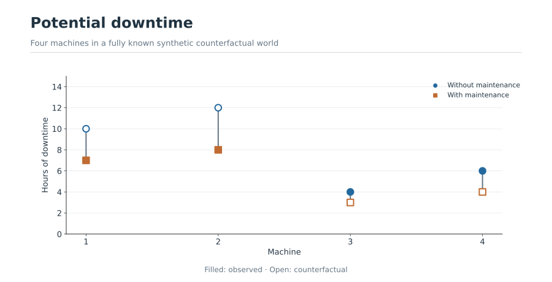

# M21-L1 – Potential Outcomes and Causal Estimands {#L1}

**Course area:** M21 – Causal Inference and Empirical Research

**Level:** Master · Elective/methods

**Prerequisites:** M17, M18.

**Learning objective:** Define causal estimands and distinguish identification from estimation.

## Two possible outcomes {#S1}

A company wants to know whether a new maintenance programme reduces the downtime of its machines. For machine $i$, let $A_i=1$ denote implementation and $A_i=0$ the existing practice. The potential outcomes $Y_i(1)$ and $Y_i(0)$ measure hours of downtime over the same specified period under the two alternatives. Under consistency, $Y_i=A_iY_i(1)+(1-A_i)Y_i(0)$. The individual effect is $\tau_i=Y_i(1)-Y_i(0)$. In a conventional parallel-group design, however, we observe only one of the two outcomes. Even a perfect prediction of observed downtime cannot reconstruct the missing counterfactual without additional assumptions.

The intervention must be precisely defined: which maintenance steps, which period, which machines? Different versions of the programme may have different effects. Furthermore, maintenance on one machine may place a greater load on a replacement machine. Such interference violates the assumption that the outcome depends only on the unit's own assignment. It may be necessary to use the workshop rather than the machine as the experimental unit.

## Estimands and selection bias {#S2}




*Figure: Potential outcomes for failure hours.*

The average treatment effect in the target population (ATE) is $\mathbb{E}[Y(1)-Y(0)]$. The ATT refers to those actually treated: $\mathbb{E}[Y(1)-Y(0)\mid A=1]$. A conditional average treatment effect (CATE) is $\mathbb{E}[Y(1)-Y(0)\mid X=x]$. A negative effect is desirable in our example. With heterogeneous effects, the figures depend on the target population.

| Machine | $Y(0)$ | $Y(1)$ | $A$ | Observed |
|---|---:|---:|---:|---:|
| 1 | 10 | 7 | 1 | 7 |
| 2 | 12 | 8 | 1 | 8 |
| 3 | 4 | 3 | 0 | 4 |
| 4 | 6 | 4 | 0 | 6 |

The table represents a fully known synthetic counterfactual world, not an observable real-world dataset. ATE = $(-3-4-1-2)/4=-2.5$ hours; ATT = $-3.5$ hours. In contrast, the observed difference is $7.5-5=2.5$ hours. Deliberately prioritising maintenance for problematic machines reverses the sign. In general,

$$\mathbb E[Y\mid A=1]-\mathbb E[Y\mid A=0]=ATT+\mathbb E[Y(0)\mid A=1]-\mathbb E[Y(0)\mid A=0].$$

The last term is the selection difference in the untreated state (6 hours here). The diagram shows both potential outcomes for each machine.

```python
import numpy as np
y0=np.array([10,12,4,6]); y1=np.array([7,8,3,4]); a=np.array([1,1,0,0], dtype=bool)
y=np.where(a,y1,y0)
ate=(y1-y0).mean(); att=(y1-y0)[a].mean(); naive=y[a].mean()-y[~a].mean()
assert (ate,att,naive)==(-2.5,-3.5,2.5)
print(ate,att,naive)
```

## Identification and study protocol {#S3}

Under randomisation, assignment is independent of the potential outcomes (in the assignment distribution, not necessarily exactly in every sample). Given consistency and positive assignment probability, the difference in group means identifies the population ATE if the usual sampling assumption holds. With observational data, conditional exchangeability $Y(a)\perp A\mid X$ can play the same role, provided both treatments are possible for relevant values of $X$. This assumption cannot be verified from observed data alone. Identification asks whether the estimand follows from the observable distribution; estimation asks how to obtain an estimate from finite data; inference concerns its uncertainty.

Before analysis, specify the target population, time of assignment, intervention, comparator, endpoint, observation period, handling of losses and planned analysis. In the presence of non-compliance, the effect of assignment (intention-to-treat) may be a different estimand from the effect of treatment actually received.

## Exercise with solution {#S4}

Change the programme outcome of the fourth machine from 4 to 9 hours in the table. What happens? Solution: its effect increases from $-2$ to $+3$; the ATE increases by $5/4$ to $-1.25$. The ATT and observed difference remain unchanged because this machine is untreated. This illustrates why observed data do not determine the ATE without further assumptions.

## Sources and further reading {#S5}

- [Cunningham: Causal Inference: The Remix, Chapter 3](https://mixtape.scunning.com/03-potential_outcomes_and_randomization) · potential outcomes, randomisation and estimands
