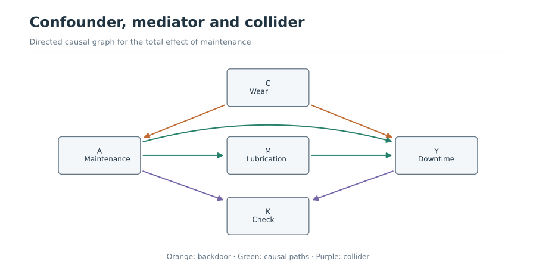

# M21-L2 – Causal Graphs and the Backdoor Criterion {#L2}

**Course area:** M21 – Causal Inference and Empirical Research

**Level:** Master · Elective/methods

**Prerequisites:** M17, M18.

**Learning objective:** Read DAGs, recognise confounding paths and derive suitable adjustment sets.

## A graph is an assumption {#S1}

A directed acyclic graph (DAG) contains nodes for variables and arrows for assumed direct causal relationships relative to the chosen model. A machine with feedback over time can be modelled using separate state nodes for each time index without creating a cycle within a DAG. An absent arrow is also a substantive assumption. Data alone generally do not determine the direction of every edge.

Three elementary patterns are the chain $A\to M\to Y$, the fork $A\leftarrow C\to Y$ and the collider $A\to K\leftarrow Y$. A chain or fork is blocked by conditioning on the middle node; a collider blocks the path without conditioning but opens it when conditioned on itself or a descendant. A path is blocked by a set if it contains at least one conditioned non-collider or at least one collider for which neither the collider nor any descendant is conditioned on. Two nodes are d-separated if all paths are blocked. Under the causal Markov assumption, conditional independences follow.

## Adjustment or intervention? {#S2}




*Figure: Maintenance causal graph and backdoor path.*

The diagram depicts a fleet of machines: wear $C$ influences the choice of maintenance $A$ and downtime $Y$. Maintenance may also act through lubrication $M$ on $Y$. A check measurement $K$ is triggered by both $A$ and $Y$. The backdoor set $\{C\}$ contains no descendant of $A$ and blocks all paths from $A$ to $Y$ that begin with an arrow pointing into $A$. It thus preserves both the direct effect and the effect mediated by $M$. In this graph, $M$ and $K$ are not suitable additional controls for the total effect.

Under the assumed graph and identification conditions, for discrete $C$,

$$\mathbb E[Y\mid do(A=a)]=\sum_c \mathbb E[Y\mid A=a,C=c]P(C=c).$$

The intervention replaces the assignment mechanism of $A$; it is not the same as selecting observed treated units. The group-specific means are combined using the same target distribution of $C$.

| Wear | Population proportion | Mean without maintenance | Mean with maintenance |
|---|---:|---:|---:|
| low | 0.6 | 4 | 3 |
| high | 0.4 | 12 | 8 |

The standardised effect is $0.6(-1)+0.4(-4)=-2.2$ hours. Suppose 80% of treated machines and only 20% of untreated machines have high wear; the crude difference is $7-5.6=1.4$ hours. With a treatment proportion of one third, these proportions correspond to the stated population.

```python
import numpy as np
p=np.array([.6,.4]); y0=np.array([4,12]); y1=np.array([3,8])
adjusted=p@(y1-y0); raw=np.array([.2,.8])@y1-np.array([.8,.2])@y0
assert np.allclose([adjusted, raw],[-2.2,1.4])
print(adjusted,raw)
```

## Misspecification and hidden variables {#S3}

An unmeasured factor $U$, such as latent load, could influence both quantities. Backdoor identification must then be reconsidered. Even an extensive feature list does not guarantee valid adjustment: post-treatment variables may be mediators or selection nodes. Domain knowledge, timestamps, alternative plausible graphs and documented measurement processes are essential. Causal discovery can constrain graph structures under additional assumptions, such as the Markov property, faithfulness and, depending on the algorithm, causal sufficiency; causally equivalent graphs can exhibit the same independences.

## Exercise with solution {#S4}

A dataset contains only machines with a check measurement $K$. Can the resulting bias automatically be eliminated by adjusting for wear? Solution: no. Selection conditions on the collider $A\to K\leftarrow Y$. The non-causal path opened in this way is not blocked by $C$. An additional assumption or a model of the selection process is required.

## Sources and further reading {#S5}

- [Cunningham: Causal Inference: The Remix, Chapter 4](https://mixtape.scunning.com/04-directed_acyclical_graphs) · DAGs and adjustment
